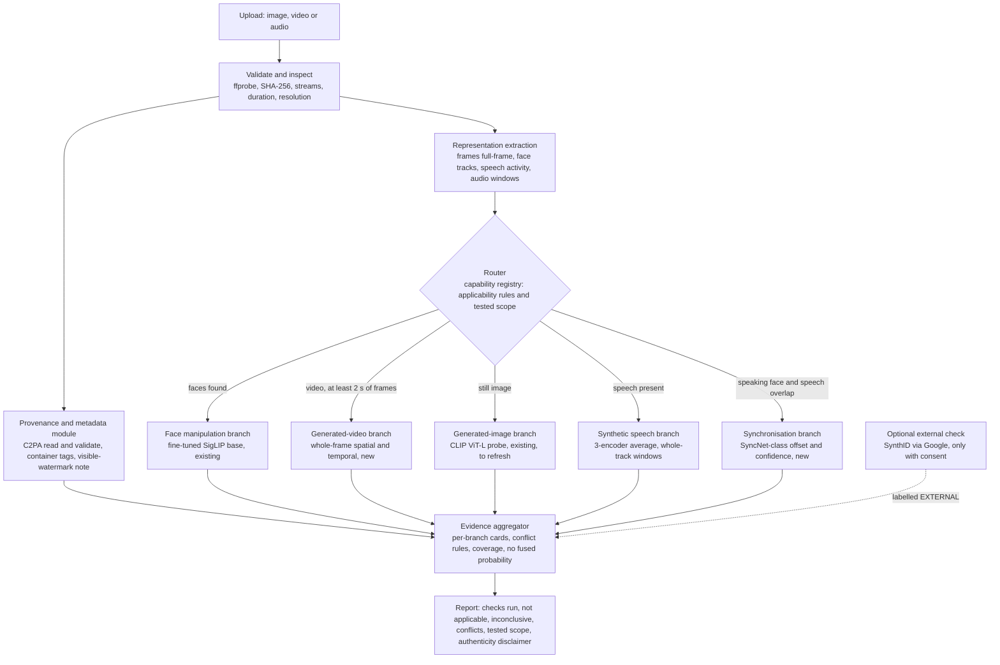

# FEASIBILITY AND TARGET ARCHITECTURE

Written 2026-10-26 (investigation of 2026-10-25 night to 2026-10-26). Status: PROPOSAL for the user's review. Nothing in this file is a result of this project unless it cites an existing experiment ID (E-xxx, M-xxx) that is already logged in docs/EXPERIMENTS.md. Every figure that is not measured here is labelled **documented** (stated by a paper, model card or official page, with the source named), **measured** (from this repository's logs or from a read-only command run on 2026-10-26) or **estimate** (my own reasoning, with its assumptions). Proposed experiment and decision IDs (E-018 onward, D-069 onward, M-006 onward) are placeholders: they are not registered in EXPERIMENTS.md or DECISIONS.md and must not be cited until they are.

Scope of the investigation: repository audit, read-only hardware and environment measurements, and a literature and documentation search. No package was installed, no dataset or weight was downloaded, no model was run, no training was started, no existing file was changed, nothing was committed.

---

## 1. Executive summary

**Short answer.** The expanded system is feasible on the current PC as a set of separate specialised branches coordinated by a rule-based router, provided that every new branch is built on frozen pretrained features or on a modest fine-tune, and that the claims stay inside what a generator-disjoint test can show. No part of the vision requires hardware that the machine lacks, with one exception: full fine-tuning of the largest vision encoders (CLIP ViT-L at batch 32 was measured to overflow the 12 GB card, M-003) and of video-language models. Those are replaceable by frozen features, parameter-efficient fine-tuning or smaller encoders of the same family.

| Capability | Exists now | Feasible on this PC | Main limit | Honest status |
|---|---|---|---|---|
| A. Face manipulation detection | Yes (fine-tuned SigLIP base, I-1, E-005, sealed E-014) | Yes | Scope: four 2019-era FF++ methods, tested on the Celeb-DF family and DFD | Implemented and measured for face swap and reenactment families; untested on modern talking-head generators |
| B. Fully AI-generated video | No | Yes (frozen DINOv2 or SigLIP features with a small head, or training-free likelihood scoring) | Data: modern generator videos with licence-clean real controls are small and restricted; shortcut risk | Technically feasible, not yet tested. Detection of unseen generators is an open research question, not a deliverable that can be promised |
| C. Synthetic speech | Yes (three-encoder average, I-4, E-009, sealed In-the-Wild 0.9148 [0.8896, 0.9383]) | Yes; a larger encoder (XLS-R 300M) fine-tune is feasible in an estimated 8 to 11 GB | Only the first 4 s are scored; training data are 2019 TTS and VC systems; no test of audio produced by video generators | Implemented and measured on ASVspoof 2019 LA and In-the-Wild; untested on modern TTS and on generated-video audio |
| D. Audio-video synchronisation | No (I-6 fused unimodal scores; the visual side was a pipeline cue, E-011, E-012) | Yes (pretrained SyncNet-class models are small) | Labelled data: LAV-DF is on disk; FakeAVCeleb is not; no dubbed-video control set exists | Technically feasible, not yet tested; detects only a subset of manipulation types (section 7.4) |
| E. Provenance and watermark | No | C2PA reading: local, yes. SynthID: no local detector exists for images, video or audio | SynthID verification is an external Google service (Gemini app; a Cloud API for partners) | Engineering feature, not a model of ours; absence of a mark never means authentic |

**Direct answers.**
- Fully AI-generated video detection: realistic to *pursue* as a research branch with a pre-registered, generator-disjoint protocol. It is not realistic to *promise* reliable detection of Veo, Kling, Runway or Sora outputs. The newest independent benchmark found (DF26, arXiv 2609.07369, September 2026) reports that the detectors it tested and human viewers were close to chance on its talking-head videos (documented, authors' claim; not measured here).
- Synthetic speech: the existing branch is a working, measured base. Its known limits (4 s window, 2019-era training attacks, 16 kHz, exploratory calibration) are fixable on this PC; transfer to audio made by video generators is untested and needs a new test set.
- Lip-sync analysis: feasible with pretrained synchronisation networks (SyncNet, LatentSync's SyncNet) at small cost. It addresses dubbing-style and audio-replacement manipulations only; it says nothing about jointly generated audio and video that are mutually consistent.
- Provenance: C2PA manifests can be read and validated locally with an Apache-2.0 / MIT library (not installed). SynthID can only be checked through Google's services, which is an external check, never our prediction, and requires the user's consent per file because uploading publishes the content to a third party.

**Recommended architecture.** A capability-registry router with independent branches (face, whole-frame and temporal video, generated image, speech, synchronisation, provenance and metadata), each returning a scoped evidence card; no overall fake probability until a fusion rule is trained and evaluated on its own data. First component to investigate: the generated-video branch's data audit and metadata-only baseline (section 11, phase 1), because without it no content-based result on generated video can be interpreted.

---

## 2. Current implementation audit

Sources: src/dfd (code read 2026-10-26), checkpoints/I-5-freeze-candidate/metadata.json, data/_results/E-014/sealed_block.md, docs/DOC_FACTS.md, docs/PLAN.md, docs/ITERATIONS.md, docs/STATUS.md.

### 2.1 What the code does

| Path | Implementation (code) | Evidence |
|---|---|---|
| Input validation | `dfd.infer.library.inspect`: extension whitelist (image, video, audio), ffprobe streams, SHA-256, duration, resolution, audio presence | Unit tests (305 pass, STATUS) |
| Video, visual | `RealAdapter.analyse`: 16 uniformly spaced frames, YuNet face detector, largest face enlarged 1.3, 224 px, JPEG 95 round trip, fine-tuned SigLIP base (IMG-17) head per frame, mean of frame probabilities, temperature 0.832, threshold 0.614 | E-005 (I-1), sealed E-014 |
| Video without a face | Visual score unavailable, warning `NO_FACE_DETECTED`; nothing else analyses the frames | Code (real_adapter.py lines 264 to 266) |
| Image | Face found: face crop through the video head. No face: whole image through frozen CLIP ViT-L/14 (IMG-13) with a linear head trained on ProGAN only | E-002, E-004, sealed E-014 |
| Audio (file or video track) | Mono 16 kHz, trim leading and trailing silence, peak-normalise, **first 64,600 samples (about 4 s) only**, repeat-padded; mean of the logits of HuBERT base, WavLM base plus and Whisper small encoder heads; warning `AUDIO_CALIBRATION_EXPLORATORY` | E-007, E-008, E-009, sealed E-014 |
| Video with audio | Visual and audio scores returned separately; **fused decision is always "undetermined"** (`AUDIO_VISUAL_FUSION = None`; library.py line 156) | D-040 item 6, D-068 |
| Synchronisation, temporal modelling, provenance, metadata analysis | **Not implemented** | none |
| Web page | Flask on 127.0.0.1, 512 MB limit; currently running on port 8001 with the freeze checkpoint (process 33448, started 2026-10-25 22:56) | web_freeze_check.py page check (not an accuracy test) |

### 2.2 What is measured (sealed, E-014; AUC with 95 percent group-bootstrap interval)

| Branch | Test set | Final system | Notes |
|---|---|---|---|
| Face video | Celeb-DF family test_x (7,650 videos, 344 groups) | 0.8218 [0.8020, 0.8393] | +0.1980 over I-0; +0.0176 [+0.0025, +0.0327] over the re-run Xception baseline, not robust at 98.33 percent |
| Face video | DFD test_x | 0.8797 [0.8566, 0.9041] | 28 groups |
| Face video | Celeb-DF++ new generators with Celeb-DF v2 reals | 0.7105 [0.6877, 0.7331] | Includes talking-face generators of Celeb-DF++ (R-053); lower than the v2 subset (0.8999) |
| Speech | In-the-Wild test_x (42 speakers) | 0.9148 [0.8896, 0.9383] | +0.1633 over I-0 |
| Speech | ASVspoof 2019 LA eval (test_in) | 0.9835 [0.9798, 0.9872] | in-dataset |
| Generated image | Diffusion test set of R-011 (10 groups) | 0.9354 [0.8967, 0.9665] | 2022-era diffusion models; unchanged since I-0 |
| Generated image | ForenSynths CNN subset (16 groups) | 0.9316 [0.8933, 0.9694] | GAN family |
| Audio-visual | LAV-DF test (I-6 heads) | visual 0.9921, fused 0.9945 | **Not a manipulation detector**: within produced videos the visual head is 0.5032 [0.4746, 0.5320] (I-6p), i.e. it separates the dataset's original videos from re-encoded produced ones (pipeline cue, E-011 control, E-012, D-059) |

All dev_x verdicts are exploratory (D-041); the three confirmatory comparisons are the only confirmed claims (D-068).

### 2.3 What is not supported by any record

- Any statement about fully generated video (T2V or I2V): no such data is on the machine and no run exists.
- Any statement about speech from modern commercial TTS or from video generators (Veo 3 class): not tested.
- Any audio-visual manipulation detection by content: E-011 and E-012 show the opposite (D-059).
- Any statement about modern image generators (2024 to 2026 diffusion and autoregressive models): the generated-image tests stop at the R-011 diffusion set.
- Any provenance or watermark statement.

### 2.4 Classification

| Functionality | Implemented | Measured | Untested | Proposed |
|---|---|---|---|---|
| Face-crop video detector | yes | yes (sealed) | modern talking-head generators | generalisation work (section 7.2) |
| Whole-image generated-image detector | yes | yes (sealed, GAN and 2022 diffusion) | modern image generators | refresh (section 7.3) |
| Speech detector, first 4 s | yes | yes (sealed) | long audio, modern TTS, video-generator audio | whole-track scoring, larger encoder (section 7.5) |
| Visual plus audio side by side | yes | unimodal only | any fused verdict | sync branch (section 7.6) |
| Whole-frame and temporal generated-video detector | no | no | n/a | yes (section 7.4) |
| Provenance and metadata | no (ffprobe is used only for validation) | no | n/a | yes (section 7.7) |
| Router and evidence report | partial (media-type switch only) | no | n/a | yes (section 7.1) |

---

## 3. Requirements for the desired system

### 3.1 Inputs

Image (PNG, JPEG, WebP, BMP), video with or without audio (MP4, MOV, MKV, WebM, AVI), standalone audio (WAV, FLAC, MP3, M4A, OGG). The existing whitelist already covers these.

### 3.2 Detection tasks and the evidence each can give

| Task | Question it answers | Question it cannot answer |
|---|---|---|
| Face manipulation | Does a visible face show traces of the face-swap or reenactment families the detector was trained and tested on? | Whether the whole video was generated; whether an unseen generator was used |
| Generated video (whole frame, temporal) | Do frame content and frame-to-frame dynamics resemble those of generated videos more than real videos, under the tested generators? | Which generator; anything about generators outside the tested set |
| Generated image | Does a still image resemble the tested generator families? | Same limits |
| Synthetic speech | Does the speech resemble the tested TTS and VC systems more than bona fide speech? | Music, effects, non-speech audio; untested generators |
| Audio-video synchronisation | Do lip movements and speech agree in timing and content for a visible speaker? | Whether either stream is generated when both were generated together and agree; dubbing intent |
| Provenance and watermark | Does the file carry a valid C2PA manifest or a detectable watermark (via the issuer's own tool)? | Authenticity when nothing is found |

### 3.3 Router requirements

R1 Route by measurable input properties (streams, duration, faces, speech activity, resolution) and by each branch's declared applicability, never by the user picking a model. R2 A missing face routes away from face analysis, never to a "fake" verdict. R3 Unsupported inputs produce "not applicable" with the reason. R4 Each branch reports its tested scope and its own calibration state. R5 No overall probability without an evaluated fusion rule. R6 External checks are labelled as external and require consent before upload.

### 3.4 Report requirements

One evidence card per branch: status (`evidence of manipulation`, `no evidence found within tested scope`, `inconclusive`, `not applicable`, `failed`), score and calibration note, tested scope (datasets, generators, date), known failure modes, and units analysed (frames, windows, faces). A conflicts section. A fixed sentence: "No result of this system establishes that a file is genuine."

---

## 4. Candidate-model comparison

Status column vocabulary: **on disk** (hash-verified in data/_logs/encoder_weights.json), **public** (weights downloadable, not downloaded), **code only** (no trained weights released), **not verified**.

### 4.1 Whole-frame and temporal generated-video detection

| Candidate | Source (documented) | Method | Training needed | Weights and licence | Fit to this PC | Reported failure modes | Transfer to unseen generators |
|---|---|---|---|---|---|---|---|
| ReStraV | Internò, Geirhos, Olhofer, Liu, Hammer, Klindt, "AI-Generated Video Detection via Perceptual Straightening", arXiv 2507.00583 (v1 2025-07-01, v4 2026-02-03), NeurIPS 2025 | DINOv2 ViT-S/14 per frame (24 frames over 2 s, 224 px); curvature and step distance of the embedding trajectory; 21-D feature; small MLP (64, 32) | Yes, tiny (MLP on 21 features) | Code Apache-2.0 (github.com/ChristianInterno/ReStraV); **no trained classifier released** (README: train first); backbone DINOv2-S Apache-2.0 **on disk** (IMG-07) | Excellent: DINOv2-S inference 0.38 GB at batch 64 (measured, cost record); paper reports about 48 ms per video on an RTX 2080 (documented) | Time-reversal invariant; may be evaded by a generator trained against curvature; future generators may straighten (authors). Training reals (DVSC2023) and fakes (VidProM) come from different sources (documented), a source-confound risk | Authors report Sora held out from training: accuracy 80.05 percent, mAP 92.85 (VidProM protocol); Veo 3 zero-shot 200 vs 200: AUROC 86.9 (documented, authors' protocol) |
| STALL | Ben Hayun, Betser, Levi, Kassel, Gilboa, "Training-free Detection of Generated Videos via Spatial-Temporal Likelihoods", arXiv 2603.15026 (v2 2026-03-18), CVPR 2026 | Whitened Gaussian log-likelihood of frame embeddings (spatial) and of normalised frame differences (temporal), percentile fusion; 16 frames at 8 fps | **No generated data needed**; calibration on real videos only (paper default 33k VATEX; performance drops below about 5k) | Code github.com/OmerBenHayun/STALL (licence file not read, **not verified**); encoder **DINOv3 ViT-L/16** (gated, "dinov3-license", excluded by D-038); whitening statistics released for VATEX with DINOv3 | Inference fits easily (ViT-L class: CLIP ViT-L measured 2.85 GB at batch 64, 4.0 s per 1,000 frames). Calibration: about 16 frames x 5k to 33k real videos | Static videos reduce to spatial only; the paper tests other encoders and finds video-level encoders weaker (documented) | Average AUC 0.82 over VideoFeedback, GenVideo and ComGenVid (Sora, Veo 3) (documented). The score measures distance from the calibration reals, so any real source unlike the calibration set is a false-positive risk (estimate) |
| D3 | Zheng et al., "D3: Training-Free AI-Generated Video Detection Using Second-Order Features", ICCV 2025, arXiv 2508.00701 | Second-order temporal differences of encoder features (XCLIP-16 in the example command) | No | Code MIT (github.com/Zig-HS/D3); encoder XCLIP (licence not verified) | Feasible (inference only) | Static videos and concatenated clips; poor on Text2Video-Zero (about 45 AP) (documented) | Authors report +10.39 mAP over prior best on GenVideo (documented) |
| UNITE | Kundu, Xiong, Mohanty, Balachandran, Roy-Chowdhury, "Towards a Universal Synthetic Video Detector", CVPR 2025, arXiv 2412.12278 | Frozen SigLIP-So400M (384 px) features, transformer over 64 frames, attention-diversity loss so that attention is not concentrated on faces | Yes (head) | **Code and weights: no release found** (search 2026-10-26) | Re-implementation feasible as frozen features plus a small transformer; So400M fp16 inference about 0.8 GB weights (estimate). Full fine-tune not feasible (estimate: about 2.8 times the tokens of CLIP ViT-L at 224, which already used 9.13 GB at batch 16) | Not read | Authors report cross-dataset gains on T2V and I2V (documented, numbers not checked) |
| Frame-level frozen encoder with temporal pooling (our own baseline) | Our T-V harness (E-001) | SigLIP base or DINOv2 frame features on whole frames, mean or attention pooling, linear head | Yes, small | **On disk** (IMG-07, IMG-08, IMG-17, IMG-13) | Measured costs exist (cost record) | Spatial only unless a temporal feature is added | Unknown; the necessary control baseline |
| Video transformers (VideoMAE, ViViT class) | not read in this investigation | Spatio-temporal tokens | Fine-tune | not verified | Inference feasible; fine-tune only with small batch and gradient checkpointing (estimate) | STALL reports video-level encoders weaker in its zero-shot setting (documented) | Not recommended first |
| Video-language models (7B class) | RA-Bench, arXiv 2608.14391 (2026-08) | Prompted judgement | No or LoRA | various | 4-bit inference fits (estimate 5 to 8 GB); fine-tuning marginal | RA-Bench abstract: zero-shot multimodal models do not generalise consistently (documented) | Not recommended as a detector branch |

**Recommendation for B.** Start with the three cheapest, face-independent candidates that run on weights already on disk: (1) ReStraV features on DINOv2-S, (2) a STALL-style likelihood scorer on DINOv2 (S or B) calibrated on licence-clean real videos, (3) whole-frame SigLIP or DINOv2 features with pooling and a linear head. Treat DINOv3 (STALL's encoder) as an optional fourth candidate only if the user accepts its gated licence (a new decision, since D-038 excluded it). Do not re-implement UNITE before the cheap candidates are measured.

### 4.2 Synthetic speech

| Candidate | Source | Training | Weights and licence | Fit | Notes |
|---|---|---|---|---|---|
| Current I-4 average (HuBERT base, WavLM base plus, Whisper small encoder, linear heads) | E-009 | done | on disk; WavLM and Whisper conditional, research-only (D-038) | Inference 2.3 to 2.4 GB at batch 32 per encoder (measured) | Base of the branch |
| SSL front end plus AASIST back end (SSL-AASIST) | Tak et al. 2022, R-029 (READ); code github.com/TakHemlata/SSL_Anti-spoofing, MIT | Released LA and DF checkpoints (Google Drive) | XLS-R 300M Apache-2.0 (model card); checkpoint licence **not verified** | Fine-tune estimate 8 to 11 GB at batch 8 to 16 of 4 s clips in bf16 (analogy: CLIP ViT-L, 304 M parameters, 257 tokens, measured 9.13 GB at batch 16; 4 s of XLS-R is about 200 frames) | Repository pins fairseq and Python 3.7; **not compatible as is with the Python 3.13 environment** (fairseq's last PyPI release is 0.12.2 from 2022; compatibility not tested). Porting the weights to `transformers` Wav2Vec2 is engineering work |
| XLS-R plus SLS | Hugging Face reproduction card (MIT) | released | licence on card MIT | similar to above | Card reports In-the-Wild EER 7.46 percent (paper) and 7.84 percent (its v1 checkpoint) (documented, secondary) |
| AASIST (small, raw waveform) | R-012 | train | code MIT (not re-verified) | trivial | Weak cross-corpus in the sections read (R-012 note) |

**Not models but likely the largest gains, all inference-side:** score the whole track in overlapping windows with speech-activity gating instead of the first 4 s; report the fraction and the time positions of high-scoring windows; keep the calibration warning.

### 4.3 Audio-video synchronisation

| Candidate | Source | What it outputs | Training | Weights and licence | Fit | Limits |
|---|---|---|---|---|---|---|
| SyncNet | Chung and Zisserman 2016 (NR in RESEARCH.md); code github.com/joonson/syncnet_python, MIT | AV offset (frames), minimum distance, confidence per face track | none for inference | weights via script; licence of the weights **not stated** | Small CNN; face tracking dominates cost | Needs a frontal speaking face; offset model, not a fake detector |
| LatentSync StableSyncNet | ByteDance, github.com/bytedance/LatentSync, Apache-2.0; checkpoint `stable_syncnet.pt` on Hugging Face | sync score | none for inference | repository Apache-2.0; checkpoint licence not separately stated | Small (estimate under 1 GB VRAM) | Built as a training loss for lip-sync generation; authors report 94 percent sync accuracy on VoxCeleb2 and HDTF (documented). A generator trained against such a loss may pass it by design |
| SpeechForensics | Liang et al., NeurIPS 2024 (arXiv 2508.09913); code github.com/Eleven4AI/SpeechForensics (licence not stated) | similarity of audio and visual speech representations | none on fakes (uses AV-HuBERT pretrained on real speech) | AV-HuBERT Large: Meta AV-HuBERT licence, **non-commercial research only** | Inference estimate 2 to 4 GB; needs fairseq (same Python 3.13 conflict) and a landmark-based mouth crop | Repository reports AUC FF++ 97.6, FakeAVCeleb 99.0, KoDF 91.7 (documented). Face forgery focus |
| Self-supervised AV anomaly detection | Feng, Chen, Owens, CVPR 2023, R-026 (PARTIAL) | anomaly score from a model of real AV synchrony | trained on real videos only | not verified | not verified | Read parts: FakeAVCeleb and KoDF results |
| AVFF | R-023 | supervised AV detector | yes | not verified | not verified | Authors: needs a coherent pair; unsupported for asynchronous audio, several speakers or occlusion |

**Recommendation for D.** Use a pretrained SyncNet-class model as a fixed feature extractor (offset, confidence, per-window distance profile), calibrate a decision rule on real talking-head videos only, and evaluate on LAV-DF (on disk) and FakeAVCeleb (if approved). SpeechForensics is the strongest documented candidate but brings a non-commercial licence and a separate fairseq environment; consider it second.

### 4.4 Provenance and watermark

| Mechanism | Local? | What it shows | Status here |
|---|---|---|---|
| C2PA Content Credentials | Yes: `c2pa-python` (Apache-2.0 and MIT, Python 3.10 or later, prebuilt native library) or `c2patool` | Signed manifest, signer, edit history, validation status | Not installed; supported container formats to be checked against the c2pa-rs list (not verified for MP4 or MOV audio) |
| SynthID (Google) | **No local detector** for images, video or audio found | Presence of Google's watermark in Google-generated content | Gemini app check: images, video and audio (Google blog 2026-05-19, documented); size and duration limits 100 MB and 90 s appear only in secondary reports (not verified). Google Cloud "AI Content Detection API" launched with trusted partners (same blog) |
| Visible watermarks (Veo, Sora logos) | Yes (template matching) | A removable overlay | Weak evidence; mainly a **shortcut risk** in experiments (section 8.3) |
| Container metadata | Yes (ffprobe present, ffmpeg 9.0.1) | Encoder tags, creation times, codec, GOP, bitrate | Descriptive only; easily altered or stripped by platforms |

---

## 5. Dataset and licensing plan

### 5.1 Already on the machine (measured sizes, 2026-10-26)

| Dataset | Size on disk | Modalities | Role today | Use for the expansion |
|---|---|---|---|---|
| FF++ c23 | 8.42 GB | video, **no audio** (M-001) | face training | face branch only |
| Celeb-DF v2 | 9.46 GB | video, no audio | dev_x and sealed test | sealed; do not reuse for new tuning |
| Celeb-DF++ (test list) | 4.91 GB (+ 54.01 GB zip in data/_incoming) | video | sealed test | sealed |
| DFD | 22.51 GB | video | sealed test | sealed |
| LAV-DF | 23.75 GB (+ 23.85 GB tar, D-039 says delete after freeze) | video 224 x 224, 25 fps, AAC 16 kHz (ffprobe, 2 files) | I-5, I-6 | **sync branch** (audio-only fakes replace words, so lips and speech disagree locally); real talking-head controls (but low resolution) |
| ASVspoof 2019 LA | 7.13 GB | speech | speech training | speech |
| In-the-Wild | 8.12 GB | speech | dev_x and sealed test | sealed for the old branch; a new speech test needs new data |
| ForenSynths subsets, diffusion test | 9.71 GB | images | image branch | image |
| Encoder weights (D:\cache) | 7.68 GB | n/a | all branches | DINOv2-S and -B, SigLIP base, CLIP ViT-L x2, EfficientNet-B4, Xception, four speech encoders |

Caches and archives: data/_cache 36.91 GB, data/_crops 6.28 GB, data/_incoming 77.85 GB (two archives; deleting them needs the user's approval).

### 5.2 Candidate new datasets (none downloaded)

| Dataset | Purpose | Real / synthetic | Generators | Audio | Licence and access (as read 2026-10-26) | Size | Allowed use for us |
|---|---|---|---|---|---|---|---|
| **DF26** (Shykula, Yermakov, Samarskyi, Mishkin, Cech, Mishchuk, arXiv 2609.07369, 2026-09-07) | Modern talking-head generated video; final held-out test | 271 real, 2,420 fake; 1280 x 720 H.264 (HF card) | Open: HunyuanVideo 1.5, LTX 2.3 distilled, Wan 2.2 (I2V and T2V). Closed (API, I2V): Grok Imagine, Kling 3.0, Veo 3.1, Wan 2.6 | **not stated** (card lists video only) | Gated, automatic approval; "df26-evaluation-only-license": detector training **only on the open-source-generator subset and only under its leave-one-generator-out protocol**; the closed subset is "strictly evaluation-only" and may not be used for calibration, threshold tuning, augmentation or model selection; no redistribution; non-commercial research. Source-specific terms for OpenVid (CC BY 4.0), MAVOS-DD (CC BY-NC-SA 4.0), TalkingCelebs | 3.57 GB | Open subset: development under LOGO. Closed subset (Veo 3.1, Kling 3.0): **sealed final test**, which matches CLAUDE.md rule 3 exactly. No frames in our documents without the maintainers' permission |
| **DeepAction v1** (Bohacek and Farid, arXiv 2412.00526) | Human-action generated video, no talking heads | 2,600 fake from six models plus a Pexels real folder (paper: 100 real videos) | AnimateDiff, CogVideoX-5B, RunwayML (Gen-3 in the paper), Stable Diffusion video, Veo (pre-release), VideoPoet | not stated | Generated folders CC BY 4.0, real folder Pexels licence (HF card); ungated | 6.06 GB; normalised to 512 x 512 (card) | Training and development; note that resolution normalisation differs from DF26, and real controls are only 100 |
| **ComGenVid** (STALL authors) | Sora and Veo 3 versus real | about 3.4k to 3.5k fake, about 1.7k real (MSVD) | Sora, Veo 3 | not stated | Licence **not stated** on the card; not verified | not stated (5.1k rows) | Only after the licence is established; MSVD reals are low resolution (160 to 1,920 px wide), a confound |
| GenVideo / GenVideo-100K (DeMamba, arXiv 2405.19707) | Large training pool | about 1.21 M real (Kinetics-400, Youku-mPLUG), about 0.53 M fake in the full training set; 100K variant 10k per category | ZeroScope, I2VGen-XL, SVD, VideoCrafter, Pika, DynamiCrafter, and others in test | not stated | Dataset licence **not verified**; Kinetics must be fetched separately from YouTube lists | full size **not verified** (estimate above 100 GB for the 100K variant) | Optional, later; disk is the constraint |
| FakeAVCeleb (R-014) | AV manipulation categories (real or fake audio x real or fake video), Wav2Lip lip-sync | 500 real, 19,500 fake | face swap, Wav2Lip, cloned voice | yes | request form; derived data may not be published (D-020) | not stated | Sync and speech tests; **not on the machine** (blocker 3) |
| ASVspoof 5 | Newer TTS and VC attacks for speech training | crowdsourced | many | speech | ODC-By (Zenodo, docs/_agents/B.md) | train + dev 57.6 GB, eval 84.8 GB | Speech fine-tuning |
| MLAAD (v9: 140 TTS models, 51 languages) | Multilingual modern TTS | fake only; reals from M-AILABS | 140 TTS | speech | licence **not verified** | not verified (about 680 h) | Speech training or test after licence check |
| Deepfake-Eval-2024 (R-049, Chandra et al.) | In-the-wild 2024 deepfakes, video, audio, image | mixed | unknown, in the wild | yes | licence **not verified** (github.com/nuriachandra/Deepfake-Eval-2024) | 44 h video, 56.5 h audio, 1,975 images (documented) | Realistic external test after licence check |
| Real-only talking-head and general video (calibration, controls) | STALL calibration; false-positive control | real | n/a | some | VATEX and Kinetics are YouTube lists (availability decays); OpenVid (CC BY 4.0) is named in DF26's terms; Pexels | varies | A licence-clean, multi-source real pool of at least 5k videos is the **single most important missing resource** |

### 5.3 Missing categories (no suitable data found or held)

- **Genuine dubbed or translated videos** with labels: none found. Needed so that the sync branch is not tested only on manipulations. Would have to be collected (licence-clean sources such as public-domain or CC-licensed lectures with official dubs) and documented as a small control set.
- **Audio produced by video generators (Veo 3 class) with labels**: DF26 and ComGenVid do not state whether audio is included. Not verified; may need to be generated by the user under the generator's terms or obtained from a source that permits research use.
- **Generated video with matched real counterparts at the same resolution, codec and duration**: no dataset guarantees this; the re-encoding control (section 8.4) is the mitigation.

---

## 6. Hardware and computation feasibility

### 6.1 Measured machine (read-only commands, 2026-10-26 00:00)

| Item | Value | Command |
|---|---|---|
| GPU | NVIDIA GeForce RTX 5070, 12,227 MiB, compute capability 12.0, bf16 supported, WDDM | nvidia-smi; torch.cuda |
| GPU memory now | nvidia-smi: 4,973 MiB used, 6,971 MiB free (desktop applications and the running web page). `torch.cuda.mem_get_info`: 11,035 MiB free of 12,226 MiB. The two readings disagree under WDDM; plan with the conservative 7 to 11 GiB and close the web page during training | nvidia-smi; torch |
| GPU utilisation | 0 percent, 42 C, P8, 250 W limit | nvidia-smi |
| Driver and CUDA | 595.79, CUDA 13.2 (driver); torch built for CUDA 13.0, cuDNN 9.24 | nvidia-smi; torch |
| CPU | AMD Ryzen 9 7900X, 12 cores, 24 threads, 5 percent load | Win32_Processor |
| RAM | 31.1 GiB total, 14.7 GiB free | Win32_OperatingSystem |
| Disk | C: 96.4 GB free of 400 GB; **D: 162.9 GB free of 530.8 GB** (PLAN.md recorded 404 GB free on 2026-10-24) | Win32_LogicalDisk |
| OS, Python | Windows 10 Pro 10.0.19045; Python 3.13.15 (.venv) | |
| Frameworks | torch 2.14.1+cu130, torchvision 0.29.1, timm 1.0.30, transformers 5.20.2, huggingface-hub 2.3.0, safetensors 0.8.0, opencv-python-headless 5.0.0.93, soundfile 0.14.0, scikit-learn 1.9.1, scipy 1.18.1, flask 3.1.3, playwright 1.64.1 | uv pip list |
| Not installed | torchaudio, open_clip, decord, onnxruntime, mediapipe, fairseq, c2pa-python, exiftool, c2patool, mediainfo, 7z, aria2c | |
| Media tools | ffmpeg and ffprobe 9.0.1 with libx264, libx265, libsvtav1, libaom, libvpx-vp9 and NVENC (H.264, HEVC, AV1) encoders | ffmpeg -encoders |
| Checkpoints | 7.84 GB in checkpoints/ (I-1 4.38, I-6 2.08, I-1b 1.04, I-5-freeze-candidate 0.35, I-0-mvp) | |
| Data | 220.98 GB in data/ | |

"Which relevant models can load": every encoder in data/_logs/encoder_weights.json was loaded and timed in this environment during E-001 to E-003 and the cost record (measured, 2026-10-25). No new model was loaded in this investigation. Models needing fairseq (SSL-AASIST original code, AV-HuBERT, SpeechForensics) are **not loadable in the current environment** without porting or a second environment (not verified by a load test, because installing was not allowed).

### 6.2 Measured reference costs from this repository

| Model | Inference (fp16, batch 64 or 32) | Full fine-tune step | Source |
|---|---|---|---|
| DINOv2-S (22 M) | 0.38 GB; 0.39 s per 1,000 frames model only, 0.94 end to end | 2.0 GB, 47.7 ms at batch 32 | cost record; step_time_alone |
| SigLIP base (93 M) | 1.30 GB; 0.94 s per 1,000 | 3.99 GB, 112.5 ms at batch 32 | same |
| DINOv2-B (87 M) | 0.95 GB; 1.19 s per 1,000 | 4.49 GB, 132.2 ms at batch 32 | same |
| CLIP ViT-L/14 (304 M) | 2.85 GB; 4.04 s per 1,000 | 9.13 GB, 242.7 ms at batch 16; **13.75 GB, 15.3 s per step at batch 32 (overflow into shared memory, not usable)** | same |
| Speech encoders (95 M, 4 s) | 2.3 to 2.4 GB at batch 32; about 2 to 2.5 s per 1,000 clips | n/a | cost record |
| Face pipeline | YuNet 12 ms per frame; 16-frame crop pipeline 6.35 videos per second at 16 workers | n/a | M-001, M-002 |

### 6.3 Per-component feasibility (category key: DIRECT = pretrained inference; FROZEN = frozen features and a small head; FT = local fine-tune; SCRATCH; SMALLER = only with a reduced model or input; EXTERNAL = external service; MORE-HW = more hardware needed; BLOCKED-DATA)

| Component | Category | VRAM | RAM | Model disk | Data | Feature extraction time | Training time | Inference per typical input | Storage overhead | Basis |
|---|---|---|---|---|---|---|---|---|---|---|
| Face branch (existing) | done | 1.3 GB | under 4 GB | 0.37 GB | on disk | n/a | n/a | about 2 to 3 s for a 10 s video, dominated by decoding and YuNet (estimate from M-001) | none | measured |
| Generated video: ReStraV on DINOv2-S | FROZEN | under 1 GB | 4 to 8 GB with decoding workers | 0.08 GB (on disk) | DF26 + DeepAction, about 10 GB | about 15 to 40 min for about 5,300 videos, decode bound (estimate: 24 frames per video at 4 to 8 videos per second, by analogy with M-001) | seconds (MLP on 21 features); 3 seeds x LOGO folds, minutes | under 1 s per video after decoding (paper: 48 ms on an RTX 2080, documented) | 21 floats plus optional 24 x 384 CLS per video, under 0.5 GB total | estimate |
| Generated video: STALL-style on DINOv2 (or DINOv3 if licensed) | DIRECT + calibration | 1 to 3 GB | 8 GB | 0.33 GB (DINOv2-B on disk) or 1.2 GB (ViT-L, not on disk) | **at least 5k real videos for calibration** (documented sensitivity) | calibration: 5k to 33k videos x 16 frames = 80k to 530k frames, 5 to 35 min model time at ViT-L speed plus decoding, 1 to 6 h total (estimate) | none | under 1 s per video (paper reports about 0.49 s, hardware not named) | 1024 x 16 fp16 = 32 KB per video, about 1 GB for 33k | estimate |
| Generated video: whole-frame SigLIP or DINOv2 with pooling head | FROZEN | 1 to 2 GB | 8 GB | on disk | same | same as above | minutes | under 1 s | 24 KB per video | estimate |
| Generated video: UNITE-style (So400M, 64 frames, transformer head) | FROZEN (re-implementation) | 2 to 4 GB inference; head training under 4 GB | 16 GB | about 1.7 GB (not on disk) | needs a larger, more varied training pool | about 1 to 2 s per video for 64 frames at 384 px (estimate) | hours per seed | 1 to 2 s | 64 x 1152 fp16 = 147 KB per video | estimate |
| Same, full fine-tune of So400M | MORE-HW (or SMALLER with LoRA and checkpointing, untested) | over 20 GB at batch 16 (estimate from the CLIP ViT-L measurement scaled by tokens) | | | | | | | | estimate |
| Video-language model detector (7B) | SMALLER (4-bit inference) | 5 to 8 GB | 16 GB | 4 to 8 GB | | | QLoRA marginal | tens of seconds per video | | estimate; not recommended |
| Speech: whole-track windowed scoring | DIRECT (inference change) | 2 to 3 GB per encoder | 4 GB | on disk | In-the-Wild dev_x for the decision | 15 windows x 3 encoders for 60 s of audio | none | 0.3 to 1 s per minute of audio (estimate from 64 to 237 clips per second, E-009) | none | estimate |
| Speech: XLS-R 300M fine-tune (+ AASIST or linear) | FT | 8 to 11 GB at batch 8 to 16, bf16, gradient checkpointing (estimate by analogy with CLIP ViT-L) | 16 GB | 1.2 GB | ASVspoof 2019 LA (on disk); ASVspoof 5 train + dev 57.6 GB optional | n/a | ASVspoof 2019 LA (25,380 training clips): about 10 to 20 min per epoch, 3 to 6 h per seed, 10 to 18 h for 3 seeds (estimate). With ASVspoof 5: **several days** (estimate) | about 0.1 s per 4 s window | checkpoints 1.2 GB per seed | estimate |
| Sync: SyncNet-class features | DIRECT + small head or rule | under 1 GB | 4 to 8 GB | under 0.1 GB (estimate) | LAV-DF on disk; FakeAVCeleb pending; real-only controls | face tracking at 25 fps dominates: about 5 to 30 s per minute of video (estimate from YuNet 12 ms per frame) | rule or logistic head: minutes | 5 to 30 s per minute | offset and confidence per window, negligible | estimate |
| Sync: SpeechForensics (AV-HuBERT Large) | DIRECT in a **second environment** | 2 to 4 GB (estimate) | 8 to 16 GB | about 1.9 GB (estimate) | same | landmark and mouth crop extraction adds cost | none | several seconds per clip (estimate) | mouth crops if cached | estimate; licence non-commercial |
| C2PA reading | DIRECT, CPU | 0 | small | small | none | n/a | none | under 1 s | none | estimate |
| SynthID | EXTERNAL | 0 | 0 | 0 | none | n/a | none | manual, minutes | none | documented |
| Metadata census and metadata-only baseline | CPU | 0 | small | none | dataset files | ffprobe about 20 to 50 ms per file (estimate) | seconds | under 1 s | CSV | estimate |
| Re-encoding control | CPU or NVENC | 0 to 1 GB | 4 GB | none | copies of test sets | about 0.2 to 1 s per short clip with libx264 at 24 threads (estimate) | n/a | n/a | one extra copy of each re-encoded set (DF26 about 3.6 GB) | estimate |

**What would be infeasible on this PC, and why:** full fine-tuning of encoders at or above about 300 M parameters with useful batch sizes (limit: VRAM, measured for CLIP ViT-L at batch 32); full fine-tuning of video-language models (limit: VRAM); training a video generator-scale detector from scratch on millions of videos (limit: storage and data, not compute alone: GenVideo's real pool alone is about 1.2 M YouTube-sourced videos). Everything else in the table is feasible, some of it slowly.

### 6.4 Complete-system budget

- **Loading strategy.** The router needs only the branches that apply. Weights of all candidate branches together are about 3 to 5 GB in fp16 (estimate: SigLIP base fine-tuned 0.37 GB, CLIP ViT-L 0.6 GB, three speech encoders about 0.9 GB, DINOv2-S or -B 0.05 to 0.2 GB, SyncNet under 0.1 GB, optional XLS-R 0.6 GB), with activations of 1 to 3 GB per branch at the batch sizes above. They can stay loaded together while no training runs. During training, the web page must not hold models on the GPU (it currently runs with the freeze checkpoint).
- **Peak memory during preprocessing.** Decoding a 60 s 1080p video to 24 sampled frames is small; decoding all frames at 25 fps for sync analysis (1,500 frames) needs streaming (frames are discarded after face tracking). RAM peak estimate 4 to 8 GB per video in the worst case of full-resolution buffering.
- **Batching.** Frames from one video batch naturally (16 to 64 frames per forward pass, all measured batch sizes fit).
- **Disk.** New raw data in the recommended first phase: DF26 3.57 GB + DeepAction 6.06 GB + re-encoded copies about 10 GB + features under 2 GB = about 22 GB. A licence-clean real pool of 5k to 10k short clips: 10 to 40 GB (estimate). ASVspoof 5 train + dev: 57.6 GB. FakeAVCeleb: not stated. Total for the full roadmap: about 100 to 150 GB, which fits on D: (162.9 GB free) only if the 77.85 GB of archives in data/_incoming are deleted or moved after the user approves.
- **Contention.** One GPU: one training or extraction job at a time (the incident of 2026-10-25 under STATUS.md shows what overlapping jobs cost). The CPU-bound jobs (metadata census, re-encoding, C2PA, decoding for feature caches) can overlap with a GPU job if decoding workers are limited (M-001: growth stops after about 8 workers).
- **External compute.** Not required for the recommended plan. It would be required only for the infeasible items above.

---

## 7. Target architecture

### 7.1 Component diagram

### 7.2 Router: recommendation

**Recommended: option 3, automatic applicability routing with an optional "concern" that only changes emphasis and opt-in costs.**

- Automatic routing is the default and is deterministic: each branch declares preconditions (stream types, minimum duration, face present with minimum size, speech activity above a threshold, face and speech co-occurring) and a tested scope. The router runs every branch whose preconditions hold and records the reason for each branch it skips.
- The user may state a concern (face manipulation, fully generated video, synthetic speech, lip-sync). The concern never selects or suppresses models; it orders the report and may enable expensive optional checks (whole-video sync analysis, the external SynthID upload) that are otherwise off by default because of cost or privacy.
- Why not concern-only routing: users cannot know which manipulation they face, and a concern-only router would silently skip the branch that matters. Why not pure automatic: the external check needs consent, and sync analysis of a long video is the slowest step.

Applicability rules (initial, to be validated):

| Branch | Runs when | Does not run when (reported as not applicable) |
|---|---|---|
| Face | at least one face of at least about 64 px in at least 4 of 16 sampled frames | no face, faces too small |
| Generated video | video stream with at least 2 s at the sampling rate | single-frame or sub-2-s video (falls back to the image branch on frames, flagged) |
| Generated image | still image (whole image); face images also go through the face branch | n/a |
| Speech | speech-activity detector finds at least about 1 s of speech | music or effects only, silence |
| Sync | face branch preconditions and speech overlap in time for at least about 2 s, one dominant speaker | several overlapping speakers, profile faces, off-screen narration |
| Provenance | always | n/a |

### 7.3 Evidence aggregation rules

1. One card per branch, never merged into one number. A fused probability is allowed only after a fusion model is trained and tested on data that has every modality and a label for each (LAV-DF style), and its claim is limited to that data.
2. Status vocabulary: `evidence of manipulation` (score above the branch's validation-chosen threshold, inside tested scope), `no evidence found within tested scope`, `inconclusive` (score in an uncertainty band, or input outside tested scope, for example a talking head scored by the face branch), `not applicable`, `failed`.
3. Conflict examples the report must explain: face branch "no evidence" but generated-video branch "evidence" (expected for a fully generated talking head, which is not a face swap); sync "consistent" but speech "evidence" (jointly generated or well-aligned synthetic speech); C2PA manifest valid and from a camera while a model branch flags (report both; a valid signature covers the signed asset, edits after signing break it).
4. A negative from every branch yields "no evidence found by the checks that apply", never "genuine". A missing watermark or manifest yields "not found", never "authentic".
5. External results (SynthID) appear in their own card with "external service, not a prediction of this system".

### 7.4 Branch specifications

**B. Generated-video branch (new; the highest-priority research question).**
Reuse: frame decoding (`dfd.prep.video`), encoders (`dfd.sweep.encoders`), linear heads, bootstrap and ranking (`dfd.eval`, `dfd.sweep.rank`), score-file and ledger machinery. Recommended method: candidates of section 4.1 compared under section 8. Data: DF26 open subset and DeepAction for development; DF26 closed subset sealed. Compute: section 6.3, hours. Failure modes: source and codec shortcuts; static or slow-motion real videos flagged by temporal statistics; screen recordings, animation and CGI (real but non-camera) flagged; heavy recompression removing temporal detail; generators newer than the test set. Testing: generator-disjoint protocol with metadata-only and re-encoding controls. Dependencies: none on other branches (independent build).

**A. Face branch (exists).** Reuse unchanged as the frozen I-5 system for the existing claims. Improvement for newer face manipulations is a separate research line (for example adding Celeb-DF++ style talking-face generators or DF26 open-subset faces to training), which would need its own E-entry and a new sealed test, because the Celeb-DF family tests are already spent. Known failure modes: below chance on LAV-DF (E-010), 0.7105 on Celeb-DF++ new generators (E-014). In the new report, a fully generated talking head scored by this branch must be marked "outside tested scope".

**Generated-image branch (exists).** Trained on ProGAN only, tested up to the R-011 diffusion set. A refresh (modern image generators) is lower priority than video but cheap: the same frozen CLIP ViT-L features, new training and test generators, generator-disjoint protocol.

**C. Speech branch (exists).** Phase 1: inference-only whole-track scoring with speech-activity gating (new E-entry, decided on In-the-Wild dev_x, which is allowed for development). Phase 2: a modern-speech test set (ASVspoof 5 eval, MLAAD or Deepfake-Eval-2024 audio after licence checks, and generated-video audio if obtainable). Phase 3: XLS-R 300M fine-tune if phase 2 shows a gap. Failure modes: music and effects in generated-video soundtracks (out of the training distribution), languages other than English, codecs of social platforms, 16 kHz band limit, calibration (ECE rose after temperature scaling, E-003).

**D. Synchronisation branch (new).** Method: pretrained SyncNet-class model on the dominant speaking face, per-window offset and confidence, a decision rule calibrated on real talking-head videos. Which cases it can address (expected, untested):

| Case | Expected sync signal | Can the sync branch detect it? |
|---|---|---|
| Audio replaced in a genuine recording (different words or speaker) | lips and speech disagree | yes, when the face is visible and frontal |
| Lip-sync manipulation (Wav2Lip class) | often good sync by design; residual mouth artefacts | partly; generators trained with a SyncNet loss may pass a SyncNet test by construction |
| Generated speech dubbed onto a real video | disagreement unless re-lip-synced | yes, as for replaced audio |
| Fully generated video and audio produced together (Veo 3 class) | may be consistent | **no conclusion**; consistency is not authenticity |
| Genuine dubbed or translated video | disagreement | **false positive by design**; must be reported as "inconsistent audio and lips", not "fake" |

So the sync branch reports "audio-visual inconsistency", which is evidence of editing or dubbing, not of synthesis. Data: LAV-DF (on disk), FakeAVCeleb (pending), a dubbed-video control set (to collect). Compute: small. Dependencies: face detection from the face branch; speech activity from the speech branch.

**E. Provenance and metadata module (new, engineering).** C2PA read and validation (local library, requires approval to install), container metadata summary, optional visible-watermark note, manual SynthID field filled by the user with the date and the result shown by Google. No learned component.

### 7.5 Build order and independence

The branches share only the extraction layer and the evidence schema. The generated-video, sync and provenance branches can be built and tested independently and registered with the router later. Changing the generated-video branch later requires only re-registering its card (tested scope, threshold, version), not touching the face, speech or provenance code.

---

## 8. Experimental validation plan

These are drafts for pre-registration. They must be copied into docs/EXPERIMENTS.md with real IDs, before any run, after the user approves.

### 8.1 Central question and hypotheses

Question: can a face-independent video branch identify fully generated videos from generators it never saw in training or tuning?

- **H-G0 (shortcut audit, M-006 and E-018 proposed).** A metadata-only classifier (container and stream properties: codec, profile, resolution, frame rate, duration, bitrate, GOP length, audio presence and codec, encoder tags) separates real from generated videos in DF26 and DeepAction with AUC well above 0.5. Prediction: yes, high (estimate: above 0.8 on the raw files), because real and generated videos come from different pipelines. This is a diagnostic, not a hypothesis we want to be true.
- **H-G1 (generator-disjoint detection, E-019 proposed).** After canonical re-encoding of every video (section 8.4), at least one content-based candidate trained only on permitted open generators reaches, on the sealed DF26 closed-generator subset (Veo 3.1, Kling 3.0, Wan 2.6, Grok Imagine) against DF26 reals, a pooled AUC whose 95 percent group-bootstrap lower bound is above 0.70, and a per-generator lower bound above 0.5 for every held-out generator.
- **H-G2 (content, not container).** The same candidate's AUC on re-encoded inputs is at least the metadata-only baseline's AUC on re-encoded inputs plus 0.10, with the paired lower bound above zero.
- **H-G3 (face-independence).** On DeepAction (no talking heads; many frames without a usable face), the candidate's AUC lower bound is above 0.6 while the existing face branch returns "not applicable" or chance.
- **H-G4 (scope probe, no training).** The frozen face branch (I-5) scored once on DF26 videos is near chance (interval including 0.5 or lower bound below 0.6). This quantifies, with our own measurement, why the face branch cannot serve as a generated-video detector. The DF26 authors report the same pattern for FF++-trained detectors (documented); our run would be the first measurement of our own system.

The thresholds 0.70, 0.6 and 0.10 are proposals that need the user's approval; their rationale: 0.70 is the lowest AUC at which a score is useful as evidence in a report that never issues a verdict alone; the per-generator 0.5 bound guards against an average hiding a failure; 0.10 is about twice the width of the expected seed spread (an estimate to be replaced by the measured seed spread, as was done for D-066).

### 8.2 Data splits

- **Sealed test (touched once, `--final`):** DF26 closed-generator subset and a matched share of DF26 reals. The DF26 licence forbids calibration, threshold tuning and model selection on the closed subset, which coincides with CLAUDE.md rule 3.
- **Development:** DF26 open subset under its leave-one-generator-out (LOGO) protocol, DeepAction (all six generators, leave-one-generator-out), remaining DF26 reals, and a licence-clean real pool.
- **Groups:** real videos grouped by source (person or channel identity where known, else by source file family); generated videos grouped by prompt and, for image-to-video, by the source image. **DF26 is I2V for all closed generators**: if its conditioning images are frames of DF26 real videos, an I2V fake and a real video share content. This must be checked in `prompts.csv` and the metadata before splitting (not verified).
- **Near duplicates:** perceptual hash of sampled frames within and across splits, as in the existing `dfd.data.dedup`.
- **Real share:** DF26 has 271 reals; with about 40 to 60 identity groups (unknown) the intervals will be wide. Estimate: with 271 real and about 1,000 closed-subset fakes and AUC near 0.75, an independent-sample standard error is about 0.02 (Hanley and McNeil approximation), and the group bootstrap will be wider. Additional reals from other sources must be reported as a separate condition, because mixing sources changes what the AUC measures.

### 8.3 Threats and controls

| Threat | Control |
|---|---|
| Different codecs, bitrates, GOP | Metadata-only baseline (H-G0); canonical re-encoding of all inputs (8.4); report AUC on raw and re-encoded inputs |
| Different resolutions and aspect ratios | Resize and centre-crop to one size in the re-encoded copy; report AUC per resolution bin |
| Frame rate | Resample to one rate (for example 24 fps) before sampling; sample by time, not by frame index |
| Audio availability | Strip audio for the video branch; report audio presence per class in the census |
| Visible watermarks (Veo, Sora, Kling logos) | Census of watermark presence; mask the corner regions or crop; report AUC with and without masking |
| Source identity leakage | Group splits (8.2); LOGO by generator |
| Near duplicates | Frame perceptual hashes across splits |
| Unequal compression | Re-encoding to one CRF; secondary condition with a second, stronger CRF applied to both classes |
| Duration | Fixed 2 s windows (ReStraV, STALL defaults); several windows per video averaged; duration as a metadata feature in H-G0 |
| Dataset shortcuts (scene type, content, talking-head framing) | DeepAction (actions) and DF26 (talking heads) reported separately; cross-dataset condition (train on one, test on the other) |
| Calibration source bias (STALL) | Calibration reals from sources disjoint from test reals; report false-positive rate on each real source separately |

The project already has two measured examples of exactly these shortcuts, which justify the controls: the LAV-DF visual head separated original from produced videos, not manipulated from unmanipulated faces (E-011 control, E-012; sealed I-6p 0.5032), and trivial recording features reversed sign between ASVspoof and In-the-Wild (M-004).

### 8.4 Canonical re-encoding

Every video in every split (real and generated) is decoded and re-encoded with one recipe: H.264 (libx264), one CRF (for example 23), yuv420p, one frame rate, one resolution (for example short side 512, centre crop to a square for frame encoders), audio removed, no metadata copied. The raw-versus-re-encoded change in AUC is reported for every candidate and for the metadata-only baseline. The recipe is fixed before any run.

### 8.5 Baselines

1. Metadata-only (logistic regression and a small gradient-boosted tree on the census features).
2. Frozen face branch I-5 (scope probe, no training).
3. Frame-only frozen encoder with mean pooling (no temporal information): the ablation that tells whether the temporal candidates add anything.
4. Chance and a trivial "always real" rule for the false-positive analysis.

### 8.6 Metrics

ROC-AUC with a 95 percent group bootstrap (2,000 resamples), per generator and pooled; true-positive rate at 1 percent and 5 percent false-positive rate on reals, with the threshold chosen on development data only; per-real-source false-positive rate; ECE before and after temperature scaling; 3 seeds for every trained component (mean, standard deviation); paired comparisons by the existing `dfd.eval.run --compare`.

### 8.7 What each outcome supports

| Outcome | Conclusion allowed |
|---|---|
| H-G1 and H-G2 supported | "On the DF26 closed generators, after re-encoding, the branch separated generated from real talking-head videos with AUC [interval]." Nothing about other generators, other content or later versions |
| H-G1 supported only on raw files, not after re-encoding | The branch detects pipeline properties, not generation; report as a negative result |
| H-G1 fails for one generator only | Report per generator; the branch is not evidence for that generator |
| H-G1 fails overall | "Generator-disjoint detection was not achieved by these candidates on this protocol"; this is a valid, publishable negative result and matches the DF26 finding |
| H-G3 supported | Face-independence demonstrated for action content; not for landscapes or animation unless tested |

### 8.8 Experiments for the other branches (drafts)

- **Speech, whole-track scoring (E-020 proposed):** hypothesis that averaging window logits over speech-active windows raises In-the-Wild dev_x AUC by a paired interval above zero against the first-4-s rule; failure if the interval includes zero. Development only; the In-the-Wild sealed test is already spent for this branch, so any confirmatory claim needs a new sealed set (for example ASVspoof 5 eval or MLAAD languages not used in training).
- **Speech, modern-speech transfer (E-021 proposed):** score the frozen I-5 speech branch once on a new sealed modern-speech set. No prediction of success; this is a measurement of the gap.
- **Sync (E-022 proposed):** on LAV-DF test produced videos only (so that the pipeline cue of E-011 cannot help), the sync score separates audio-modified from audio-unmodified videos with lower bound above 0.6; control: the same on time-shifted real videos (positive control) and on dubbed videos (expected false positives, reported).

---

## 9. Project evolution and rationale

Sources: DECISIONS.md D-001 to D-068, ITERATIONS.md, PLAN.md, EXPERIMENTS.md E-001 to E-017 and M-001 to M-005, E-014 sealed block.

1. **Initial design.** The system was specified on 2026-10-24 (D-001 to D-019, REQUIREMENTS.md) to estimate the probability that an image, a video with its audio, or a standalone audio clip is fake, with fake meaning a swapped, reenacted or audio-driven face, a GAN or diffusion image, synthesised or converted speech, or separately manipulated audio and video. Fully generated video was not in the stated scope (REQUIREMENTS.md section 9 excludes content kinds the data does not cover, O-002).
2. **Why those models and datasets.** Data were chosen from requirements (D-021): FF++ c23 for face training because its official split and published baselines make comparison possible; Celeb-DF v2, Celeb-DF++ and DFD as cross-dataset tests; ASVspoof 2019 LA and In-the-Wild for speech; ForenSynths and the R-011 diffusion set for images; LAV-DF for audio-visual work because it has per-modality labels. Encoders were chosen by a pre-declared sweep with a tie rule (cheapest wins, D-036, D-049).
3. **What I-0 showed (E-004).** Frozen encoders with linear heads worked in-dataset but transferred weakly: dev_x AUC 0.6933 for face video and 0.6100 for speech, 0.9935 for generated images on two generator units. Sealed I-0: Celeb-DF family 0.6238, In-the-Wild 0.7516.
4. **What later iterations improved.** I-1 full fine-tuning of SigLIP base on face video (E-005: dev_x 0.9096); I-2 silence trimming and peak normalisation (E-007, +0.0623); I-3 nuisance augmentation (E-008, +0.0732); I-4 averaging three speech encoders (E-009, dev_x 0.8130). Sealed: video +0.1980 and speech +0.1633 over I-0; video +0.0176 over a re-run Xception baseline at 95 percent, not robust at 98.33 percent, non-inferior (E-014, D-068).
5. **Supported hypotheses.** E-005, E-007, E-008, E-009 (exploratory); the two improvement tests and the non-inferiority test (confirmatory).
6. **Failed hypotheses.** E-006 (rPPG signal not recoverable, 0.301 against 0.6); E-010 (frozen FF++ head below chance on LAV-DF, not tested further); E-012 (no visual manipulation signal recoverable on produced LAV-DF videos, 0.517); I-1b and I-1c did not enter (E-016, E-017); two speech predictions failed upward at the freeze (E-014). E-011 was supported mechanically but its control showed a pipeline cue (D-059).
7. **What the cross-dataset tests revealed.** Performance falls with distance from the training family (Celeb-DF v2 0.8999, Celeb-DF++ new generators 0.7105, sealed); a face head trained on one dataset can be below chance on another (E-010); recording and pipeline properties are easy shortcuts (M-004, E-011 control).
8. **Why the video detector is insufficient for fully generated video.** It analyses only the largest face crop in 16 frames, so videos without a face get no score; it was trained on four 2019 face-manipulation methods whose artefacts (blending boundaries, face-region inconsistency) need not exist in a video generated as a whole; it has no temporal model (mean of frame scores); it was never tested on T2V or I2V content. This is a statement about scope from the code and the data, not a measurement on generated video, which does not exist yet (H-G4 would provide it).
9. **Why the audio-visual system is not a validated multimodal detector.** A video's two scores are shown separately and the fused decision is fixed at "undetermined" (library.py, D-068); the only fusion result (E-011) rested on a production-pipeline cue; no model compares audio with mouth movement.
10. **Why a broader architecture is considered now.** Because generated video with speech (Veo 3 class, Kling, Sora) is the kind of content users now ask about, and items 7 to 9 show that the frozen system cannot answer that question; the literature search of 2026-10-26 found face-independent methods (ReStraV, STALL, D3, UNITE) and a modern held-out benchmark with a training licence that fits our protocol (DF26).
11. **Additional components needed.** Generated-video branch, synchronisation branch, provenance and metadata module, router and evidence report; improvements to the speech branch (whole track, newer data).
12. **What runs on the existing PC.** All of the above at the scale proposed (section 6).
13. **What needs more.** Licence-clean real-video pools and modern generated-video audio (data); DINOv3 or AV-HuBERT (licence decisions); full fine-tuning of large encoders or video-language models (hardware); SynthID (external service).
14. **What the completed system should demonstrate.** That a set of scoped detectors, each evaluated on a protocol designed to defeat shortcuts, can be combined into a report that is useful because it states what each check can and cannot show, including an honest measurement of whether generator-disjoint detection of modern generated video works at all.

The expanded architecture is future work until its experiments are logged. The frozen system (D-061, tags iter-1 to iter-4, base) and its sealed results stay as they are; the new branches get new IDs and new sealed sets.

---

## 10. Main technical constraints

| Constraint | Effect | Type |
|---|---|---|
| 12 GB VRAM (7 to 11 GiB usable in practice under WDDM with the desktop and web page running) | No full fine-tuning of ViT-L class encoders at batch 32 (measured), no So400M or 7B full fine-tuning | GPU memory |
| 31 GiB RAM | Fine for streaming decoding; caching full-resolution frames of long videos must be avoided | RAM (not limiting with streaming) |
| 162.9 GB free on D:, 96.4 GB on C: | The full roadmap needs 100 to 150 GB; requires deleting or moving 77.85 GB of archives | Storage |
| Real-video controls | No licence-clean, multi-source pool of at least 5k real videos on disk; DF26 has only 271 reals | Dataset availability (the binding constraint for B) |
| Closed-generator data | Only evaluation licences (DF26 closed subset); no training data from Veo, Kling, Sora under a training licence | Licensing, and it is what makes the test meaningful |
| Generated-video audio | Not documented in DF26 or ComGenVid | Dataset availability |
| Dubbed-video controls | None found | Dataset availability |
| DINOv3 (STALL's encoder), AV-HuBERT (SpeechForensics) | Gated or non-commercial licences; fairseq-based code does not match the Python 3.13 environment | Licensing and software environment |
| No released weights for UNITE; none for a trained ReStraV classifier | Must re-train or re-implement | Pretrained weights |
| Rapid generator turnover | Any test set ages within months; a positive result is dated | Evaluation validity |
| Sealed sets already used (Celeb-DF family, DFD, In-the-Wild) | Any new claim needs a new sealed set | Evaluation requirements |

---

## 11. Recommended implementation roadmap

### 11.1 Before 2026-10-30 (submission preparation only)

- Continue the existing NEXT STEP of docs/STATUS.md (verification and commit of the three deliverables). No new experiment enters the paper, report or slides.
- Optional, after the user's approval: add one paragraph to the limitations and future-work sections that states the scope gap (face-only video branch; no generated-video, sync or provenance evidence) and points to this plan as future work, with no numbers from it.

### 11.2 After submission (dependency-aware)

| Phase | Work | Prerequisites | Compute (estimate) | Acceptance criterion | Integrates as |
|---|---|---|---|---|---|
| 1 (first) | D-069 scope decision; DATA_LOG entries (licence, URL, version, hashes) for DF26 and DeepAction; RESEARCH.md entries for ReStraV, STALL, D3, UNITE, DF26, DeepAction (read in full before citing); download DF26 (3.57 GB) and DeepAction (6.06 GB); M-006 metadata census with ffprobe; E-018 metadata-only baseline; check DF26 I2V conditioning sources | user approvals; disk | CPU, under 1 h | Census table per class and generator; metadata AUC with intervals; leakage report | Defines the shortcut floor for every later number |
| 2 | Canonical re-encoding recipe fixed and applied; E-019 candidates (ReStraV on DINOv2-S, STALL-style on DINOv2, whole-frame pooled baseline) under LOGO on open subset and DeepAction; H-G4 scope probe on development data; selection rule fixed before the run; one sealed evaluation on the DF26 closed subset | phase 1; real calibration pool for the STALL-style candidate | GPU 2 to 6 h; CPU re-encoding 1 to 3 h | H-G1 to H-G3 evaluated as written, failures logged | Generated-video branch card with tested scope "DF26 closed generators, re-encoded, talking heads; DeepAction actions" |
| 3 | Provenance and metadata module (c2pa-python after approval), report schema version 2 with evidence cards, router with applicability rules; unit tests with fixtures | install approval | none | Tests for every status and conflict rule; files with and without C2PA | Router and report backbone; independent of phase 2 results |
| 4 | Speech: E-020 whole-track windows (dev_x); assemble a modern-speech sealed set (licence checks for MLAAD, Deepfake-Eval-2024, ASVspoof 5 eval); E-021 transfer measurement; if the gap is large, XLS-R 300M fine-tune (port weights to transformers) | data approvals; about 60 to 140 GB disk | inference minutes to hours; fine-tune 10 to 18 h for 3 seeds on LA, days with ASVspoof 5 | Pre-registered intervals | Speech card version 2 |
| 5 | Sync: SyncNet-class feature extractor; E-022 on LAV-DF produced videos; FakeAVCeleb if approved; collect a small dubbed-video control set | face tracks at native frame rate (new extraction) | CPU-bound tracking, hours to a day for LAV-DF subsets | Lower bound above 0.6 on produced videos; dubbed false-positive rate reported | Sync card: "audio-visual inconsistency" |
| 6 | Integration: all cards in the web page, model loading by applicability, end-to-end tests, a parity check per branch | phases 2 to 5 | none | Page shows per-branch cards; no fused probability | Complete system |
| 7 (optional) | Learned fusion only on data with labels for every modality, evaluated on its own sealed split; refresh of the generated-image branch; UNITE-style head if phase 2 shows the cheap candidates fail | evidence from earlier phases | hours to days | Pre-registered | Optional fused card limited to its data |

The first component to implement is phase 1 plus the cheapest candidate of phase 2 (ReStraV features on DINOv2-S), because DINOv2-S is already on disk and verified, the method needs only a tiny classifier, and the metadata baseline and re-encoding control make its result interpretable.

---

## 12. Final recommendation

**Primary architecture:** a modular, applicability-routed evidence system (section 7) whose new research core is a face-independent generated-video branch evaluated under a generator-disjoint, shortcut-controlled protocol on DF26's closed generators. It is the best trade-off because every branch fits the measured 12 GB card with frozen or modestly fine-tuned encoders, the generated-video question is answered by measurement rather than by a model's reputation, the report format stays honest when branches disagree or do not apply, and each branch can be improved or replaced without rebuilding the others.

- **Build:** router and evidence schema; generated-video branch (ReStraV-style and STALL-style candidates on DINOv2, with a frame-only ablation); sync branch on a pretrained SyncNet-class model; provenance and metadata module; whole-track speech scoring.
- **Reuse:** the frozen face branch (I-5, with its scope stated), the speech branch (I-4), the image branch, the data, leakage, bootstrap, ledger and sealed-evaluation machinery, the measured cost records.
- **Do not build from scratch:** a video foundation model, a speech foundation model, a lip-reading network, a watermark detector for SynthID (none is available locally, and imitating one would be wrong), a fused "fake probability".
- **Needs more data or compute:** a licence-clean real-video pool of at least 5k clips; generated-video audio with labels; dubbed-video controls; FakeAVCeleb; ASVspoof 5 (disk); DINOv3 or AV-HuBERT (licence decisions); large-model full fine-tuning (hardware).
- **Uncertain:** whether any candidate passes H-G1 on Veo 3.1 and Kling 3.0 (the DF26 authors report near-chance detectors on their benchmark); whether DF26 includes audio; how DF26's I2V conditioning images relate to its reals; licences of ComGenVid, GenVideo, MLAAD, Deepfake-Eval-2024 and some checkpoints; all estimates in section 6.3.
- **Cannot be claimed until new experiments are complete:** detection of fully generated video by any generator, including "Veo", "Kling", "Runway", "Sora" or "Gemini"; detection of their audio; lip-sync manipulation detection; any multimodal fusion claim; any statement that a file is genuine. A successful demonstration on one clip is not evidence of accuracy.

### What makes the expanded system worthwhile rather than larger

| Component | Substantive contribution | What it is not |
|---|---|---|
| Generated-video branch with the protocol of section 8 | A measured answer, positive or negative, to generator-disjoint detection with shortcut controls; this is the research contribution | Not a claim that modern encoders generalise |
| Sync branch | A genuinely cross-modal signal (timing agreement of mouth and speech), unlike side-by-side unimodal scores | Not a detector of jointly generated content |
| Router and evidence report | Scope-aware abstention and conflict explanation, which is an engineering contribution that prevents misuse of scores | Not multimodal learning |
| Provenance module | Useful context from issuers' signatures | Not a neural detector built by us |
| Speech improvements | Removes a known weakness (4 s window) and measures transfer to modern speech | Not evidence about Veo audio until tested |

---

## Appendix A. External sources consulted on 2026-10-26

None of these is in docs/RESEARCH.md yet. Each must be added (with status READ or PARTIAL for the parts read, CLAUDE.md rule 6) before it is cited in the paper, report or slides. "Consulted" below means the abstract page, model card, dataset card or README was read through a web fetch; it does not count as READ.

| Source | What was consulted | Date or version |
|---|---|---|
| Internò et al., ReStraV, arXiv 2507.00583, NeurIPS 2025 | abstract page; HTML v4 first two thirds (method, results, limitations); GitHub README | v4 2026-02-03 |
| Ben Hayun et al., STALL, arXiv 2603.15026, CVPR 2026 | HTML v2 first half; project page; GitHub README | v2 2026-03-18 |
| Zheng et al., D3, ICCV 2025, arXiv 2508.00701 | search summary of the CVF page; GitHub README | 2025 |
| Kundu et al., UNITE, CVPR 2025, arXiv 2412.12278 | search summaries only (no release found) | 2025 |
| Shykula et al., DF26, arXiv 2609.07369 | abstract page; Hugging Face card; LICENSE.md (via summary); repository tree | v1 2026-09-07 |
| Bohacek and Farid, DeepAction, arXiv 2412.00526 | Hugging Face card | v2 |
| Liang et al., RA-Bench, arXiv 2608.14391 | abstract page | v2 2026-08-17 |
| Chen et al., DeMamba and GenVideo, arXiv 2405.19707 | search summary of the repository | 2024 |
| Liang et al., SpeechForensics, NeurIPS 2024, arXiv 2508.09913 | abstract page; GitHub README | 2025-08-13 |
| AV-HuBERT LICENSE (facebookresearch/av_hubert) | licence text via summary | read 2026-10-26 |
| joonson/syncnet_python, bytedance/LatentSync | README | read 2026-10-26 |
| TakHemlata/SSL_Anti-spoofing; facebook/wav2vec2-xls-r-300m card | README; model card | read 2026-10-26 |
| Google blog "Making it easier to understand how content was created and edited" | page | 2026-05-19 |
| contentauth/c2pa-python README | README | read 2026-10-26 |
| facebook/dinov3-vitl16-pretrain-lvd1689m card | model card | read 2026-10-26 |
| MLAAD arXiv 2401.09512 (v9), Deepfake-Eval-2024 arXiv 2503.02857 | search summaries only | not read |
| OmerXYZ/comgenvid card | dataset card (licence not shown) | read 2026-10-26 |

## Appendix B. Changes to other files that this proposal implies (not made; each needs approval)

1. docs/FILES.md: one line for this file (rule: every added file is listed).
2. docs/DECISIONS.md: D-069 (whether to adopt the expanded scope as post-submission future work; router option 3; no fused probability rule), and separate decisions for any licence acceptance (DINOv3, AV-HuBERT, DF26 terms).
3. docs/EXPERIMENTS.md: M-006, E-018 to E-022 with the hypotheses of section 8, written before any run.
4. docs/DATA_LOG.md: DF26, DeepAction (and later ComGenVid, ASVspoof 5, MLAAD, FakeAVCeleb) with licence, URL, version and hashes before use.
5. docs/RESEARCH.md: the sources of appendix A.
6. docs/STATUS.md: a pointer to this document in "Where the project stands" and the post-submission NEXT STEP.
7. docs/VIVA_PREP.md: questions such as "why does the system not detect Veo videos?" with the answer from section 9 items 8 and 9.
8. Paper, report, slides: only a limitations and future-work paragraph, after approval, with no numbers from this proposal.
