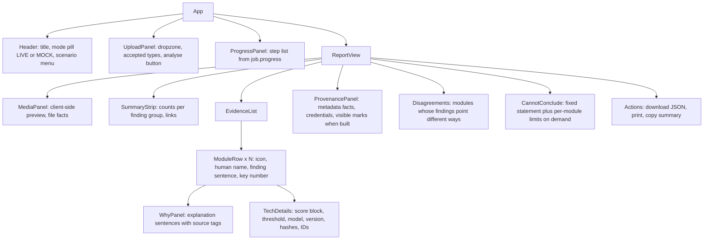
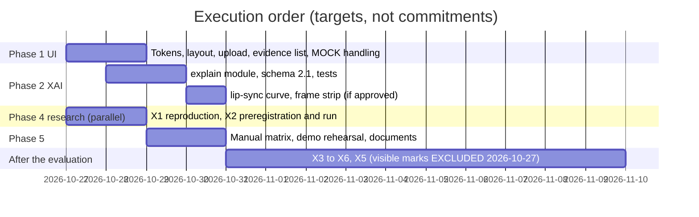

# Product redesign and model roadmap

Written 2026-10-26 from an inspection of the repository at branch `feat/generated-video-sprint`, HEAD `5af239a9427339890bb63169476de12099fc5f47`, with 28 modified tracked files and 8 new paths uncommitted (the demonstration and deliverables work of 2026-10-26). Nothing in this document was implemented; no detector, threshold, checkpoint, dataset, frozen result or ledger entry was changed while writing it. Facts are tagged with the file they come from. "Confirmed" means read in the code or reproduced in a run recorded in `docs/TESTING_RECORD.md`; "hypothesis" means not established.

Decisions requiring approval are collected in `docs/PRODUCT_REDESIGN_DECISIONS.md`.

**Status update 2026-10-27.** The user excluded visible-logo (for example Gemini) and visible-watermark detection: every passage below that plans it (section 7.4, D10, M-22, M-23, the P2 backlog row, the Phase 3 bar, one risk row, acceptance criterion D) is marked EXCLUDED and kept only as history. The implementation of Phases 1 and 2 and the first two experiments is recorded in section 18; section 18 is the current state, the sections above are the plan as written on 2026-10-26.

---

## 1. Executive summary

- The software is sound enough to redesign on top of it without touching any detector. The report contract (schema v2: per-module status, finding, score block, tested scope, limitations, warnings, observations; no global score) is the right foundation. The dashboard renders that contract faithfully but as raw diagnostics: seven technical cards, the same status information three times, unrounded numbers, internal experiment IDs and fields that are always "unknown".
- Seven confirmed product defects need attention before any demonstration (section 3.3). None changes a research result; two are honesty problems (always-unknown routing fields; the experimental generated-video score shown at the same visual weight as real findings).
- One confirmed routing limitation matters for generated images: when a still image contains a face, only the face-swap video model scores it; the generated-image model (T-I) never runs on it (`src/dfd/platform/modules/image_detector.py`, the `face_crop` branch). An AI-generated portrait is therefore never examined by the generated-image detector.
- (EXCLUDED 2026-10-27, history only) The Gemini video gave no logo result because no module looks for visible marks: the provenance modules read metadata and C2PA bytes only, and the generated-video model's canonical crop removes the left and right edges of a landscape frame, where corner logos sit (section 7).
- Explainability can be done honestly now with deterministic templates over fields the modules already return. Two additional evidence types are real and cheap: the lip-sync offset curve (computed and discarded today) and the canonical frames the generated-video model actually saw. Per-frame face-swap evidence exists inside the frozen adapter but is not returned; exposing it means changing protected code and needs a decision.
- Model research: the generated-video head does not generalise (DF26 AUC 0.4957, E-020). The cheapest decisive next step is a diagnostic, not a new model: test whether the head flags real videos from other sources as generated (a source confound). The most promising improvement experiment is in-domain training on DF26's open-generator subset under its licensed leave-one-generator-out rule, which the project's own decision D-071 currently rules out; that needs your approval.
- The UI work (Phases 1 and 2) does not depend on any model work and can be finished for the 30 October evaluation. Model experiments beyond the two cheap ones are unlikely to finish and be written up honestly by then; the plan says so instead of compressing them.

---

## 2. Repository and architecture findings

### 2.1 End-to-end data flow (confirmed in code)

```mermaid
flowchart LR
  A[Browser: dashboard.js startAnalysis] -->|POST /api/analyse multipart| B[serve.py analyse: temp file, JobStore.submit]
  B -->|one worker thread, max 4 queued| C[JobStore._run]
  C --> D[pipeline.analyse_file]
  D --> E[dfd.infer.library.inspect: extension whitelist, decode check, ffprobe]
  E -->|InputError code| X[job failed: UNSUPPORTED_MEDIA_TYPE / UNREADABLE_FILE / EMPTY_FILE]
  E --> F[module.probe_from_media: Probe]
  F --> G[Coordinator.analyse: for each module]
  G --> H[applicability: applicable / not_applicable / unsupported]
  H --> I[run with time limit: completed / failed / timed_out / skipped]
  I --> J[schema.validate_module_result: contract check, INVALID_RESULT on breach]
  J --> K[coordinator.build_report: sections, coverage, conflicts, state, statement]
  K --> L[job done: report JSON; upload deleted]
  L -->|GET /api/jobs/id polling| M[dashboard.js renderReport]
```



| Stage | Files and functions | Contract or schema | Tests |
|---|---|---|---|
| Upload | `src/dfd/platform/dashboard/dashboard.js` `startAnalysis`, `pollJob`; `serve.py` `create_app` routes `/api/analyse`, `/api/jobs/<id>`; `JobStore.submit/_run` | 512 MB limit (`MAX_BYTES`), 4 queued (`MAX_QUEUED`), 50 jobs kept, one worker, upload deleted after the pipeline | `tests/platform_dashboard/test_dashboard_live_ui.py` (12 tests), `test_dashboard.py` (17) |
| Validation and inspection | `src/dfd/infer/library.py` `inspect`, `_ffprobe` (frozen v1 code, read-only use) | `InputError` codes `NO_FILE`, `EMPTY_FILE`, `UNSUPPORTED_MEDIA_TYPE`, `UNREADABLE_FILE`; accepted extensions listed in `IMAGE_EXT`, `VIDEO_EXT`, `AUDIO_EXT` | `tests/infer/test_infer_library.py` |
| Probe | `src/dfd/platform/module.py` `Probe`, `probe_from_media` | `n_faces` and `speech_detected` are parameters that `pipeline.analyse_file` never passes | `tests/platform/test_platform_core.py` |
| Module selection | each module's `applicability`; `coordinator.Coordinator._run_one` | `Applicability.yes/no/unsupported` | `tests/platform/test_coordinator_reliability.py` |
| Inference | `modules/face_video.py`, `image_detector.py`, `speech.py` (wrappers sharing one `AdapterProvider.analyse` per file, cached by SHA-256); `modules/lip_sync.py`; `modules/generated_video.py`; `provenance/modules.py` | `ModuleResult` in `schema.py` | `tests/platform_modules`, `platform_lipsync`, `platform_genvideo`, `platform_c2pa`, `platform_provenance` |
| Aggregation | `coordinator.build_report`, `find_conflicts` | `schema.validate_report`: no `fused`, `overall_score`, `overall_probability`, `probability_fake`, `verdict`; fixed `STATEMENT`; state failed / partial / ok | `tests/platform`, `tests/platform_pipeline` |
| Explanation | none: only module-written `tested_scope`, `limitations`, `warnings[].message`, `observations[].text`, `score.meaning` strings | no explanation field | none |
| Rendering | `dashboard.js` `renderBanner`, `renderMeta`, `renderRouting`, `renderSections/renderCard`, `renderCoverage`, `renderConflicts`; `index.html`; `dashboard.css` | client-side `FINDING_LABEL`, `STATUS_LABEL` | dashboard tests, `scripts/platform/live_full_e2e.py --browser` |

Test hooks that the redesign must keep or migrate (counted in the dashboard, live-face and live E2E tests): `#analyse-btn` (12 uses), `.card` (9), `#report` (8), `#live-status` (8), `#banner` (8), `#scenario` (6), `#live-panel` (6), `#meta` (4), `#analyse-file` (4), `#live-unavailable` (3), `data-live`, `data-coverage`, `#statement`, `#partial-note`, `#error`.

### 2.2 What each module returns today (confirmed)

| Module (section) | Status paths | Finding vocabulary | Score | Evidence fields it fills |
|---|---|---|---|---|
| `face_video` (authenticity) | completed; not_applicable (no video stream, no face) | indicates_manipulation / no_indication_within_tested_scope | temperature-calibrated mean over face frames, threshold T-V | `units_analysed` (frames with a face, at most 16), warnings `MULTIPLE_FACES`, `NO_FACE_DETECTED`; per-frame probabilities are computed inside `dfd/infer/real_adapter.py` (mean at line 209) but not returned |
| `image_detector` (authenticity) | completed via `face_crop` (T-V head, uncalibrated) or `whole_image` (T-I head, calibrated); not_applicable | same | path-dependent | `tested_scope` carries `path=face_crop` or `path=whole_image` |
| `speech` (authenticity) | completed; not_applicable (no audio) | same | exploratory calibration, threshold T-A | first window of about 4 s only; warning `AUDIO_CALIBRATION_EXPLORATORY` |
| `lip_sync` (cross_modal) | completed (consistent / potential_mismatch / inconclusive); not_applicable; unsupported (no weights) | consistent / potential_mismatch / inconclusive | confidence / 10, display only | observations `av_offset_frames`, `sync_min_dist`, `sync_confidence`, `frames_with_face`; the 31-value `SyncResult.mean_dist` curve (`syncnet/scoring.py`) is computed and dropped |
| `generated_video` (authenticity) | completed, always inconclusive (gate, `APPROVED_HEADS = {}`); unsupported (no or incompatible head); failed (encoder missing, non-finite) | inconclusive in practice | uncalibrated ranking score, no threshold shown | warning `EXPERIMENTAL_UNVALIDATED`; head meta: model name, evaluation, tested scope (DF26 chance level) |
| `media_metadata` (provenance) | completed, always inconclusive | inconclusive | none | observations: container, streams, tags (`encoder`, `creation_time`, ...); heuristic flags `NO_CREATION_TIME`, `ENCODER_TAG`, stream-duration mismatch |
| `content_credentials` (provenance) | completed | credentials_valid (only with operator anchor) / credentials_invalid / no_credentials_found / inconclusive | none | marker scan and C2PA verification observations, validation codes, signer, declared AI source type |

### 2.3 Architectural constraints to respect

- No global score, no "genuine" value: enforced by `schema.validate_report`. Any summary must be a structured list of module findings, not a number.
- Frozen detectors: `src/dfd/infer` and `src/dfd/web` are protected; the wrappers read the adapter's result only. Anything needing new adapter outputs (per-frame scores, face boxes) is a change to protected code (decision D4 in the decisions file).
- Generated-video gate: `APPROVED_HEADS = {}` stays; the UI must keep the head visibly experimental.
- Lip-sync band (-6, +2) stays; explanations describe it, never adjust it.
- No build tooling: the frontend is plain JavaScript served by Flask with explicit routes for `/dashboard.js` and `/dashboard.css` only (`serve.py`). Adding files means adding routes.
- One GPU worker; analyses take about 0.5 to 3 s each after an 11 s first load (docs/DEMO.md).

---

## 3. Current UI/UX problems (grounded in code)

### 3.1 Information architecture

- Status shown three times: "Modules that ran / did not run" in `renderRouting`, the six-box `renderCoverage` panel, and the status tag on every card (`renderCard`). A lay evaluator sees 3 lists before a single finding.
- No summary: the first thing after the banner is "Request" with request id, SHA-256, size in bytes and processing time in ms (`renderMeta`).
- Card titles are raw identifiers (`face_video`, `content_credentials`), cards carry `version`, `source`, model names and evaluation strings with internal experiment IDs (for example "Evaluation: E-005 (fine-tuning; ...)" from the wrappers' `EVALUATION` constants), and every limitation and warning is expanded by default.
- Findings are ordered by section and module registration order, not by importance.
- The uploaded media is never shown; the server deletes it and the page has no client-side preview.
- A MOCK scenario is rendered at page load even in live mode (`init` calls `loadFixture(names[0])`), so the first screen a visitor sees is invented data; it is correctly tagged MOCK but it still dominates the page until a file is analysed.
- The file input has no `accept` attribute: accepted types are learned only from an `UNSUPPORTED_MEDIA_TYPE` failure.
- The live status line shows internal module ids ("Running: lip_sync (3 of 7 modules done)").

### 3.2 Visual design

- Diagnostic styling: 6 px coloured left borders, dotted, double and dashed variants per status, `opacity:.85` and `.75` on not-applicable and skipped cards (lowers text contrast; not measured), uppercase status tags, 15 px system font, no spacing scale (`dashboard.css`).
- Colour meaning is inconsistent: completed cards are blue regardless of finding; the finding chip carries red for "indicates manipulation" and a neutral grey for everything else; "credentials invalid" reuses the lip-sync mismatch amber.
- No focus styles of its own (browser default outline only), no visible drag-and-drop target, no empty state for the live panel.

### 3.3 Confirmed defects

| # | Defect | Evidence | Severity |
|---|---|---|---|
| UX-1 | "Faces found" and "Speech detected" always read "unknown" | `pipeline.analyse_file` calls `probe_from_media(media)` without `n_faces` or `speech_detected`; `renderRouting` prints them | High: shows a capability that is never exercised |
| UX-2 | Unrounded numbers: threshold shown as `0.6138830927259571` | `renderCard` prints `str(m.score.threshold)`; observed in the demo run (`docs/test_evidence/2026-10-26/demo_api_run.txt`) | Medium |
| UX-3 | Internal experiment IDs in user-facing evaluation lines | wrappers' `EVALUATION` strings rendered as "Evaluation: ..." | Medium (meaningless to evaluators; fine in technical details) |
| UX-4 | Experimental generated-video score shown at the same weight as real findings (score 1.0 on a real LAV-DF clip and on a test pattern in the demo run) | `renderCard`; `docs/DEMO.md` section 4 | High for honesty |
| UX-5 | Speech module gives a finding on non-speech audio (440 Hz tone: no indication, 0.0) | demo run; D-075 | Medium (documented; display needs a caveat) |
| UX-6 | Malformed attribute: `<div id="banner"class="banner" ...>` (no space) | `index.html` line 26 | Low (browsers tolerate it) |
| UX-7 | Generated portraits are never examined by the generated-image model | `image_detector.py` `face_crop` branch; D-033 | High for the product claim "detects generated images" |

Fixed earlier on 2026-10-26: a failed analysis left the MOCK report on screen (regression test in `test_dashboard_live_ui.py`).

### 3.4 Duplicated logic and drift risks (confirmed)

- Finding and status vocabularies exist twice: server (`schema.FINDINGS`, `STATUSES`) and client (`FINDING_LABEL`, `STATUS_LABEL`). A new finding added on the server renders as "Inconclusive" on the client (`FINDING_LABEL[m.finding] || "Inconclusive"`), which silently mislabels.
- The "experimental" test (`/^EXPERIMENTAL/` on warning codes) is written twice in `renderCard`.
- `find_conflicts` covers the authenticity section only; a lip-sync mismatch next to a "no indication" never surfaces as a disagreement (hypothesis: intended; not documented).

---

## 4. Design system

### 4.1 Direction

Calm, precise, document-like: a forensic report you can read top to bottom, not a monitoring console. Large quiet surfaces, one accent colour for interaction only, colour used for meaning sparingly and always paired with text and an icon shape. No green for "no indication": green reads as "safe/authentic", which the system must never imply.

### 4.2 Palette (final proposal, contrast computed 2026-10-26 with the WCAG 2.x relative-luminance formula)

| Token | Light | Dark | Use | Contrast (text on its background) |
|---|---|---|---|---|
| `--bg` | `#F6F7F9` | `#0E1116` | page | |
| `--surface` | `#FFFFFF` | `#161B22` | panels, cards | |
| `--border` | `#DDE2E8` | `#2B3340` | decorative card edges | 1.30 / 1.36 (decorative only) |
| `--control-border` | `#7A8699` | `#5F6C80` | inputs, buttons, focusable edges | 3.69 / 3.25 (non-text 3:1 met) |
| `--ink` | `#101828` | `#E6EAF0` | primary text | 17.75 / 14.33 on surface |
| `--ink-2` | `#344054` | `#C3CAD5` | secondary text | 10.46 / 10.49 |
| `--muted` | `#5D6B7E` | `#98A2B3` | captions | 5.43 / 6.72 on surface; 5.06 / 7.34 on bg |
| `--accent` | `#0E6E6E` | `#4FC1B9` | buttons, links, focus ring, selection | 6.04 / 7.96 on surface |
| `--accent-soft` | `#E6F2F1` | `#12302E` | hover and selected backgrounds | |
| finding: signs of manipulation | fg `#B42318` on `#FEF3F2` | fg `#FDA29B` on `#3A1513` | `indicates_manipulation`, `credentials_invalid` | 6.05 / 8.34 |
| finding: needs attention | fg `#9A4A03` on `#FFF6E5` | fg `#FDB868` on `#3A2508` | `potential_mismatch` | 5.83 / 8.45 |
| finding: nothing found in scope | fg `#344054` on `#F2F4F7` | fg `#D0D5DD` on `#222A35` | `no_indication_within_tested_scope`, `consistent`, `no_credentials_found` | 9.49 / 9.82 |
| finding: inconclusive | fg `#4A4F8C` on `#F1F2FA` | fg `#B4B9F2` on `#23264A` | `inconclusive` | 6.75 / 7.71 |
| system: did not run properly | fg `#8A3C00` on `#FFF4ED` | fg `#F7B27A` on `#3A1F0C` | failed, timed_out, skipped | 7.12 / 8.40 |
| verified credential | fg `#1D6B4F` on `#ECF7F2` | fg `#7FD1AE` on `#12301F` | `credentials_valid` only (cryptographic fact, not authenticity) | 5.86 / 7.92 |
| MOCK | fg `#A3125C` on `#FDF0F6` | fg `#F4A3CB` on `#3D1029` | mock data badge and hatched banner | 6.78 / 8.39 |
| EXPERIMENTAL | fg `#3A3F9E` on `#EEF0FC` | fg `#B8BEF8` on `#22264F` | experimental badge | 7.76 / 8.06 |

Rationale: a desaturated slate base keeps attention on content; the single teal accent is distinct from every finding colour, so "clickable" never looks like "a result". Red and amber are reserved for the two findings that call for attention; "nothing found" is neutral slate, the same family as body text, so it reads as absence of a signal, not as reassurance. All text pairs pass WCAG AA (4.5:1); most exceed 5.4:1. Colour is never the only carrier: every finding has a label and an icon shape (filled triangle: signs of manipulation; ring: needs attention; dash: nothing found; question mark: inconclusive; slashed circle: not applicable; wrench: did not run; shield with check: verified credential), which also covers colour-vision deficiency.

### 4.3 Typography, spacing, surfaces

- Font: system stack `"Segoe UI Variable", "Segoe UI", system-ui, -apple-system, "Helvetica Neue", Arial, sans-serif` (offline, no web-font download); numbers in `font-variant-numeric: tabular-nums`; monospace `"Cascadia Mono", Consolas, monospace` for hashes and codes in technical details only.
- Scale (px / line height): 12/16 caption, 14/20 body small, 16/24 body, 18/26 card title, 22/30 section, 28/36 page title. Weights 400, 600; no all-caps except the MOCK banner.
- Spacing on a 4 px grid: 4, 8, 12, 16, 24, 32, 48. Page max width 1120 px, 24 px gutters (16 px below 640 px).
- Surfaces: radius 12 px for panels, 8 px for cards and buttons, 999 px for badges; shadow `0 1px 2px rgba(16,24,40,.06), 0 1px 3px rgba(16,24,40,.10)` on panels in light mode, none in dark mode (borders instead).
- Buttons: primary filled accent, 40 px high, 16 px horizontal padding; secondary outlined with `--control-border`; focus ring 2 px accent with 2 px offset on every focusable element.
- Badges: 12/16 text, 2 px by 8 px padding, icon plus label; MOCK and EXPERIMENTAL badges never share a colour with findings.
- Responsive: one column below 720 px (summary, then media, then evidence); two columns at 720 to 1080 px (media plus summary on top, evidence list below); three areas above 1080 px (left rail with media and file facts, main column with summary and evidence, right column collapses into the main column under 1280 px). Touch targets at least 44 px.
- Motion: 150 ms opacity and height transitions for disclosure, disabled under `prefers-reduced-motion`.

---

## 5. Page layout and component hierarchy

### 5.1 Live analysis page (desktop)

```
+------------------------------------------------------------------------------------------+
| [logo mark] Media Analysis            LIVE ANALYSIS (teal pill)        [Demo scenarios v] |
+------------------------------------------------------------------------------------------+
| UPLOAD / FILE                       | WHAT THE MODULES FOUND                              |
| +---------------------------------+ | 1 module found signs of manipulation                |
| |  media preview (client-side)    | | 2 modules found nothing within their tested scope   |
| |  video player / image / audio   | | 2 modules were inconclusive   2 did not apply       |
| |  waveform                       | |  (counts link to the groups below; no total score)  |
| +---------------------------------+ | --------------------------------------------------- |
| sample_video.mp4  5.9 s  video+audio| ! Face manipulation detector                        |
| 1280 x 720                          |   Signs of manipulation in the largest face          |
| [Analyse another file]              |   Score 0.97 (decision line 0.61), 16 frames         |
|                                     |   [Why?]  [Technical details]                        |
| FILE FACTS                          | - Speech synthesis detector                          |
| - Accepted, decoded                 |   Nothing found within tested scope (first 4 s)      |
| - Metadata: no creation time        | ? AI-generated video (EXPERIMENTAL)                  |
| - Content credentials: none found   |   No decision is made; research prototype            |
|                                     | o Lip-sync timing                                    |
|                                     |   Audio and lips line up within the normal range     |
|                                     | (/) Not applicable: image detector (this is a video) |
|                                     | --------------------------------------------------- |
|                                     | WHAT THIS REPORT CANNOT TELL YOU (fixed statement)  |
|                                     | [Download report JSON] [Print / PDF] [Copy summary] |
+------------------------------------------------------------------------------------------+
```

### 5.2 Upload state (before a file)

```
+---------------------------------------------------------------+
|                Analyse an image, video or audio file           |
|  +---------------------------------------------------------+  |
|  |   Drop a file here or [Choose file]                      |  |
|  |   Images: PNG JPG JPEG BMP WEBP  Video: MP4 MOV AVI MKV  |  |
|  |   WEBM  Audio: WAV FLAC MP3 M4A OGG   Up to 512 MB       |  |
|  +---------------------------------------------------------+  |
|  The file stays on this computer and is deleted after analysis |
|  [Analyse] (disabled until a file is chosen)                   |
+---------------------------------------------------------------+
```

(The "stays on this computer" sentence is true for the live server: it binds 127.0.0.1 and deletes uploads in `JobStore._run`.)

### 5.3 Progress state

```
 Analysing sample_video.mp4
 [=========-----------]  3 of 7 checks done
 v File accepted and decoded
 v Face manipulation detector
 v Image detector (not applicable)
 * Speech synthesis detector  (running)
   Lip-sync timing  (waiting)
   ...
```

Human names replace module ids; the same list becomes the evidence list when done.

### 5.4 Component hierarchy



### 5.5 States

| State | Where it comes from | How it is shown |
|---|---|---|
| Queued | job `state: queued` | progress panel, "Waiting for the previous analysis" |
| Processing | job `state: running`, `progress.module_id` | step list with the running step highlighted (human name) |
| Completed, report state ok | report `status.state: ok` | full report |
| Partial | `status.state: partial` | amber note at the top of the evidence list: "N checks did not complete (failed / timed out / unsupported); the summary covers the rest", with the affected rows in a "Did not run properly" group |
| Failed (whole file) | job `state: failed`, error code | upload panel returns with an error card: plain sentence plus the code; no report |
| Report failed (no module completed) | `status.state: failed` | report shell with the "nothing was analysed" message; never a summary |
| Module unsupported | module status | grouped under "Not available on this computer" with the reason (missing model) |
| Module not applicable | module status | grouped under "Did not apply" with the reason |
| Inconclusive | finding | question-mark row with the reason sentence (warning text) |
| Timed out / failed module | module status | wrench row in "Did not run properly" |

### 5.6 Conflicts and incompleteness

- A "Disagreements" block appears when the report's `conflicts` list is non-empty, and (new, client-side, read-only) when a cross-modal mismatch or invalid credential sits next to "nothing found" findings. Wording: "These checks look at different things and can disagree; neither cancels the other." No resolution, no score.
- The summary strip counts only completed findings and states the number of checks that did not run. It never says "authentic", "likely real", "fake" or a percentage.

### 5.7 Mock and demo scenarios

- In live mode the page opens on the upload panel, not a mock report. Scenarios move to a "Demo scenarios" menu; choosing one shows a full-width hatched MOCK banner ("Invented example data: no model ran") and a MOCK badge on every row, and disables report actions that could export it as real (the JSON download is named `MOCK_...json`).
- Without `--live`, the page states "Live analysis is not available on this server" and shows scenarios with the same MOCK treatment.

### 5.8 Framework recommendation

Keep plain JavaScript and Flask. Reasons: no build step on an offline evaluation machine, the existing 29 dashboard tests drive the DOM directly, the page is small (474 lines of JS today), and every string is already inserted with `textContent` (XSS-safe; a test covers HTML in file names). Split `dashboard.js` into three files (`render.js` components, `labels.js` human names and vocabulary, `app.js` flow), served by three explicit routes; add `/api/vocabulary` so the client reads finding and status labels from the server (fixes the drift risk in 3.4). Migration to a framework is not justified by anything found.

---

## 6. Evidence-grounded explainability (XAI)

### 6.1 Principles

1. Every sentence shown to a user is generated from a field of the module result and carries that field's name (`source`), so it can be checked.
2. Four kinds of sentence, always labelled: observation (measured fact about the file), model output (a number a model produced), interpretation (what the project's rule makes of the number), limitation/uncertainty.
3. The explanation never combines modules into one judgement; the report-level text only counts and groups.
4. Deterministic templates first. No language model in the default product (decision D11).

### 6.2 Schema addition (schema version 2.1, additive)

Each module result gains an optional `explanation` object, produced on the server by a new pure function `dfd.platform.explain.explain(module_result) -> dict` (no model, no I/O), called in `build_report` after validation:

```json
"explanation": {
  "headline": "Signs of manipulation in the largest face",
  "headline_kind": "interpretation",
  "sentences": [
    {"kind": "model_output", "text": "The face manipulation model gave 0.97 on a 0 to 1 scale.", "source": "score.value"},
    {"kind": "interpretation", "text": "That is above the fixed decision line of 0.61, so the module reports signs of manipulation.", "source": "score.threshold"},
    {"kind": "observation", "text": "It examined the largest face in 16 sampled frames.", "source": "units_analysed"},
    {"kind": "limitation", "text": "It was trained on face-swap videos; it was not evaluated on fully generated talking-head video.", "source": "limitations[0]"}
  ],
  "does_not_mean": "This does not show who made the video or how; other checks can disagree.",
  "template_id": "face_video.completed.indicates_manipulation.v1"
}
```

- Numbers are rounded for display (score 2 decimals unless closer than 0.01 to the threshold, then 3; thresholds 2 decimals) and the raw value stays in technical details.
- `validate_module_result` gains checks: every `source` resolves to a non-null field; `kind` in the four values; no forbidden words (section 6.5).
- Report-level `summary` (also derived, not a score): counts per finding group and the list of module ids in each, plus the existing fixed statement.

### 6.3 Example explanations from actual output fields

Values are from the demo run of 2026-10-26 (`docs/test_evidence/2026-10-26/demo_api_run.txt`); fields not printed there are shown as `{field}`.

1. Face manipulation (`face_video`, file 1, completed, indicates_manipulation, score 0.99998, threshold 0.6139, calibrated true):
   "Signs of manipulation in the largest face. The face manipulation model gave 1.00 (0 to 1 scale, calibrated on FaceForensics++ validation videos); its fixed decision line is 0.61. It examined the largest face in {units_analysed} sampled frames. Limitation: trained and tested on face-swap material; not evaluated on fully generated talking-head video, and on content-edited LAV-DF videos its sealed result was below chance. This does not show who made the video."
2. Image detection (`image_detector`, file 5, face_crop path, score 0.999983, threshold 0.6139, calibrated false):
   "Signs of manipulation in the face of this still image. A face was found, so the image was checked with the face-swap model built for video frames, not with the generated-image model; that model gave 1.00, above its decision line 0.61. This score is not calibrated for still images, and this model was not evaluated on still face-swapped photos. The generated-image check did not run on this image."
3. Speech (`speech`, file 4, no_indication, score 0.15311, threshold 0.6954, warning AUDIO_CALIBRATION_EXPLORATORY):
   "Nothing found within the tested scope. The speech synthesis model gave 0.15; its decision line is 0.70. Only the first window of about 4 seconds was analysed. The score's calibration is exploratory, so read it as a ranking, not a probability. On sources other than its training data its sealed results were lower. This does not show the speech is human."
4. Lip-sync (`lip_sync`, file 3, consistent, score 0.3656 so confidence 3.66, observation `av_offset_frames` = {value}):
   "Audio and lip movement line up within the normal range for real speech clips. The best alignment was {av_offset_frames} frames ({av_offset_frames x 40} ms); the accepted range is -6 to +2 frames, fitted on real VoxCeleb2-derived clips. The alignment stood out with confidence 3.66 (minimum 3.0). This measures timing only: synchronised fakes pass it, and in testing it flagged none of 160 Wav2Lip fakes."
5. Generated video (`generated_video`, file 3, inconclusive, score 1.0, warning EXPERIMENTAL_UNVALIDATED):
   "No decision is made. This is a research prototype: a model trained on one dataset of generated action videos that performed at chance on an independent benchmark of generated talking-head videos. Its raw score (1.00 here) is shown only in technical details and should not be read as evidence; real videos also receive high scores."
6. Media metadata (`media_metadata`, file 1, inconclusive, warnings NO_CREATION_TIME, ENCODER_TAG):
   "File facts: video {codec} {width}x{height} at {fps} fps; no creation time recorded; encoder tag '{encoder}' names the last program that wrote the file. These facts describe the file; missing or present metadata does not show whether content is real."
7. Content credentials (`content_credentials`, file 1, no_credentials_found):
   "No content credentials were found in the file. Credentials are optional and are removed by most editing and sharing, so their absence says nothing about the content. Invisible watermarks such as SynthID are not checked."

### 6.4 Failures, missing evidence, contradictions

- not_applicable / unsupported / failed / timed_out: template uses `reason` and error code only ("Did not run: no audio stream."; "Not available on this computer: the lip-sync model file is not installed.").
- Missing optional fields (for example `units_analysed` null): the sentence is omitted, never filled with a default.
- Contradictions: never explained away; the Disagreements block lists them (5.6).

### 6.5 Testing factual consistency

1. Number check: every number in rendered explanation text must equal a field value after the template's declared rounding (regex extraction, compared against the source field).
2. Source check: every sentence's `source` path resolves to a non-null field of the same module result.
3. Vocabulary check: forbidden in explanations unless quoted from a field: "authentic", "genuine", "real" as an adjective of the media, "fake" as a verdict, "proves", "deepfake detected", "%" (no percentages unless `score.calibrated` is true, and even then not in the headline).
4. Coverage: one golden test per template id over the 11 mock fixtures plus synthetic results for every status and finding of every module (parametrised; the list of template ids must match the list of reachable status/finding/warning combinations).
5. Status integrity: a module that did not complete can never contribute a sentence of kind `model_output` or `interpretation`.
6. Browser test: the Why panel shows the same text as the JSON.

### 6.6 Optional LLM layer (evaluated, not recommended now)

A local or hosted LLM could paraphrase the template sentences, but it adds no evidence, needs either a download of several GB or sending report data to a third party, and introduces a failure mode (invented observations) that the checks above cannot fully exclude. If wanted later: input only the structured result and the template sentences, output constrained to a reordering and rephrasing of those sentences, then run the number, source and vocabulary checks on the output and fall back to templates on any violation. Not part of the plan for 30 October.

### 6.7 Visual explainability: what is defensible

| Candidate | Supported by current models? | Plan |
|---|---|---|
| Frames the generated-video model actually saw (8 canonical frames, 224 px centre crop, first 2 s) | Yes: computed in `GeneratedVideoModule.run` (`canonical.read_frames`) | Return thumbnails as data (base64 JPEG, 8 x about 5 KB) in technical details: "these are the only pixels this module used". Honest and shows the crop limitation. |
| Lip-sync offset curve (31 points) | Yes: `SyncResult.mean_dist` | Plot distance against offset with the accepted band shaded; platform-only change. |
| Face-swap per-frame scores and face crops | Computed inside the frozen adapter, not returned | Needs an additive change to `src/dfd/infer/real_adapter.py` with a parity test proving the clip score is unchanged (decision D4). |
| Region heatmaps (Grad-CAM, attention rollout) on SigLIP or CLIP | Technically computable on the fine-tuned SigLIP; not implemented; reliability of saliency for ViTs is contested and not in docs/RESEARCH.md | Not promised. Research item only, with a randomisation sanity check before any display. |
| Speech: which seconds | Only the first window is scored | Show the analysed 4 s span on the waveform; nothing more. |

---

## 7. Gemini video: watermark and provenance investigation

**EXCLUDED by the user (2026-10-27): visible-logo and visible-watermark detection is out of scope and will not be built, tested or planned.** Sections 7.1 to 7.3 are kept as a record of what the provenance modules examine; 7.4 is withdrawn.

### 7.1 What the system examines (confirmed in code)

| Layer | Examined? | Where |
|---|---|---|
| Embedded C2PA content credentials | Yes: marker-byte scan (first 256 MB) and full manifest validation with c2pa-python 0.38.0 | `provenance/metadata.py` `scan_c2pa_markers`; `provenance/c2pa_verify.py` `verify` |
| File metadata and encoder tags | Yes: ffprobe container, streams, tags `encoder`, `creation_time`, `major_brand`, `handler_name`, `title`, `comment`; descriptive flags | `provenance/metadata.py` `describe`, `heuristics` |
| Visible logos or watermarks in the pixels | No module | none |
| Invisible watermarks (SynthID and others) | No; stated as a limitation on every provenance card | `provenance/modules.py` `_LIM_WATERMARK` |

### 7.2 Why the visible mark was not used by the detectors either

- `face_video` sees only crops of the largest face.
- `generated_video` sees the canonical clip: first 2.0 s, 7 fps, scaled so the short side is 224 px, then a centre crop of 224 x 224 (`genvideo/canonical.py` `VF`). For a 1280 x 720 frame the scaled width is about 398 px and the crop keeps about the middle 224, i.e. original columns of roughly 280 to 1000 of 1280: anything within about 280 px of the left or right edge, where corner marks usually sit, never reaches the model. For a portrait 720 x 1280 frame the top and bottom are removed instead. This is by design (E-019: header and layout shortcuts were removed), and it means a corner mark cannot influence the score.

### 7.3 Not established (needs the actual file)

Whether the user's Gemini video carries C2PA credentials, an encoder tag naming a Google tool, or a visible mark at a particular position was not checked here: the file is not in the repository. Action: run the existing pipeline on it and record the `content_credentials` and `media_metadata` cards (manual test M-07 in section 10). If credentials are present but signed by an untrusted signer, the module reports inconclusive with a verification observation; that is correct behaviour, not a defect.

### 7.4 (WITHDRAWN 2026-10-27) Recommendation: a separate optional "visible AI marking" module

**EXCLUDED by the user (2026-10-27): visible-logo and visible-watermark detection is out of scope and will not be built, tested or planned.**

- New module `visible_marking`, in a new report section `declared_markings` (not provenance, not authenticity), with its own finding vocabulary: `visible_ai_label_found`, `no_visible_ai_label_found`, `inconclusive`. Schema 2.1 adds the section; `validate_report` rules unchanged otherwise.
- Method (first version): template matching of a small curated set of published visible marks (for example the generators' own corner logos), at multiple scales, on frames sampled across the whole video and the full frame (no crop), plus OCR of short text in the four corner regions if an OCR engine is approved (none is installed; Tesseract would be a new external executable). A visual-language model is not recommended: large download, slow on the shared GPU, and it can describe marks that are not there.
- Output: the matched template name, frame times and corner, match score, and the region crop as evidence.
- Evaluation before it is shown as anything but experimental: a labelled set built from (a) generated videos and images the user creates with each supported tool (owned outputs; terms recorded in DATA_LOG), (b) negatives: real non-sealed videos with and without unrelated logos (FF++ originals come from broadcast-style YouTube videos and may contain channel marks; that was not checked here, and any that do are useful hard negatives), (c) transformed positives: cropped, scaled, blurred, partly covered, re-encoded. Metrics: precision and recall per template with Wilson intervals, false-positive rate on negatives, recall under each transformation. Gate: precision lower bound above an agreed value on negatives before the label "found" is shown without the experimental badge.
- UI wording: "A visible label that looks like {generator}'s AI mark appears in the {corner} corner at {time}." Always with: "A visible label can be added to or copied onto any video, and removed by cropping. Finding one does not prove the video was AI-generated by that tool; not finding one does not mean the video is real."
- The existing provenance modules stay unchanged and keep saying what they do not check.

---

## 8. Generated-image and generated-video research roadmap

### 8.1 Verified baseline (from the repository, not repeated from the brief)

| Item | Value | Source |
|---|---|---|
| Installed head | logistic regression on the mean CLS embedding of 8 frames of frozen DINOv2-small, canonical-v3 clips | `checkpoints/genvideo-E020/head.npz` meta; E-020 |
| DeepAction leave-one-generator-out macro AUC (C2) | 0.8281 [0.7908, 0.8662] | `data/_results/genvideo/e020_dev_results.json` |
| DF26 all clips | 0.4957 [0.4755, 0.5168] | `e020_df26_results.json` |
| DF26 closed-generator subset (preregistered primary) | 0.4880 [0.4534, 0.5204]; H-G1 not supported | same |
| Trajectory classifier C1 (ReStraV-style) | DeepAction 0.5073 [0.4608, 0.5542]; DF26 0.5077 [0.4723, 0.5424] | same |
| Pixel statistics C3 | DeepAction 0.7613 [0.7182, 0.8033]; DF26 0.5604 [0.5361, 0.5852], sign flips across generators | same |
| Score | uncalibrated ranking score; threshold set on DeepAction only; module always inconclusive | D-072, D-074 |
| Image detector T-I (CLIP ViT-L/14 frozen, linear head on ProGAN) sealed | diffusion test set 0.9354 [0.8967, 0.9665]; CNN-synthesis subset 0.9316 [0.8933, 0.9694]; ProGAN test 1.0000 | E-014 |

The figures in the brief match the records.

### 8.2 Data restrictions that bound the plan (from DATA_LOG and decisions)

- DF26 (R-081, licence version 1.0 read 2026-10-26): training a detector is allowed only on the open-generator subset (HunyuanVideo 1.5 I2V and T2V, LTX 2.3 I2V and T2V, Wan 2.2 I2V and T2V) under the leave-one-generator-out protocol of the dataset card; the closed subset (Grok Imagine, Kling 3.0, Veo 3.1, Wan 2.6) is evaluation only (no calibration, threshold tuning, augmentation or selection); no redistribution. The project went further in D-071 (4): DF26 is evaluation only, the open-subset exception is not used. Using it for training needs that decision amended (D12). The closed subset has already been evaluated once (E-020); every further evaluation must be preregistered and counted.
- DeepAction (R-082): generated folders CC BY 4.0, real folder Pexels licence. One real source (100 Pexels clips) against 2,505 generated: the main suspected confound.
- FakeAVCeleb sealed half: never touched again (E-015). Development halves of other corpora: usable for diagnostics.
- Generated images on disk: ProGAN (CC BY-NC-SA 4.0), the 2022 diffusion test sets (LDM, Glide, Guided, DALL-E-mini; image licence not established), CNN-synthesis units. No modern text-to-image generator (Stable Diffusion XL or later, Midjourney, Imagen or Gemini, Flux) is on disk. Candidate sources are logged but not downloaded: GenImage (CC BY-NC-SA 4.0 plus terms), Community Forensics and its Eval split (CC BY 4.0 / CC BY-NC-SA 4.0, by shard) (DATA_LOG I4 to I7).
- Hardware: one RTX 5070 with 12 GB. Measured: frozen DINOv2-small features for 2,605 canonical clips in 105 s and for 2,691 in 108 s (E-020 logs). Already downloaded and hash-verified encoders: DINOv2-small and -base, CLIP ViT-L/14 (OpenAI and LAION), SigLIP base, EfficientNet-B4, Xception. Fine-tuning a CLIP ViT-L does not fit 12 GB at the project's settings (DOC_FACTS); frozen features plus small heads do.

### 8.3 Image and video are different problems

- Images: a single frame, often high resolution, frequently portraits. The routing gap (UX-7) means faces never reach T-I. T-I has never seen a modern generator. The first question is measurement, not a new model.
- Video: temporal and appearance cues, heavy compression, talking heads in the realistic threat. E-020 showed that what separated DeepAction (appearance, possibly source) does not transfer to DF26. The first question is diagnosis of why.

### 8.4 Experiments (proposed; IDs assigned at preregistration as E-026 onward)

Common rules for all: hypothesis, success and failure criteria written and committed as their own commit before any run (docs/RESEARCH_INTEGRITY.md section 2); three seeds where training is involved; group bootstrap intervals; per-generator AUC plus macro mean; results logged even when negative; the installed head and frozen files never overwritten (new folders `checkpoints/genvideo-E0xx/`).

**X1. Baseline reproduction from stored artefacts** (safe now)
- Question: do the E-020 development numbers reproduce from the stored DeepAction features and frozen heads?
- Hypothesis: macro AUCs identical to 4 decimals.
- Data: `data/_results/genvideo/features_deepaction.npz`, frozen `head_C*.npz`; DF26 not touched (its numbers are checked against the stored result file only, already done).
- Change: none. Compute: CPU, minutes (not timed).
- Metrics: macro LOGO AUC and intervals with the same seeds. Success: identical. Failure: any difference, which then blocks X3 to X5 until explained.
- Risks: none. Safe under restrictions: yes.

**X2. Source-confound test of the installed head** (safe now; recommended first experiment)
- Question: does the installed head score real videos from sources other than Pexels as generated?
- Hypothesis (from E-020's interpretation, untested): the head separates "Pexels stock footage" from "everything else"; real clips from other sources get high scores. The demo run showed 1.0 on one real LAV-DF clip, which motivates the test but is not evidence.
- Data: real clips only, non-sealed: FF++ original validation videos, LAV-DF train real clips (unmodified), Celeb-DF v2 development real clips if in a dev split; DeepAction real clips' out-of-fold scores as the reference. No generated data, no DF26.
- Change: none (frozen head, same canonical-v3 pipeline). Compute: canonicalisation plus DINOv2-small features; at the measured rate about 2 minutes per 2,600 clips for features; canonicalisation not timed.
- Metrics: score distribution per source; false-positive rate at the development threshold 0.9623 with Wilson intervals; AUC of "DeepAction real vs other real" (should be 0.5 if no source effect).
- Success (hypothesis supported): false-positive rate on non-Pexels real clips with Wilson lower bound above the DeepAction out-of-fold false-positive rate and above 0.5. Failure: rates comparable to DeepAction real.
- Risks: other sources differ in content (talking faces vs action), so a high rate shows the head does not transfer to real footage of other kinds, not exactly which factor causes it.
- Value: decides whether any DeepAction-trained candidate is worth more work. Safe under restrictions: yes.

**X3. In-domain training under the DF26 open-generator protocol** (needs decision D12)
- Question: can frozen-feature heads trained on matched real and generated talking-head clips generalise to an unseen generator?
- Hypothesis: macro LOGO AUC over the six open generators clearly above 0.5 for at least one frozen encoder; then the closed subset as a single preregistered evaluation.
- Data: DF26 open subset (six generators) with the 271 real clips split into folds by source group (the real clips are shared by all generators, so they must be partitioned to avoid the same real clip on both sides); closed subset only for one final evaluation of the frozen chosen head (ledger entry). DeepAction not used for training here.
- Change: encoders DINOv2-small, DINOv2-base, CLIP ViT-L/14, SigLIP base (all local), mean CLS over 8 canonical frames, logistic regression; plus the C3 pixel baseline as control.
- Compute: DINOv2-small features 108 s for all 2,691 DF26 clips (measured); the others not measured, pilot on 100 clips first.
- Metrics: per-generator and macro AUC, paired difference to C3, three seeds; on the closed subset AUC and EER per generator once.
- Success: macro LOGO lower bound above 0.60 and above C3 by a positive paired interval. Failure: interval including 0.5 or not above C3.
- Risks: small real class; source groups few; the closed subset was already evaluated in E-020, so a new result there is informed by that earlier look; DF26 licence obligations.
- Safe: only after D12; closed subset evaluation-only.

**X4. Crop and frame-count ablation** (after X3, same protocol)
- Question: does the 224 px centre crop of the first 2 s discard evidence?
- Change: full-frame resize (letterbox) and 16 frames over the whole 5 s clip versus canonical-v3, best encoder of X3 only.
- Success: paired improvement with a positive interval; failure: none. Safe: same as X3.

**X5. Modern-generator check of the image detector** (needs decisions D13 and D8)
- Question: how does the frozen T-I head rank modern generated images against real photos, and how often are generated portraits routed away from it?
- Data: a preregistered test-only subset of Community Forensics Eval (per-generator real pairs; licence CC BY-NC-SA 4.0), downloaded by shard; declared test-only before download; no training.
- Change: none to the detector; an analysis script runs T-I on the whole image regardless of faces, and also records which images the current routing would send to the face path.
- Compute: CLIP ViT-L/14 features; time not measured; pilot on 200 images.
- Metrics: per-generator AUC, macro mean, fraction of images with a detected face. Success is not a pass/fail on the product; it decides whether the image detector's tested scope must be narrowed and whether an image-side training experiment is justified.
- Safe: yes after the download decision; not sealed.

**X6. Calibration and operating point for any candidate that passes** (after X3)
- Fit temperature and threshold only on the open-subset out-of-fold scores (allowed inside the protocol), report expected calibration error with intervals; never on the closed subset.

### 8.5 Promotion, retention and rollback rules

- Retain as experimental: any candidate that passes its own success criterion; it may replace the installed head only as another experimental head (new `head_id`, new folder, gate still closed), with the tested-scope text updated from the new result. The E-020 head files stay byte-identical; rollback is pointing `DEFAULT_HEAD` back.
- Promote to definitive findings (adding a hash to `APPROVED_HEADS`): only after an independent, preregistered validation on data never used for training, selection or calibration (docs/SETUP.md section 8). Nothing in this plan reaches that point before 30 October.
- Reject: a candidate failing its criterion is logged with its result and never installed.
- Regression detection: X1 must pass before X3; the generated-video tests (`tests/platform_genvideo`, 46) and the gate tests must pass after any head change; the reproducibility check (`scripts/genvideo/repro_check.py`) is rerun for a new head only on DeepAction clips.

---

## 9. Experiment matrix

| ID | Phase | Needs decision | Data touched | Training | Gate to start | Pass criterion | On failure | Display change allowed after |
|---|---|---|---|---|---|---|---|---|
| X1 | 4 | no | stored DeepAction features | no | none | identical metrics | stop and investigate | none |
| X2 | 4 | no | real non-sealed clips | no | X1 pass | FPR lower bound above reference and 0.5 | record; DeepAction path deprioritised either way | tested-scope text may cite X2 |
| X3 | 4 | D12 | DF26 open (train), closed (once) | linear heads | X1, X2 done, preregistration committed | macro LOGO lower bound above 0.60 and above C3 | log negative; keep E-020 head | experimental head swap with new scope text |
| X4 | 4 | D12 | as X3 | linear heads | X3 pass | positive paired interval | log | as X3 |
| X5 | 4 | D13, D8 | Community Forensics Eval subset | no | download recorded in DATA_LOG | none (measurement) | n/a | image-detector scope text, routing decision |
| X6 | 4 | D12 | DF26 open OOF scores | calibration only | X3 pass | ECE reported with interval | report uncalibrated | none (gate stays closed) |

---

## 10. Manual validation matrix

Manual tests check application behaviour; they are not benchmarks. Expected behaviour below is what the software must do, not what a detector should conclude. Record for every run: date, git HEAD and dirty state, server command, file name and SHA-256 (from the report), each module's status, finding, rounded score and warnings, screenshot, and any disagreement between modules (listed, not resolved). None of these can change frozen results or research conclusions, because no result of a manual test is used for any decision about a model.

| ID | Input | Safe source | Expected application behaviour |
|---|---|---|---|
| M-01 | Real, unmanipulated video | FF++ original, validation (`data/_demo_inputs/2_...`) | all seven modules reported; face module completed; no global score |
| M-02 | Face-swap video | FF++ Deepfakes, validation (`1_...`) | face module completed with its finding; provenance completed |
| M-03 | Talking-head deepfake (lip-sync type) | FakeAVCeleb development half only (dev_x), one Wav2Lip clip; or LAV-DF train fake | lip-sync completed or inconclusive with reason; no claim beyond timing |
| M-04 | Gemini-generated video | user's own file (record tool, date, terms) | generated_video inconclusive with EXPERIMENTAL; record credentials and metadata cards; record whether a visible mark exists and where |
| M-05 | Generated video, other generator | user's own output from another tool; or DeepAction generated clip (CC BY 4.0) | as M-04 |
| M-06 | Real image | ProGAN real (LSUN) validation or a user photo | image module path recorded (face_crop or whole_image) |
| M-07 | Generated image | ProGAN validation fake; plus a user-generated portrait | record path; confirm generated-image check did not run when a face was found (UX-7) |
| M-08 | Genuine speech | ASVspoof development bona fide clip | speech completed |
| M-09 | Spoofed speech | ASVspoof development spoof clip (`4_...`) | speech completed |
| M-10 | Audio only | any of M-08/09 | video modules not applicable with reasons |
| M-11 | Video only, no audio | FF++ clip | speech and lip-sync not applicable: "no audio stream" |
| M-12 | Video without a face | synthetic (`6_...`) | face module not applicable: no face |
| M-13 | Non-speech audio | synthetic tone (`6_...`) | lip-sync inconclusive AUDIO_NOT_SPEECH_LIKE; speech caveat displayed (UX-5) |
| M-14 | Missing model artefact | start a server with `checkpoints` path changed via a test config, never by deleting files | affected modules unsupported or failed with reason; others run; report state partial |
| M-15 | Unsupported format | `7_unsupported_notes.txt` | job failed UNSUPPORTED_MEDIA_TYPE; no report |
| M-16 | Corrupt media | `8_corrupt_video.mp4` | job failed UNREADABLE_FILE; no report |
| M-17 | File with rich metadata | phone video recorded by the team | metadata observations listed |
| M-18 | File with stripped metadata | M-17 re-encoded with `-map_metadata -1` | NO_CREATION_TIME flag; no claim |
| M-19 | Valid trusted credentials | test fixture signed with the ephemeral test PKI and `DFD_C2PA_TRUST_ANCHORS` set (as in `scripts/platform/live_c2pa_e2e.py`) | credentials_valid with operator-anchor wording |
| M-20 | Valid, untrusted | same fixture, no anchor | inconclusive, C2PA_VALID_SIGNER_UNTRUSTED |
| M-21 | Tampered credentials | tampered fixture | credentials_invalid |
| M-22 | (EXCLUDED 2026-10-27) Visible AI mark present | M-04 if it shows a mark | today: nothing reported (no module); after Phase 3: visible_marking row |
| M-23 | (EXCLUDED 2026-10-27) Visible mark absent | M-01 | after Phase 3: no_visible_ai_label_found with the "does not mean real" sentence |
| M-24 | Mock scenario | each of the 11 fixtures | MOCK banner and badges on every row; exports named MOCK |

Disagreements (for example a face finding against "nothing found" from speech, or a credentials result next to a detector finding) are recorded as observed and shown in the Disagreements block; nobody resolves them by hand in the report.

---

## 11. Documentation and presentation impact

| Document | Update after Phase 1 to 3 (software) | Update only after an experiment passes its criteria |
|---|---|---|
| `docs/DEMO.md` | new screens, wording, inputs M-01 to M-24 | none |
| `docs/TESTING_RECORD.md` | new test counts with logs | none |
| `docs/SETUP.md` | new routes, OCR tool if approved | none |
| `docs/EXPERIMENTS.md` | preregistrations X1 to X6 before runs, results after | all claims about new heads or image scope |
| `docs/DECISIONS.md`, `docs/STATUS.md`, `docs/FILES.md` | every approved decision; new files | same |
| Report (`report/ch4_platform.py`, testing section) | dashboard description, explanation layer, screenshots without internal IDs | generated-video and image sections, limitations |
| Slides (demo, platform, testing, limitations) | same | results slides |
| Paper | platform paragraph only if the explanation layer is described | results only after preregistered passes |

Claims that must not change without a passed experiment: any generalisation statement for generated video or images; any statement that the image detector covers modern generators or portraits; calibration statements. The documents must keep saying: what works (software), what has been validated (the sealed staircase results and the logged experiments only), what remains experimental (generated video, lip-sync as evidence, visible marks), what the system cannot conclude (authenticity of any file), and that software tests are not accuracy.

---

## 12. Prioritised implementation backlog

Sizes: S under half a day, M about a day, L several days (relative, not measured).

| Priority | Item | Phase | Size | Depends on |
|---|---|---|---|---|
| P0 | Fix UX-1 (remove always-unknown probe rows or fill them from module results after the run) | 1 | S | none |
| P0 | Upload panel: accept attribute, drag and drop, accepted types, size limit, client-side preview | 1 | M | none |
| P0 | Live mode opens on upload, scenarios in a menu with full MOCK treatment | 1 | S | none |
| P0 | Evidence list with human names, grouped by finding, rounded numbers, technical details collapsed, internal IDs only in details (UX-2, UX-3) | 1 | M | none |
| P0 | Generated-video row: no score in the summary, EXPERIMENTAL badge, explanation sentence (UX-4) | 1 | S | none |
| P0 | Design tokens and CSS rewrite (section 4), dark mode, focus styles, reduced motion | 1 | M | none |
| P1 | `dfd.platform.explain` deterministic templates, schema 2.1 `explanation` and `summary`, validators, golden and number-consistency tests | 2 | L | P0 renderer structure |
| P1 | `/api/vocabulary` and removal of client duplicates | 1 | S | none |
| P1 | Speech caveat on non-speech audio (display text only unless D9 approves a warning) | 2 | S | D9 |
| P1 | Lip-sync offset curve in technical details | 2 | M | D5 |
| P1 | Generated-video canonical frame strip in technical details | 2 | M | D6 |
| P1 | Report actions: download JSON, print stylesheet, copy summary | 1 | S | P0 |
| P1 | X1 and X2 preregistration and runs | 4 | M | none |
| P2 | Image routing: whole-image check also when a face is found, as a separate experimental output | 2 | M | D8, X5 |
| (EXCLUDED 2026-10-27) | Visible-marking module prototype and labelled set | 3 | L | D10 rejected by the user |
| P2 | X5 data download and run | 4 | M | D13 |
| P3 | Per-frame face evidence from the adapter with parity test | 2 | M | D4 |
| P3 | X3, X4, X6 | 4 | L | D12, X1, X2 |
| P3 | Optional LLM paraphrase | 2 | L | D11 (default no) |

Top five: (1) the evidence-list redesign with human names, grouping, rounding and collapsed details; (2) honest generated-video presentation; (3) upload panel and opening state; (4) deterministic explanation layer with consistency tests; (5) X2 source-confound test.

---

## 13. Dependencies and blockers

- Decisions D1 to D15 in the decisions file; the UI work needs only D1 to D3, D7 and D14.
- External: Community Forensics Eval download (D13); (OCR for D10: EXCLUDED 2026-10-27); the user's Gemini file and any other user-generated media with their terms.
- Protected code: per-frame face evidence (D4) touches `src/dfd/infer`.
- Time: 30 October is four days away; Phase 4 beyond X1 and X2 is not expected to finish and be documented honestly by then.

---

## 14. Risks and mitigations

| Risk | Mitigation |
|---|---|
| A polished interface reads as more certain than the evidence | Summary counts only, no score or verdict, "cannot tell you" block always visible, EXPERIMENTAL and MOCK treatments tested in the browser |
| Explanations drift from data | server-side templates with source fields; number, source and vocabulary tests; client never writes free text about evidence |
| Test hooks break during redesign | keep the listed ids and data attributes or migrate tests in the same change; full dashboard suite in every change |
| (EXCLUDED 2026-10-27) Visible-mark detector false positives on unrelated logos | hard negatives from real footage, precision gate, experimental badge until it passes |
| DF26 overuse of the closed subset | one preregistered evaluation per experiment, ledger entries, report the count of looks |
| Source confound persists in any new training data | X2 first; matched real and generated in X3 by design; C3 control in every comparison |
| Deadline pressure leads to unlogged experiments | no claim in deliverables without a logged pass; preregistration commits before runs |
| Licences (SyncNet weights, FakeAVCeleb, DF26, new datasets) | no redistribution; record terms before use; keep demonstration local |

---

## 15. Acceptance criteria per workstream

- A (audit): this document; every defect has a file reference (met).
- B (UI): all P0 items; dashboard and live-face test suites pass with migrated hooks; a browser run over the 8 demo inputs and the 11 mock fixtures with screenshots; axe-style checks of contrast pairs from section 4.2 computed in a test; no global score or verdict word anywhere in rendered text (existing forbidden-word test extended).
- C (XAI): every reachable status/finding/warning combination has a template; the number, source, vocabulary and status-integrity tests pass; three non-team readers can say what each module checked (informal, recorded as a quick look, not a measurement).
- D (provenance; the marks part is EXCLUDED 2026-10-27): provenance modules unchanged; if built, the visible-marking module reports with the required caveat and has a recorded evaluation on the labelled set before the experimental badge is removed.
- E (models): X1 reproduced; X2 run and logged; every other experiment preregistered before running; no change to frozen artefacts; `APPROVED_HEADS` unchanged.
- F (manual validation): M-01 to M-24 run and recorded with HEAD and screenshots before the evaluation.
- G (documents): report, slides, demo guide and testing record updated for every shipped change; no result claim without a logged experiment; documentation check 0 fail.

---

## 16. Recommended execution order



Parallel: Phase 1 and X1/X2 are independent (different files, no shared state). Phase 2 depends on the Phase 1 renderer structure. Phase 3 and X3 to X6 depend on decisions and are planned after 30 October unless approved earlier with reduced scope. Regressions are detected by the full safe suite, the dashboard browser tests, the gate tests and the documentation check after every merge into the working branch, and by X1 before any model experiment.

---

## 17. Decisions requiring approval

See `docs/PRODUCT_REDESIGN_DECISIONS.md` (D1 to D15, with recommended defaults and consequences).

---

## 18. Implementation status (2026-10-27)

Implemented under the user's instruction of 2026-10-27 (decision D-076, autonomous within that instruction, needs user review). Tests and browser
evidence: docs/TESTING_RECORD.md section 7. Nothing here changed a detector decision, threshold, checkpoint, frozen result, ledger entry or
`APPROVED_HEADS`.

| Roadmap item | State | Where |
|---|---|---|
| UX-1 faces / speech always "unknown" | fixed: the probe still says "not determined before analysis"; the report summary now derives both facts from module results after the run, each with its source field, or says "Not established" with the reason (speech is never inferred from an audio stream) | `src/dfd/platform/explain.py` `_faces_fact`, `_speech_fact` |
| UX-2 unrounded numbers | fixed: 2 decimals, 3 or 4 only when needed to keep the side of the decision line visible; raw values in Technical details | `explain.fmt_score`, `dashboard.js` |
| UX-3 experiment ids in user text | fixed: ids, versions, hashes and evaluation strings only under Technical details | `dashboard.js` `techPanel` |
| UX-4 experimental score as prominent as findings | fixed: own group "Experimental, no finding made", EXPERIMENTAL badge, never a key figure (checked by the validator), score shown as "Experimental signal, not a finding" | `explain._key_figure`, `check_explanation` |
| UX-5 speech finding on non-speech audio | detector unchanged (D-075); the speech module's limitations now state it; when the lip-sync speech screen found the audio unlike speech, the speech explanation cites that and the card shows "Audio may not be speech" (D9, at the explanation layer only) | `modules/speech.py` (one limitation string), `explain._speech` |
| UX-6 malformed banner attribute | fixed; a test catches attributes without a separating space | `index.html`, `test_dashboard.py` |
| UX-7 generated portraits never reach the generated-image model | NOT changed (routing is detector behaviour; D8 still deferred); the image explanation now says so on every face-crop result | `explain._image_detector` |
| Design system (D1) | implemented: tokens of section 4.2, light and dark, focus ring, reduced motion, print; contrast of every text pair computed in a test | `dashboard.css`, `tests/platform_dashboard/test_dashboard_design.py` |
| Plain JS and Flask (D2) | kept; `/api/vocabulary` added and the client copy of the labels removed; the split into three JS files was not done (one file, 815 lines) | `serve.py`, `dashboard.js` |
| Schema 2.1 (D3) | implemented: optional `explanation`, `summary` and module `evidence`, validated when present; version 2 reports stay valid and may not carry them | `schema.py`, `explain.py`, `coordinator.build_report` |
| Lip-sync offset curve (D5) | implemented: the 31 values the scorer computed, with the band; decision unchanged (test) | `modules/lip_sync.py` `offset_curve_evidence` |
| Generated-video frame strip (D6) | implemented: the 8 frames the encoder received, as 112 px thumbnails, produced after the score | `modules/generated_video.py` `model_input_frames` |
| Human names, collapsed details (D7) | implemented | `explain.MODULES`, `dashboard.js` |
| Upload-first, mock scenarios in a menu (D14) | implemented: live mode opens on the upload panel; scenarios only on request, with the MOCK banner and MOCK-named downloads | `index.html`, `dashboard.js` |
| X1 reproduction | run as the gate of E-026 | docs/EXPERIMENTS.md E-026 |
| X2 source-confound test | preregistered and run as E-026 | docs/EXPERIMENTS.md E-026 |
| D4, D8, D12, D13 | open: they need the user's decision | docs/PRODUCT_REDESIGN_DECISIONS.md |
| D10 visible marks | rejected by the user | |

Found while implementing (not in the plan above): `generated_video.units_analysed` counts the 14 decoded canonical frames, while the encoder
receives 8 of them (`features.PICK`). The field was left as it is; the explanation cites the frame-strip counts instead, so it never says
"14 frames analysed".

---

## 19. Generated-image evaluation plan (2026-10-27; nothing here has been run)

### 19.1 What runs on a still image today (confirmed in code)

| Input | Path taken | Model | Validated for that input? |
|---|---|---|---|
| Photo with a detectable face (real, AI portrait or face swap alike) | `face_crop`: the largest face, YuNet, 1.3 crop, 224 px | T-V: fine-tuned SigLIP base, trained on face-swap VIDEO frames; uncalibrated on stills (`calibrated: false`) | No: never evaluated on still photos of any kind |
| Image with no detectable face | `whole_image` | T-I: frozen CLIP ViT-L/14 with a linear head trained on ProGAN | Sealed E-014: ProGAN test 1.0000, ForenSynths CNN subset 0.9316 [0.8933, 0.9694], 2022 diffusion test set 0.9354 [0.8967, 0.9665] |

Consequences: an AI-generated portrait is examined only by a face-swap model (UX-7); a whole-image generator check never sees a face; no
module looks at edits other than face swaps (splicing, inpainting, retouching). The explanation layer now states the first point on every
face-crop result; the routing itself is unchanged (D8).

### 19.2 Data actually on disk (checked 2026-10-27, `data/`)

ForenSynths ProGAN val and test, the ForenSynths CNN-synthesis subset and the 2022 diffusion test set (LDM, Glide, Guided, DALL-E-mini).
No generator newer than those, no real portrait photo set and no AI-portrait set is on disk. GenImage (I4) and Community Forensics (I5 to I7)
are logged in DATA_LOG with licences but status DROP and were never downloaded; the share of portraits in Community Forensics Eval is not
known (NR).

### 19.3 Evaluation matrix (each cell reported separately; no pooled accuracy across cells)

| Cell | Real class | Fake class | Path the router takes | Data status |
|---|---|---|---|---|
| G-1 whole-image, older generators | LSUN / ForenSynths reals | ProGAN, CNN subset, 2022 diffusion | whole_image | measured (E-014, sealed) |
| G-2 whole-image, modern generators | per-generator reals of the eval set | 2023 and later text-to-image generators | whole_image | needs D13 (test-only download) |
| G-3 AI portraits | real portrait photos | generated portraits | face_crop today | no data; source and licence to be found (NR) |
| G-4 AI portraits, counterfactual | same as G-3 | same as G-3 | whole_image forced, analysis script only | same as G-3; product routing still unchanged |
| G-5 face-swapped stills | FF++ val original frames | FF++ val manipulated frames | face_crop | on disk, non-sealed (development roles) |

Per cell: AUC with a group bootstrap interval, false-positive rate on reals at the frozen threshold with a Wilson interval, and the share
of images routed to each path. Success is not a product pass: a cell result decides whether the stated scope must be narrowed or whether an
image-side experiment is justified.

### 19.4 Proposed experiments (preregister each before running; IDs assigned then)

- X5 (G-2): unchanged from section 8.4; needs D13. First measurement of T-I on modern generators.
- X7 (G-5, can run without a new approval): T-V on single still frames of FF++ val clips through the image module's own face-crop path,
  compared with the same clips' video scores. Question: does the video-trained head behave the same on stills? Development data only; nothing
  is fitted. Not run yet.
- X8 (G-3 and G-4): blocked on data. Needs a lawful source of real portrait photos and of generated portraits from named generators, each
  with terms recorded in DATA_LOG before use. It would measure both the current routing and the whole-image counterfactual; only after that
  can D8 be decided on evidence.
- Training or fine-tuning an image detector is not proposed until X5 and X8 show where the current models fail.
