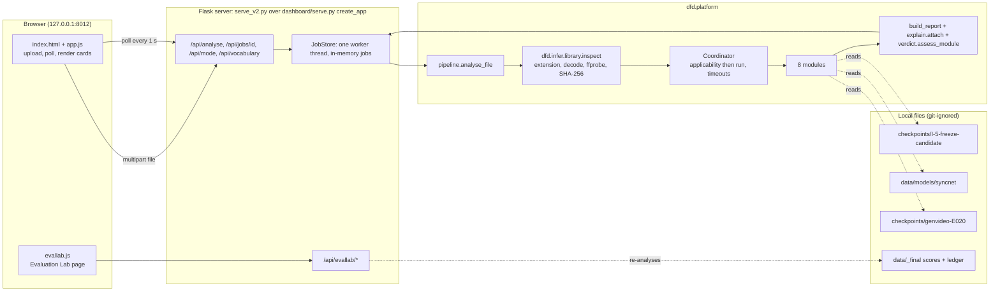
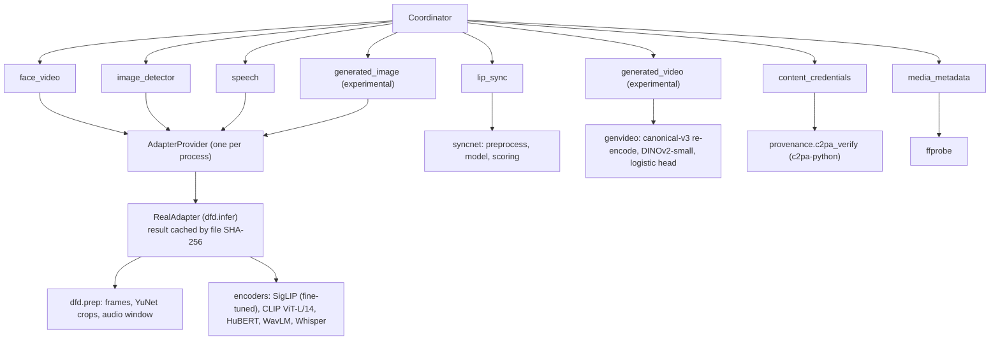
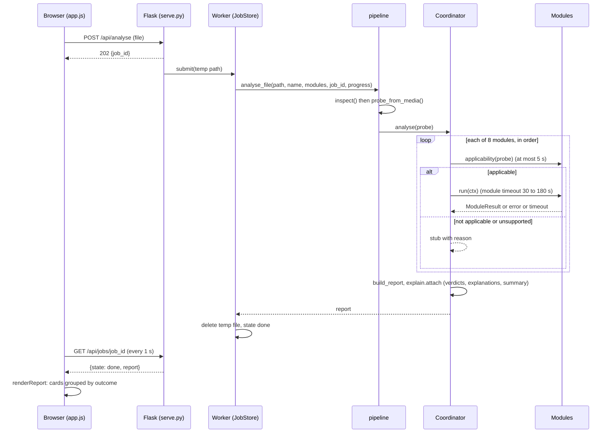
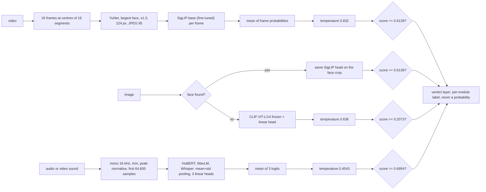

# PROJECT MASTER LEARNING GUIDE

Multimodal deepfake detection for images, video and the speech in videos. A textbook for the three authors (Shivansh Gupta, Vaibhav Shiroorkar, Adithya Jithesh) to learn, rebuild and defend the project.

Written 2026-10-30 from the repository at commit e27de9a (tag `submission-final`). Every fact here was checked against the source code or the project records; the companion file `docs/GROUND_TRUTH_INVENTORY.md` lists the status of each component, and section 6 of that file lists the places where code and documents disagree. Numbers are quoted with their experiment id (E-xxx) or decision id (D-xxx). Where something could not be established, this guide says so.

How to read it. Sections 1 to 3 give the story and the concepts. Section 4 is the architecture you must be able to draw on a whiteboard. Section 5 covers each module. Section 6 covers the research results and what they do and do not show. Section 7 is the rebuild tutorial. Section 8 compares alternatives. Section 9 is revision material, including more than 65 viva questions.

A word on authorship that you must be ready for. Git shows every commit under one account, and the records show that an AI coding agent did much of the implementation under the decisions written in docs/DECISIONS.md. In the viva, be precise and honest: say which decisions you made, which parts you implemented or checked yourselves, and which parts you understand well enough to rebuild. Section 7 exists so that each of you can rebuild every part by hand. Do not claim to have written code you did not write; claim the understanding you can show.

---

## 1. Project overview

### 1.1 The problem

A deepfake is media in which a face, a voice or a whole scene was produced or altered by a generative model so that it looks or sounds real. The project covers four kinds (D-002, DOC_FACTS section 2):

1. **Face manipulation in video**: a face is swapped (identity replaced) or re-enacted (expression driven by someone else).
2. **Fully generated images**: produced by GANs or diffusion models.
3. **Synthetic or converted speech**: text-to-speech or voice conversion.
4. **Audio and video manipulated separately** in one file (for example a lip-synced clip with cloned speech).

The system takes an image, a video (with its audio track) or an audio file, runs a set of independent checks, and shows each check's result with its scope and limits. It does not output one overall "fake" or "real" answer (D-087).

### 1.2 Why detection is hard

- **Generalisation.** A detector learns the traces of the generators in its training data. A new generator leaves different traces. A published benchmark example used in our slides: a plain Xception scores 0.9450 within its training domain and 0.7718 across datasets (context only; not our run).
- **Shortcuts.** Datasets carry cues unrelated to manipulation: codec settings, file format, image size, recording conditions, silence at the start of a clip. A model can score high by learning those cues. We measured several: codec metadata alone separates FakeAVCeleb real from fake at AUC 0.9985 (E-021); file format alone gives 0.93 on a modern image set (E-028); container headers alone give 1.0 on DeepAction (E-018).
- **Identity leakage.** If the same person appears in training and test, a model can learn "this face was fake in training" instead of manipulation traces. That inflates test scores. Our splits keep each person, speaker or source video on one side only.
- **Calibration shift.** A threshold tuned on one dataset gives very different false-alarm rates on another. Our face-video threshold flags 1.4 percent of real FF++ test videos but about 11 percent of real Celeb-DF family videos and 14 percent of real DFD videos (E-032, post hoc).
- **Compression.** Social media re-encodes video, which destroys fine traces.

### 1.3 Motivation, objectives and intended use

Motivation (report chapter 1, D-005): build a documented path from a simple working version to a frozen system, judged on a protocol we wrote and ran ourselves, so every claim can be traced to a logged experiment.

Objectives as declared (CLAUDE.md section 1, D-004, D-016):

| Objective | Outcome |
|---|---|
| A simple working version (MVP) first | Done: I-0, tag `iter-0-mvp`, 2026-10-25 (E-004) |
| At least seven iterations, each with a written hypothesis | Done: I-1 to I-7 plus I-1b, I-1c (E-005 to E-017); several were negative and are reported as such |
| Results comparable with a published detector on our own protocol | Done in the declared sense: non-inferior to a re-run Xception baseline (T3, E-014) |
| Image, video and audio coverage | Done for the three single-modality tasks; audio-visual fusion was tried and is **not** claimed (D-059) |
| rPPG (pulse) evidence as a candidate | Tried; failed its signal check (E-006); not adopted |
| Paper, report, slides | Built (submission/); see docs/FINAL_SUBMISSION_AUDIT.md for what is still missing |

Intended users: an analyst who wants independent signals about a file, on a local machine. It is a research prototype, not a production service. It binds to 127.0.0.1 only.

### 1.4 What the system can and cannot conclude

| It can say | It cannot say |
|---|---|
| "This check's score is above its decision line, within its tested scope" | "This file is fake" |
| "This check found nothing it looks for" | "This file is authentic" (the word is banned in explanations) |
| "The audio and the mouth are in step by the measured rule" | "The video was not manipulated" |
| "A signed content credential is present and valid relative to a configured trust anchor" | "The content is true" |
| "A research prototype produced a number" (experimental cards) | Anything definitive from an experimental module |

**Suspicious evidence is not proof.** A detector score is a ranking signal from a model trained on particular data. Above the line means "this file resembles the fakes the model saw more than the reals it saw". The rate of false alarms on real material varies by source (E-032), so a flag is a reason to look closer, not a determination.

### 1.5 Main contributions of the actual implementation

1. A group-disjoint evaluation protocol with a test-set guard and an append-only ledger, applied to three tasks (face video, generated images, speech).
2. A frozen system whose video and speech parts improved over the working version on sealed tests (T1 +0.1980, T2 +0.1633), and whose video part is non-inferior to a re-run Xception baseline (T3, margin 0.0100).
3. Negative results kept with their reasons: rPPG, audio-visual fusion, generated-video detection, modern generated images.
4. Shortcut audits that show where common datasets let a model cheat.
5. A local platform with eight modules, per-module verdicts, explanations, coverage reporting and failure isolation, and an Evaluation Lab that re-analyses stored scores.

### 1.6 Maturity

| Part | Maturity |
|---|---|
| Face-video, speech, image detectors | Frozen research models with sealed results; thresholds do not transfer across sources |
| Lip sync | A timing rule calibrated on real clips; not a detector of lip-sync fakes (E-025) |
| Generated image (whole image on portraits), generated video | Experimental, never make a finding |
| Metadata, content credentials | Informational and provenance only |
| Platform | Tested software (713 passed on 2026-10-29), local only, one worker thread |

---

## 2. The project in chronological phases

The chronology below is reconstructed from git history (168 commits from 2026-10-24 16:17 to 2026-10-29 14:50), tags and the dated records. Commits per day: 60, 88, 12, 0, 1, 7. Work dated 2026-10-27 in the records was committed together on 2026-10-28 (commit f417011), so the order within that day comes from the records, not from git. The plan (docs/PLAN.md) put the freeze on 2026-10-29; it actually ran on 2026-10-25 evening.

For each phase: why, question, concepts, tools, steps, files, connections, validation, results, failures and changes, alternatives, lessons, how to recreate, viva questions.

### Phase 0: Environment, rules and first literature pass (2026-10-24, tag `setup`)

1. **Why.** Nothing can be measured until the machine is verified and the rules of evidence are fixed.
2. **Question.** What hardware do we have, and what rules will keep the results honest?
3. **Concepts first.** Python virtual environments, CUDA and PyTorch versions, GPU memory, version pinning, research-integrity rules (hypothesis before run, no test-set tuning).
4. **Tools.** uv, PyTorch 2.14.1 with CUDA 13.0 wheels, nvidia-smi, git, GitHub.
5. **Steps.** Verify the GPU with nvidia-smi (RTX 5070, 12,227 MiB). Pin PyTorch cu130 in pyproject.toml. Write CLAUDE.md (rules) and the living documents. First literature pass into docs/RESEARCH.md. Scaffold the paper (IEEEtran), the report (from the college Word template) and the deck.
6. **Files.** pyproject.toml, uv.lock, CLAUDE.md, docs/*.md, paper/, report/, slides/.
7. **Connections.** Every later phase writes into the living documents set up here.
8. **Validation.** A tiny-network step-time test (float32 134.5 ms, bfloat16 77.6 ms per step at batch 256; EXPERIMENTS.md environment section).
9. **Results.** Environment ENV-DESKTOP-GPU recorded.
10. **Changes.** D-009 revised the deadline to 2026-10-30.
11. **Alternatives.** Cloud GPUs (cost and data-licence issues), conda instead of uv (slower, less reproducible lock).
12. **Lessons.** Fix the rules before the first experiment; it is impossible to fix them credibly afterwards.
13. **Recreate.** Install uv, run `uv sync`, run nvidia-smi and a tiny training loop, write down the versions.
14. **Viva.** *Why record the GPU and driver?* Results and run times depend on them; another person must be able to reproduce the environment. *Why uv?* It produces a lock file with exact versions and hashes, so `uv sync --locked` rebuilds the same environment.

### Phase 1: Data, requirements, protocol and evaluation harness (2026-10-24)

1. **Why.** The evaluation must exist before any model, otherwise model choices leak into the protocol.
2. **Question.** Which data, which labels, and how are training and test kept apart?
3. **Concepts.** Dataset licences, identity leakage, group-disjoint splits, content hashing, ROC-AUC, bootstrap intervals, sealed test sets.
4. **Tools.** Python, numpy, SHA-256 hashing, a resumable downloader (scripts/data/fetch_open.py).
5. **Steps.** Select data from requirements (D-020, D-021). Download with hash checks. Write docs/REQUIREMENTS.md and docs/PROTOCOL.md (metrics, splits, seeds, threshold policy). Build the evaluation harness: metrics, threshold, temperature scaling, group bootstrap, the `--final` guard and the ledger. Build manifests, group-aware splits, the leakage check and content de-duplication.
6. **Files.** src/dfd/data/ (builders per dataset, manifest.py, splits.py, leakage.py, dedup.py, hashing.py), src/dfd/eval/ (metrics.py, bootstrap.py, threshold.py, calibration.py, guard.py, ledger.py, run.py), docs/PROTOCOL.md, docs/DATA_LOG.md.
7. **Connections.** Every model later reads data only through the loaders, which refuse sealed splits unless `final=True`.
8. **Validation.** Acceptance checks A1 to A9 (V-001, V-002 in EXPERIMENTS.md); unit tests in tests/data and tests/eval.
9. **Results.** FF++ c23 verified (5,000 videos); splits frozen with recorded hashes.
10. **Changes.** D-045: Celeb-DF++ and Celeb-DF v2 treated as one family; 150 byte-identical real videos counted once; Celeb-DF++ samples of the 15 development identities excluded.
11. **Alternatives.** Random splits (leak identities), the official splits only (Celeb-DF v2 official test list was not used as the headline; listed as future work).
12. **Lessons.** Leakage is the most common way to fool yourself; check it with a script, not by eye.
13. **Recreate.** Write one builder per dataset producing rows (path, label, group_id, split); write a split function that assigns whole groups; write a check that no group_id or file hash is in two splits.
14. **Viva.** *What is a group here?* The unit that must not cross a split: a person identity for Celeb-DF, a speaker for audio, a connected component of source videos for FF++. *Why a ledger?* So a sealed read cannot be repeated silently; a repeat needs a written reason.

### Phase 2: Workstreams, preprocessing, sweep design and the iteration ladder (2026-10-24 night)

1. **Why.** Preprocessing is shared by training, evaluation and inference; if it differs, the deployed model sees different inputs from the ones it was tested on.
2. **Question.** How do we turn a video, image or audio file into model input, and which encoders do we compare?
3. **Concepts.** Frame sampling, face detection, crop enlargement, resampling audio, pretrained encoders, linear probes.
4. **Tools.** OpenCV (YuNet face detector), ffmpeg, soundfile.
5. **Steps.** Measure preparation speed (M-001: 6.35 videos per second with 16 workers). Compare face detectors (M-002: YuNet, UltraFace, SCRFD; YuNet chosen for its MIT licence). Measure fine-tuning cost (M-003: CLIP ViT-L/14 at batch 32 needs 13.75 GiB, so it cannot be fine-tuned on the 12 GB card). Define the development slices dev_x (D-035), the encoder shortlist (D-038), the sweep rule (D-036) and the ladder I-0 to I-8 (D-041).
6. **Files.** src/dfd/prep/ (face.py, video.py, audio.py, pipeline.py, config.py), docs/ITERATIONS.md, docs/O007_SWEEP.md, docs/WORKSTREAMS.md.
7. **Connections.** The preprocessing configuration is hashed into a preprocessing identifier stored in every checkpoint; the loader refuses a mismatch.
8. **Validation.** tests/prep; parity checks later (M-004, E-004 parity).
9. **Results.** 16 frames, YuNet, enlarge 1.3, 224 px, JPEG 95; audio 16 kHz mono, first 64,600 samples.
10. **Changes.** FF++ and Celeb-DF v2 have no audio (M-001), so audio-in-video needs LAV-DF or FakeAVCeleb.
11. **Alternatives.** RetinaFace or MTCNN for faces; more frames; full-clip audio.
12. **Lessons.** Measure the bottleneck before planning; check licences of tools, not only of data.
13. **Recreate.** Implement `sample_indices(n, 16) = floor((i + 0.5) n / 16)`, detect faces per frame, keep the largest, enlarge by 1.3, crop square, resize to 224.
14. **Viva.** *Why the largest face?* Simplicity; a multi-face video gets a MULTIPLE_FACES warning and a limitation sentence. *Why 16 frames?* A cost and coverage compromise fixed before the sweep; not tuned.

### Phase 3: Inference library, web page, encoder sweep and the MVP I-0 (2026-10-25 00:00 to 03:29, tag `iter-0-mvp`)

1. **Why.** The project rule is "simple working version first", end to end, before any improvement.
2. **Question.** Which frozen encoder is the cheapest one that is not measurably worse than the best, per task?
3. **Concepts.** Frozen features, linear heads, class-weighted cross-entropy, temperature scaling, threshold selection, paired bootstrap, tie sets.
4. **Tools.** PyTorch, transformers, timm, Flask.
5. **Steps.** Build the inference library with a fixed response contract and a mock adapter. Build the Flask page. Extract features once per encoder, train linear heads with three seeds, rank on dev_x (E-001 to E-003). Fit temperature and threshold on validation. Write checkpoint `I-0-mvp`. Check parity between the training path and the inference path. Run the page on the real checkpoint.
6. **Files.** src/dfd/infer/, src/dfd/web/, src/dfd/sweep/ (encoders.py, heads.py, rank.py), scripts/mvp/.
7. **Connections.** The checkpoint format (metadata.json with hashes, preprocessing identifier, temperatures, thresholds) is the one the platform still loads.
8. **Validation.** Parity: maximum difference 0.0019 against a tolerance of 0.02 (E-004).
9. **Results (exploratory, dev_x).** Video: leader CLIP ViT-L/14 0.7464, winner by cost DINOv2 small 0.6933. Images: CLIP ViT-L/14 0.9935. Speech: inconclusive, winner by cost HuBERT base 0.6100 (E-001 to E-004).
10. **Failures.** Speech did not transfer from ASVspoof to In-the-Wild (validation 0.99, dev_x 0.61). Temperature scaling made dev_x calibration worse for video and speech (ECE 0.2048 to 0.2217; 0.3293 to 0.4052).
11. **Alternatives.** Fine-tune from the start (costlier, no baseline diagnosis); pick the top-ranked encoder regardless of cost (the rule prefers the cheapest equivalent).
12. **Lessons.** A diagnostic battery after the MVP told us exactly what to change: video underfits (training AUC 0.8367), speech has a domain shift.
13. **Recreate.** For each encoder: features for all clips, a logistic-regression-like linear head, AUC on dev_x with a group bootstrap, then the cheapest in the tie set.
14. **Viva.** *Why not the highest-scoring encoder?* With 15 identity groups the intervals overlap; the protocol says pick the cheapest among those not distinguishable from the leader (CLAUDE.md rule 4). *Is the MVP score a probability?* Only for content like the validation data.

### Phase 4: Iterations I-1 to I-7 and the Xception baseline (2026-10-25 day)

1. **Why.** Each iteration tests one lever chosen from the previous diagnosis.
2. **Question.** Which changes improve the development-slice AUC by more than the noise?
3. **Concepts.** Fine-tuning, learning-rate schedules, data augmentation, ensembling, late fusion, rPPG.
4. **Tools.** PyTorch fp16 training, ffmpeg, the LAV-DF dataset.
5. **Steps and results (all dev_x, exploratory).** I-1: fully fine-tune SigLIP base (three encoders by three learning rates, then three seeds), dev_x 0.9096, +0.1700 [+0.1228, +0.2114] (E-005). I-2: trim silence and peak-normalise speech, +0.0623 (E-007). I-3: speech augmentation (noise, low-pass, reverb, MP3), +0.0732 (E-008). I-4: mean of three speech encoders, dev_x 0.8130, +0.0675 (E-009). I-5: LAV-DF pre-check, visual head below chance 0.3838, not tested further (E-010). I-6: in-domain LAV-DF heads, fused 0.9935, but the visual head is at chance within produced videos (0.507), so the fusion rests on a production cue (E-011); E-012 not supported (0.517). I-7: rPPG signal check failed, 0.301 against the required 0.6 (E-006). Baseline: Xception with the same recipe (E-013).
6. **Files.** src/dfd/train/finetune.py, src/dfd/prep/audio_aug.py, src/dfd/rppg/pulse.py, scripts/i1/ to scripts/i6/, scripts/baseline/, scripts/rppg/.
7. **Connections.** The final system (D-061) takes the I-1 video head, the I-0 image head and the I-4 speech head.
8. **Validation.** Each run logged before and after in EXPERIMENTS.md; three seeds; paired bootstrap.
9. **Results.** See section 6.
10. **Failures and changes.** High learning rates collapsed (sensitivity 0.40 to 0.47 in E-005). One worker crash was repeated and logged.
11. **Alternatives.** Different heads (MLP), longer training, other fusion rules.
12. **Lessons.** Fusion results can look excellent while measuring the wrong thing; always run a control that removes the suspected shortcut.
13. **Recreate.** Section 7, steps 6 to 9.
14. **Viva.** *Why is the fusion result not claimed?* Inside the produced videos the visual head is at chance, so the fused AUC mostly detects how LAV-DF produced its files, not the manipulation (D-059).

### Phase 5: User review, amendments and extra iterations (2026-10-25 evening)

1. **Why.** Before the sealed read, the user reviewed D-051 to D-061 and amended the plan (D-062).
2. **Question.** Is the confirmatory design right before we spend the one sealed read?
3. **Concepts.** Multiple comparisons, Bonferroni correction, non-inferiority margins.
4. **Steps.** Split the first confirmatory test into video (T1) and speech (T2), giving three tests, and add a 98.33 percent robustness line (D-062 b). Extend the baseline grid to 3e-4 (E-013b), giving margin delta 0.0100 (D-066). Run I-1b augmentation (E-016, does not enter) and I-1c ensemble (E-017, does not enter). Run a positive control for rPPG (M-005: an injected 1.2 Hz signal is recovered in 87 percent of clips at amplitude 0.008).
5. **Files.** src/dfd/eval/run.py (Bonferroni line), docs/DECISIONS.md D-062 to D-066.
6. **Validation.** The declaration was committed at 18:44, before the first sealed read at 20:16 (PROTOCOL addendum 2026-10-28).
7. **Lessons.** Declare the tests and their correction before looking.
8. **Viva.** *Why 98.33 percent?* Three tests; Bonferroni divides alpha 0.05 by 3, so each interval is at 1 - 0.05/3 = 98.33 percent.

### Phase 6: The sealed freeze, I-8 (2026-10-25 20:16 to 22:30, tags `base`, `iter-1` to `iter-4`)

1. **Why.** Sealed sets give the only unbiased estimate; they are read once per frozen iteration.
2. **Question.** Did the final system improve over the MVP, and is it comparable with the re-run baseline?
3. **Steps.** Score every frozen tag once with `--final --iteration <tag>`; the guard writes 74 ledger entries; run T1 to T3.
4. **Files.** scripts/freeze/score_final.py, ledger/final_ledger.jsonl, data/_final/ (local).
5. **Results.** T1 video 0.6238 to 0.8218 (+0.1980 [+0.1688, +0.2242]); T2 speech 0.7516 to 0.9148 (+0.1633 [+0.1177, +0.2266]); T3 0.8218 against 0.8042, +0.0176 [+0.0025, +0.0327], 98.33 percent interval [-0.0011, +0.0355] (E-014).
6. **Lessons.** The predictions for speech were wrong (too low); that is recorded, not hidden.
7. **Viva.** *Is the final video model better than Xception?* Non-inferior at both levels; the 95 percent superiority rule was met but does not survive the Bonferroni correction; the baseline ran at 224 px (D-091 wording).

### Phase 7: Platform sprint and the FakeAVCeleb sealed half (2026-10-26 early)

1. **Why.** One score per file hides what was and was not checked; a platform can report each check with its scope.
2. **Question.** How do we combine independent checks without inventing a joint probability?
3. **Concepts.** Interfaces and contracts, timeouts, thread isolation, JSON schemas, C2PA, SyncNet.
4. **Steps.** Module interface (applicability then run), report schema, coordinator, detector wrappers around the frozen adapter, provenance modules (metadata, C2PA), SyncNet lip-sync port, live dashboard. FakeAVCeleb split by identity (D-070) and its sealed half scored once (E-015).
5. **Files.** src/dfd/platform/ (module.py, coordinator.py, schema.py, pipeline.py, modules/, provenance/, syncnet/, dashboard/).
6. **Validation.** tests/platform*, live end-to-end scripts (scripts/platform/live_full_e2e.py).
7. **Results.** E-015: visual AUC 0.9552 but sensitivity 0.480 at the frozen threshold; audio 0.9263 with specificity 0.637: thresholds do not transfer.
8. **Viva.** *What happens if one module crashes?* The coordinator records it as failed with the reason; the other modules still run and the report is marked partial.

### Phase 8: Generated video, shortcut audits and lip-sync validation (2026-10-26)

1. **Why.** Text-to-video generators are a new threat; and FakeAVCeleb's high scores needed explaining.
2. **Steps and results.** E-018: DeepAction headers alone give AUC 1.0. E-019: canonical re-encode protocols v1 to v3 to remove container shortcuts. E-020: generated-video heads; the installed C2 head scores 0.4957 on the held-out DF26 (chance). E-021: FakeAVCeleb codec metadata gives 0.9985. E-022 to E-025: lip-sync rule; E-025 band (-6, +2) frames gives 1.3 percent false alarms on real clips and flags 0 of 160 Wav2Lip clips.
3. **Decisions.** D-072: the generated-video head is experimental and never makes a finding. D-074: `APPROVED_HEADS` stays empty.
4. **Integrity caveat.** E-019 to E-025 entered git in one commit with their scripts, so git cannot prove the hypotheses preceded the runs (docs/RESEARCH_INTEGRITY.md). Say this if asked.
5. **Viva.** *Why keep a module that is at chance?* It shows the honest state, never makes a finding, and its card explains why; removing it would hide a negative result.

### Phase 9: Modern generators, redesign, verdict layer and the Evaluation Lab (2026-10-27, committed 2026-10-28)

1. **Steps and results.** E-026: the generated-video head flags 77 percent of real FF++ and LAV-DF clips. E-027: heads trained on DF26 stay source-confounded (0.8023). E-028: the frozen image head on 21 modern generators: macro AUC 0.7039, misses 74 percent. E-029: a retrained head ranks better (0.8839) but flags 52 percent of real images, so it is not installed (D-086). E-030: speech EER computed post hoc. E-032: false-alarm rates of the video threshold, post hoc.
2. **Platform.** Dashboard redesign (D-076), explanations (schema 2.1), verdict layer with per-module labels (D-087; face-video label changed to "Possible manipulation" by the user on 2026-10-28), Evaluation Lab (D-088).
3. **Integrity caveat.** For E-026 to E-030 the ordering evidence is a hash of the preregistration written before each run (`prereg.json`), weaker than a commit.
4. **Viva.** *Why per-module verdicts and no overall verdict?* The modules look at different evidence with different calibrations; no measured joint error model exists to combine them.

### Phase 10: Deliverables v2 and the submission package (2026-10-28 evening to 2026-10-29)

1. **Steps.** Shorter paper (8 IEEE pages plus college front matter), report (37 pages), deck (14 main plus 10 backup slides), redesigned website (deliverables_v2/website), claim fixes A1 to A10, submission folder with manifest. Tags `submission-v2`, `submission-final`.
2. **Decisions.** D-089 (author order Shivansh, Vaibhav, Adithya), D-090 (originals are an archive), D-091 (T3 wording), D-092, D-093.
3. **What is still missing** for the college tasks: signatures, contribution statements, DOI, MP4 demo, a 40-paper review (docs/FINAL_SUBMISSION_AUDIT.md).


---

## 3. Technologies and concepts, taught from first principles

Each entry covers: what it is; why we needed it; prerequisites; how it works; where it is in our code; input and output; configuration; strengths and limits; common mistakes; alternatives; why we chose it (only where the records say); what to learn to build it yourself; three viva questions with answers.

### 3.1 Python project structure, uv and the lock file

- **What.** A Python package `dfd` under `src/` (src layout), dependencies in `pyproject.toml`, exact versions and hashes in `uv.lock`, a virtual environment in `.venv`.
- **Why.** Reproducibility: the same code must run the same way on another machine.
- **Prerequisites.** Python modules and imports, virtual environments, pip.
- **How.** `uv sync` reads the lock and installs exactly those versions into `.venv`. PyTorch comes from a CUDA 13.0 index declared in pyproject.toml. Optional features are "extras" (`--extra c2pa`); development tools are the "dev group".
- **In our code.** pyproject.toml, uv.lock; scripts run as `PYTHONPATH=src .venv/Scripts/python.exe ...`.
- **Strengths.** Exact reproducible installs. **Limits.** scipy and Pillow are imported at run time but arrive only through other packages (not declared directly).
- **Mistakes.** A plain `uv sync` after installing the c2pa extra removes it again; use `uv sync --extra c2pa` every time (SETUP.md section 2).
- **Alternatives.** pip with requirements.txt (no hashes by default), conda (heavier), Poetry.
- **To learn.** Packaging basics, semantic versions, how a lock differs from a requirements list.
- **Viva.** *What does the lock file guarantee?* The exact version and hash of every installed package. *Why src layout?* Tests import the installed package, not stray files in the working directory. *Why pin torch to cu130?* The RTX 5070 needs a recent CUDA build; the pin keeps runs comparable.

### 3.2 Neural-network basics: encoders, linear heads, loss, optimiser

- **What.** An *encoder* turns an input (image or audio) into a vector of numbers (a feature vector or embedding). A *linear head* is one weighted sum plus a bias, followed by a sigmoid, that turns the feature into a score between 0 and 1.
- **Why.** Training a large network from scratch needs far more data and compute than we had; a pretrained encoder already captures useful structure.
- **How, step by step.** For a feature vector x of length d, the head computes z = w.x + b (the *logit*) and p = sigmoid(z) = 1 / (1 + e^(-z)). Training minimises *binary cross-entropy* L = -[y log p + (1 - y) log(1 - p)], with y = 1 for fake and 0 for real. Each class is weighted by w_y = n / (2 n_y), so a rare class counts as much as a common one (*class-balanced* loss). The optimiser *AdamW* updates weights using running averages of the gradient and of its square, plus decoupled weight decay (shrinks weights slightly each step).
- **In our code.** src/dfd/sweep/heads.py: features standardised (mean 0, variance 1, fitted on training data), one Linear layer, class-weighted BCE, AdamW lr 1e-3, weight decay 1e-4, batch 1,024, up to 200 epochs, early stop on validation AUC with patience 10, seeds 0, 1, 2.
- **Input and output.** Feature matrix and labels in; weights w, b out (saved as `.npz`).
- **Strengths.** Cheap, fast, few hyperparameters, hard to overfit. **Limits.** Cannot fix an encoder whose features lack the needed information (the video MVP underfit: training AUC 0.8367).
- **Mistakes.** Fitting the standardisation on all data (leak); early stopping on the test set.
- **Alternatives.** Logistic regression in scikit-learn (equivalent), a small MLP, an SVM.
- **Viva.** *What is a logit?* The value before the sigmoid, log(p / (1 - p)). *Why class weights?* The Celeb-DF family test is about 90 percent fake; without weights a model can score well by favouring "fake". *Why three seeds?* To see how much the result moves with random initialisation and data order; we report mean and spread.

### 3.3 Vision encoders: CLIP, SigLIP, DINOv2 and the CNN baselines

- **What.** *Vision Transformers* (ViT) cut an image into patches (for example 16 by 16 pixels), embed each patch as a vector and mix them with self-attention layers. *CLIP* (OpenAI) and *SigLIP* (Google) were trained to match images with their captions; *DINOv2* (Meta) was trained by self-supervision (agreeing on different views of one image). *EfficientNet-B4* and *Xception* are convolutional networks (CNNs) trained on ImageNet classes.
- **Why.** The encoder sweep (E-001, E-002) compared them under one protocol.
- **Self-attention in one line.** Each patch forms a query q, key k and value v; the output for a patch is a weighted average of all values with weights softmax(q.k / sqrt(d)), so any patch can use information from any other.
- **In our code.** src/dfd/sweep/encoders.py loads each encoder (weights hash-checked against data/_logs/encoder_weights.json). The frozen system uses SigLIP base (fine-tuned) for face video and OpenAI CLIP ViT-L/14 (frozen) for whole images.
- **Input and output.** A 224 by 224 RGB image in; a feature vector (for example 768 or 1,024 numbers) out.
- **Results (dev_x, exploratory).** Face video: CLIP ViT-L/14 0.7464, SigLIP base 0.7396, DINOv2 small 0.6933, EfficientNet-B4 0.6471, Xception 0.6162 (E-001). Generated images: CLIP ViT-L/14 0.9935 (E-002).
- **Strengths.** Vision-language encoders transferred well to older generated images in our sweep. **Limits.** CLIP ViT-L/14 weights have no licence in the repository and are treated as research-only (D-038); large models do not fit fine-tuning on 12 GB (M-003).
- **Alternatives.** DINOv3 (excluded: manual access gate), ConvNeXt, Swin.
- **Why chosen.** The tie-set rule: the cheapest encoder not distinguishable from the leader (D-036).
- **Viva.** *Why did CLIP-type encoders do better on generated images?* Trained on very varied web images, their features capture general image statistics; our dev slice has only 2 generator units, so this is exploratory. *Why fine-tune SigLIP and not CLIP ViT-L/14?* CLIP ViT-L/14 needs 13.75 GiB at batch 32, more than the card (M-003). *What does frozen mean?* The encoder weights are not updated; only the head is trained.

### 3.4 Fine-tuning

- **What.** Updating all weights of a pretrained encoder on our task, not only the head.
- **Why.** The MVP video head underfit (training AUC 0.8367): frozen features did not separate fakes well enough (D-051).
- **How.** Start from pretrained weights; train encoder and head with a small learning rate so useful pretrained structure survives. A *cosine schedule with warm-up* raises the learning rate linearly for the first 5 percent of steps, then lowers it along a cosine curve. *fp16 autocast* computes in half precision for speed and memory; *gradient scaling* stops small gradients rounding to zero.
- **In our code.** src/dfd/train/finetune.py: full vision tower, AdamW (betas 0.9, 0.999), weight decay 0.05, 5 percent warm-up then cosine, 1,800 steps of batch 32 (one pass over 57,600 FF++ training frames), class-balanced BCE. Selected: SigLIP base at lr 1e-5 (E-005).
- **Results.** dev_x 0.9096, +0.1700 [+0.1228, +0.2114] over the frozen probe of the same encoder (E-005); sealed Celeb-DF family 0.8218 (E-014).
- **Mistakes.** Too high a learning rate: in E-005 high rates collapsed (sensitivity 0.40 to 0.47). Choosing the learning rate on the test set.
- **Alternatives.** Partial fine-tuning (last blocks), LoRA adapters, augmentation (I-1b, did not enter).
- **Viva.** *Why one pass over the data?* A fixed budget per run (D-042) so 9 configurations could be compared fairly. *Why weight decay 0.05 and not more?* At lr 1e-5 and 1,800 steps decay shrinks weights by about exp(-lr x wd x steps), under 0.1 percent, so it is not a real regulariser here (D-063). *What did fine-tuning fix?* Underfitting; not the false-alarm shift across datasets (E-032).

### 3.5 Video preprocessing: frame sampling and face processing

- **What.** Turning a video into up to 16 face crops.
- **How.** (1) Read the frame count N from the header. (2) Pick indices idx_i = floor((i + 0.5) N / 16) for i = 0..15, the centres of 16 equal segments. (3) Detect faces with YuNet (OpenCV `FaceDetectorYN`, score threshold 0.6, non-maximum suppression 0.3, frame downscaled to at most 640 px on the long side). (4) Keep the largest face. (5) Enlarge its box by 1.3, make it square, pad with black outside the frame, resize to 224 px, re-encode as JPEG quality 95 so inference crops match the stored training crops. (6) Frames without a face are dropped and counted.
- **Where.** src/dfd/prep/video.py, face.py, pipeline.py; at inference src/dfd/infer/real_adapter.py.
- **Clip score.** Mean of per-frame probabilities, then temperature scaling.
- **Strengths.** Simple and deterministic; identical in training and inference (checked by the preprocessing identifier and a parity test). **Limits.** Largest face only; no temporal model; no face, no score.
- **Mistakes.** Different crops in training and inference; sampling only the first frames.
- **Alternatives.** RetinaFace, MTCNN, SCRFD (non-commercial weights); temporal models over frame sequences.
- **Viva.** *What is non-maximum suppression?* Removing overlapping boxes, keeping the highest-scoring one when overlap (IoU) exceeds 0.3. *Why enlarge by 1.3?* Blending artefacts often sit at the face boundary, so the crop keeps some context. *Why JPEG 95 at inference?* Training crops were stored as JPEG 95; matching keeps the input distribution the same.

### 3.6 Audio preprocessing and speech encoders

- **What.** A 4-second window and features from three self-supervised speech models.
- **How.** ffmpeg converts to mono float32 at 16 kHz. Since I-2 (E-007), leading and trailing samples with |x| <= 0.005 are trimmed and the signal is peak-normalised (divided by its largest absolute value). The first 64,600 samples (about 4.04 s) are kept; shorter clips are repeat-padded. Each encoder (HuBERT base, WavLM base plus, Whisper small encoder) gives a sequence of vectors; we take mean and standard deviation over time (2 x 768 numbers). Each has a linear head; the speech score is the mean of the three logits, then temperature.
- **Self-supervised speech models.** HuBERT and WavLM learn by predicting masked parts of the audio from the rest; Whisper's encoder was trained for speech recognition. Their features capture phonetic and acoustic structure that synthesis can get subtly wrong.
- **Where.** src/dfd/prep/audio.py, audio_aug.py (I-3: noise at 5 to 30 dB SNR with probability 0.7, low-pass, reverb, MP3), src/dfd/sweep/encoders.py, src/dfd/platform/modules/speech.py.
- **Why the trim.** M-004 found leading silence and loudness separate real from fake in opposite directions on ASVspoof and In-the-Wild (silence AUC 0.375 against 0.719). The trim removes that shortcut. Part of the speech gain (0.061 of 0.163) is that removal, not better detection.
- **Limits.** Only the first 4 s are scored; any sound (even a pure tone) gets a score; calibration did not transfer.
- **Alternatives.** AASIST (graph attention on the raw waveform; quoted at EER 1.13 percent on ASVspoof 2019 LA, not re-run), RawNet2, LFCC features with a Gaussian mixture model.
- **Viva.** *What is peak normalisation?* x / max|x|, so the loudest sample is 1; it removes overall level as a cue. *Why average logits?* Logits are additive evidence; averaging them is less dominated by one over-confident model than averaging probabilities. *What is SNR?* Signal-to-noise ratio in decibels, 10 log10(P_signal / P_noise).

### 3.7 Lip-sync analysis with SyncNet

- **What.** SyncNet (Chung and Zisserman) embeds 5 frames of the mouth region and the matching audio (MFCC features) so that in-sync pairs are close.
- **How we use it.** Video resampled to 25 fps, up to 30 s; YuNet face track; mouth crops; MFCCs. For each offset from -15 to +15 frames, compute the mean distance between the embeddings. The *offset* is the shift with the smallest distance; the *confidence* is median distance minus minimum distance. Confidence at least 3.0 and offset inside [-6, +2] frames gives "No audio-visual mismatch found"; outside the band, "Possible audio-visual mismatch (weak evidence)"; guards give "Inconclusive" (short clip, no audible audio, non-speech audio, several faces, offset at the search edge).
- **Where.** src/dfd/platform/syncnet/ (model.py, preprocess.py, scoring.py), src/dfd/platform/modules/lip_sync.py.
- **Evidence.** E-025: band fitted on 230 real clips and validated on 230 disjoint real clips: 3 false alarms of 230 (1.3 percent). It flagged 0 of 160 Wav2Lip fakes: Wav2Lip makes well-timed mouths.
- **Limits.** Timing only; the confidence threshold was chosen on the E-022 cases themselves; weights licence not stated.
- **Viva.** *Why is this not a deepfake detector?* It measures offset; a good lip-sync fake has none (0 of 160). *What is an MFCC?* Log energies in mel-spaced frequency bands passed through a discrete cosine transform: a compact short-term spectrum. *Why 25 fps?* SyncNet was trained at 25 fps, so one frame is 40 ms.

### 3.8 Generated-image detection

- **What.** Deciding whether an image was produced by a generator. Our T-I head is a frozen CLIP ViT-L/14 with a linear head trained on ProGAN images (14 LSUN classes; 6 other classes for validation).
- **Results.** Old generators: ProGAN 1.0000, CNN-synthesis set 0.9316, diffusion set 0.9354 (E-014). Modern generators (21 in Community Forensics-Eval): macro AUC 0.7039, misses 74 percent at the frozen threshold (E-028). A retrained head: 0.8839 but flags 52 percent of real images (E-029); not installed.
- **Portrait card.** When an image has a face, the image detector uses the face-swap model on the face crop; an experimental card (`generated_image`) also scores the whole image with T-I and never makes a finding (D-083).
- **Viva.** *Why does the head fail on new generators?* It learned ProGAN-era traces; modern diffusion leaves different ones; file format and size also act as shortcuts (format alone AUC 0.93, E-028). *Why not install the E-029 head?* Its false-alarm rate at its threshold is 0.52 (D-086). *Can it detect Gemini images?* Not tested (E-031 proposed only).

### 3.9 Generated-video analysis

- **What.** An experimental card. Video is canonically re-encoded (first 2 s, 7 fps, centre crop 224, H.264 CRF 23, metadata stripped) to remove container shortcuts; 8 frames go through DINOv2-small; the mean CLS embedding goes to a logistic regression (head E020-C2-seed0, an *appearance baseline*, not the ReStraV trajectory method).
- **Results.** Held-out DF26 0.4957, chance (E-020); flags 77 percent of real FF++ and LAV-DF clips (E-026). `APPROVED_HEADS` is empty, so it never makes a finding (D-074).
- **Viva.** *Why re-encode first?* E-018: container headers alone separate DeepAction real from fake perfectly. *What is a CLS embedding?* The output vector of a special token a ViT uses to summarise the image. *What would enable it?* A preregistered independent validation that passes, then a reviewed change adding the head's hash (SETUP.md section 8).

### 3.10 Evaluation metrics

Label y = 1 for fake (positive), 0 for real. A threshold t gives a decision: fake if s >= t.

- **Counts.** TP fakes flagged, FN fakes missed, TN reals passed, FP reals flagged.
- **Sensitivity (recall, TPR)** = TP / (TP + FN). **Specificity (TNR)** = TN / (TN + FP).
- **False-positive (false-alarm) rate** FPR = FP / (FP + TN) = 1 - specificity. **Miss rate** FNR = FN / (FN + TP) = 1 - sensitivity.
- **Balanced accuracy** = (TPR + TNR) / 2.
- **ROC curve.** TPR against FPR as t moves from high to low.
- **ROC-AUC.** Area under the curve. The equivalent definition our code uses (Mann-Whitney): AUC = (1 / (n1 n0)) x sum over fakes i and reals j of [1(s_i > s_j) + 0.5 x 1(s_i = s_j)]. It is the probability that a random fake outscores a random real. 0.5 is chance, 1.0 is perfect ranking, below 0.5 is a reversed ranking. It needs no threshold.
- **EER.** The error where FPR = FNR. Code: threshold minimising |FPR - FNR|, report (FPR + FNR) / 2.
- **Where.** src/dfd/eval/metrics.py (`roc_auc`, `eer`, `balanced_accuracy`, `precision_recall`, `log_loss`, `brier`, `ece`). TPR at a fixed FPR is not in the package (only in ad hoc scripts).
- **Mistakes.** Accuracy on imbalanced data (always saying "fake" scores 90 percent on the Celeb-DF family); reading AUC as accuracy; reusing a threshold across datasets.
- **Viva.** *Our video AUC is 0.82: is that 82 percent accuracy?* No: a random fake outranks a random real 82 percent of the time; accuracy depends on threshold and class balance. *Why AUC as headline?* Threshold-free and insensitive to class balance. *Why also false-alarm rates?* Users meet a threshold; E-032 shows its false-alarm rate ranges from 1.4 to 14 percent by source.

### 3.11 Calibration: temperature scaling, log loss, Brier, ECE

- **What.** Calibrated means: of files given 0.7, about 70 percent are fake.
- **Temperature scaling.** p' = sigmoid(z / T), with T fitted to minimise negative log-likelihood on validation. T > 1 softens, T < 1 sharpens. Strictly increasing, so ranking and AUC are unchanged.
- **Log loss** = mean of -[y log p + (1 - y) log(1 - p)] (p clipped to [1e-7, 1 - 1e-7]). **Brier** = mean (p - y)^2. **ECE** with 15 equal bins: sum over bins of (n_bin / n) x |accuracy_bin - confidence_bin|.
- **Where.** src/dfd/eval/calibration.py (`fit_temperature`, bisection on 1/T in [0.01, 100]), metrics.py.
- **Our finding.** Calibration fitted on validation did not carry over: dev_x ECE got worse after scaling for video (0.2048 to 0.2217) and speech (0.3293 to 0.4052) (E-004). Hence the product never calls a score a probability (`is_probability` false, D-087).
- **Viva.** *Does temperature scaling change AUC?* No, it is monotonic. *Why fit it then?* To make scores interpretable in-domain and put thresholds on a common scale. *Why is 0.7 not a 70 percent chance?* Calibration is in-domain only and measurably off elsewhere.

### 3.12 Threshold selection

- **Rule.** On validation data, consider midpoints between adjacent distinct scores, choose the one with the highest balanced accuracy, ties to the value closest to 0.5 (src/dfd/eval/threshold.py, D-024).
- **Frozen values.** T-V 0.6139 (FF++ validation), T-I 0.2073 (ProGAN validation), T-A 0.6954 (ASVspoof 2019 LA development).
- **A subtle point.** The checkpoint metadata says thresholds were chosen "on calibrated probabilities"; PROTOCOL.md section 5 describes choosing before temperature scaling. Temperature scaling is strictly increasing, so the same validation files fall on each side of either line and the validation balanced accuracy is identical; only a new score lying between two adjacent validation scores could be classified differently. The sealed AUCs do not depend on the threshold at all.
- **Viva.** *Why balanced accuracy and not Youden's J?* Same criterion: J = TPR + TNR - 1 = 2 BA - 1. *Why not tune on test?* It makes the test result optimistic (CLAUDE.md rule 3). *Why does the threshold not transfer?* Score distributions shift with source, compression and identity (E-015, E-032).

### 3.13 Confidence intervals: group bootstrap, paired comparison, Bonferroni, non-inferiority

- **Bootstrap.** Resample the test set with replacement B = 2,000 times, recompute the metric, take the 2.5th and 97.5th percentiles as the 95 percent interval (*percentile bootstrap*).
- **Group (cluster) bootstrap.** Resample whole groups (identities, speakers), not files. Files of one person are correlated; resampling files pretends there is more independent evidence than there is. The Celeb-DF family test has 7,650 videos in 344 groups (44 identities and 300 single YouTube videos).
- **Paired comparison.** Compare models A and B on the same resamples and take the difference each time; shared difficulty cancels, so the interval is narrower than comparing two separate intervals.
- **Seeds.** Within each resample, the metric is averaged over the three seeds.
- **Bonferroni.** k tests at overall error 0.05: each at 0.05 / k. Three tests: 98.33 percent intervals.
- **Non-inferiority.** Lower end of the interval of (ours minus baseline) above -delta. Delta = 0.0100, fixed beforehand from the baseline's seed spread (D-060, D-066). *Superiority* needs the lower end above 0.
- **Where.** src/dfd/eval/bootstrap.py (`ClusterResampler`, `cluster_bootstrap`, `paired_bootstrap`, `paired_from_evaluators`), run.py lines 286 to 294. Seed 20261024.
- **One-class resamples.** AUC is undefined if a resample has only one class; the code redraws it and reports the count (not stratified).
- **Viva.** *How can intervals overlap and the paired difference still exclude zero?* Pairing removes shared variation; overlap of separate intervals is a weak test. *What does T3 show?* +0.0176 [+0.0025, +0.0327] at 95 percent; [-0.0011, +0.0355] at 98.33 percent: non-inferior at both, superiority does not survive the correction. *Why bootstrap and not DeLong?* DeLong assumes independent files; the group bootstrap respects identity clustering.

### 3.14 Data provenance, identity-aware splits and leakage

- **Split names.** train; val (validation); dev_x (development slice of a cross-dataset source, used to rank candidates, read many times); test_in (sealed, same source as training); test_x (sealed, other sources).
- **Group rules.** Celeb-DF: target identity; FF++: connected component of source ids in the official pairs; DFD: actor; ASVspoof and In-the-Wild: speaker; ProGAN: LSUN class; FakeAVCeleb: identity halves by salted SHA-256 within race by gender cells (D-070).
- **De-duplication.** SHA-256 of content; byte-identical files across splits removed (150 Celeb-DF++ reals duplicated Celeb-DF v2).
- **Where.** src/dfd/data/splits.py, leakage.py, dedup.py, identity_exclusion.py, fakeavceleb_split.py; split records in data/_splits/*.json (local).
- **Limits.** LAV-DF metadata has no identity ids; its split relies on the authors' statement.
- **Viva.** *What is leakage?* Test-side information present in training, inflating scores. *A concrete example?* The same celebrity in train and test lets the model learn the identity. *How do you show there is none?* A script checks that no group id and no file hash appears in two splits (tests/data/test_data_leakage.py, acceptance checks).

### 3.15 Experimental design, baselines, ablation and confounds

- **Hypothesis before run.** Each experiment states hypothesis, success line and failure line in EXPERIMENTS.md first.
- **Baseline.** A re-run published architecture (Xception) on the same data, split, budget and metric.
- **Ablation.** Change one component and measure the effect (each iteration is one lever).
- **Confound or shortcut.** A variable correlated with the label in a dataset that is not the manipulation (codec, format, silence). Test it by training on that variable alone: a high AUC means a shortcut exists (E-018, E-021, E-028).
- **Control.** Check that the effect disappears when the suspected cause is removed (E-011 within-produced control; E-023 codec-matched control).
- **Viva.** *Exploratory versus confirmatory?* Confirmatory tests were declared before a single sealed read (T1 to T3); everything else is exploratory, post hoc or context. *Why keep failed runs?* Hiding them biases the record (CLAUDE.md rule 2). *Why is a dev-slice gain only exploratory?* The slice was used to choose; reusing it inflates the estimate.

### 3.16 rPPG (remote photoplethysmography)

- **What.** Blood flow changes skin colour slightly with each heartbeat; a camera can sometimes recover the pulse. Some papers proposed that fakes lack a coherent pulse.
- **How (POS, Wang et al. 2017).** Average skin pixels per frame in RGB; normalise; project onto a plane orthogonal to skin tone to cancel lighting; analyse 0.7 to 3 Hz (42 to 180 beats per minute); find the spectral peak; compare its signal-to-noise ratio with time-shuffled controls.
- **Where.** src/dfd/rppg/pulse.py, scripts/rppg/.
- **Result.** S-1 failed: pulse above the shuffled control in 30.1 percent of real clips against 60 percent required (E-006). A positive control recovered an injected 1.2 Hz signal in 87 percent of clips at amplitude 0.008 (M-005): the pipeline works; the compressed videos do not carry a recoverable pulse.
- **Viva.** *Why stop after S-1?* The rule written beforehand: no separation test if the pulse is not recoverable (D-052). *What did the control show?* The failure was not a pipeline bug. *Is rPPG useless?* Not shown in general; not recoverable from these compressed datasets.

### 3.17 Backend: Flask, the job queue, the coordinator

- **What.** A Flask web server with JSON endpoints, one background worker thread, and a coordinator that runs the modules.
- **How.** The browser posts the file to `/api/analyse`; the server saves it to a temporary folder and returns 202 with a job id; the worker processes jobs in order; the browser polls `/api/jobs/<id>` every second. The coordinator runs modules one at a time (one shared GPU), each in a daemon thread with a timeout; anything a module does wrong becomes a status in the report.
- **Where.** src/dfd/platform/dashboard/serve.py (`create_app`, `JobStore`), pipeline.py, coordinator.py, module.py, schema.py, explain.py, verdict.py; deliverables_v2/website/serve_v2.py.
- **Limits.** In-memory jobs; one worker; no overall timeout; a timed-out thread is abandoned, not killed (a GPU module is skipped while an abandoned GPU thread is alive).
- **Alternatives.** FastAPI with async workers; Celery with Redis; a model server such as TorchServe.
- **Why chosen.** D-043: Flask is small and enough for a local prototype.
- **Viva.** *Why 202 and polling?* Analysis takes seconds to minutes; the request returns at once and the page shows progress. *Why one module at a time?* They share a 12 GB GPU. *What protects the report from a broken module?* `_run_one` turns exceptions, timeouts and contract violations into statuses; each module appears exactly once.

### 3.18 Frontend

- **What.** Plain HTML, CSS and JavaScript with no framework and no external scripts: deliverables_v2/website/static/index.html, app.css, app.js, evallab.js.
- **How.** `startAnalysis` posts a FormData; `pollJob` polls; `renderReport` builds one card per module grouped by outcome, with a bar labelled "Model output, not a probability" and an explanation panel.
- **Viva.** *Why no framework?* A small local page with no build step and no third-party code to audit. *How does it avoid implying a probability?* The bar label, and a summary chart that counts checks and says it is not a score. *What happens without --live?* Invented fixtures under a MOCK banner.

### 3.19 C2PA content credentials

- **What.** C2PA is a standard for signed provenance manifests embedded in media. A manifest records who signed which claims (for example the capture device, edits, or a declared AI-generation source type).
- **How we use it.** c2pa-python 0.38.0 reads the manifest offline (remote fetch and OCSP off) and validates signature and hashes. Without a trust anchor, a valid signature reads Inconclusive (valid signer, not trusted); with an anchor in `DFD_C2PA_TRUST_ANCHORS`, "Content credentials verified". Tampering gives "invalid". No manifest gives "No content credentials found". Without the library, only marker bytes are scanned.
- **Limits.** Most media has no credentials; absence proves nothing; sidecar and cloud manifests and watermarks (such as SynthID) are not checked; a valid credential attests signed claims, not truth.
- **Viva.** *Is a file without credentials suspicious?* No. *Why does a validly signed file show Inconclusive by default?* No trust list is bundled, so the signer is not established. *What does a declared AI source type mean?* The signer says so; it is a statement, not a detection.

### 3.20 Testing, reproducibility and auditability

- **What.** pytest unit and integration tests (51 files), Playwright browser tests, live end-to-end scripts, a documentation checker, the ledger, and the submission manifest of hashes.
- **Last record.** 713 passed, 2 skipped (opt-in GPU tests), 13 deselected (data-dependent) on 2026-10-29. The 13 data tests were not re-run recently.
- **Viva.** *What do the tests prove?* That the software behaves as specified (contracts, failure isolation, wording rules), not detection accuracy. *Why hide the GPU in tests?* Determinism and portability (`CUDA_VISIBLE_DEVICES=-1`; an empty value does not hide it on this machine). *How can an examiner check the submitted files?* MANIFEST.txt lists SHA-256 hashes.

### 3.21 Git and repository discipline

- **Practice.** Small typed commits, tags per frozen iteration, data and checkpoints kept out of git with hashes recorded, numbered decisions, mistakes recorded in STATUS.md.
- **Limit.** All commits are under one account; history cannot show who did what.
- **Viva.** *Why are checkpoints not in git?* Size and licences (non-commercial data, research-only weights). *What does a tag give?* A fixed name for the exact code state of a frozen iteration. *How do you know sealed sets were read once?* 76 ledger entries, 0 repeats; the guard refuses a repeat without a written reason.

---

## 4. End-to-end architecture

The real sequence, corrected from the code: browser upload, then a 202 job id, then the worker, then input validation (`inspect`), then a probe, then eight modules in fixed order through the coordinator, then report assembly, then explanations and per-module verdicts, then the browser renders cards. There is no fusion step and no overall verdict.

### 4.1 System architecture



| Edge | Data passed | Implemented by |
|---|---|---|
| UI to API | multipart field `file` | app.js `startAnalysis`; serve.py `analyse` |
| API to JobStore | temp file path, original basename | `JobStore.submit` (serve.py) |
| JobStore to pipeline | path, filename, module list, job id as request id, progress callback | `JobStore._run` calls `pipeline.analyse_file` |
| pipeline to inspect | path and name | `dfd.infer.library.inspect` returns a Media record or raises `InputError` (UNSUPPORTED_MEDIA_TYPE, UNREADABLE_FILE, EMPTY_FILE) |
| inspect to coordinator | `Probe` (media type, streams, duration, size, sha256) | `module.probe_from_media` |
| coordinator to modules | `Context` (probe, shared cache view, progress, cancel event) | `Coordinator._run_one` |
| modules to report | `ModuleResult` per module (status, finding, score, scope, limitations, warnings, model block) | `schema.validate_module_result`, `build_report` |
| report to browser | JSON report schema 2.1 with `assessment` and `explanation` per module and a `summary` | `explain.attach`; `/api/jobs/<id>`; app.js `renderReport` |
| modules to local files | weights and heads, hash-checked | `infer/checkpoint.py`, `lip_sync.weights_sha256`, `generated_video` applicability |
| Lab to score files | stored CSVs; final splits only if the file hash is in the ledger | `evallab/analysis.py` |

### 4.2 Component interaction



The four adapter modules share one `RealAdapter` run per file: `face_video`, `image_detector`, `speech` and `generated_image` read the same cached result (key `dfd_adapter_result:<sha256>`), so the encoders run once per file.

### 4.3 Sequence of one request (a video with sound)



### 4.4 Model and data flow inside the detectors



### 4.5 Repository map

| Path | What lives there |
|---|---|
| src/dfd/data/ | dataset builders, manifests, splits, leakage and de-duplication checks, loaders with the sealed-split refusal |
| src/dfd/prep/ | frame sampling, face detection and crops, audio loading and augmentation, preprocessing config hash |
| src/dfd/sweep/ | encoder loading and feature extraction, linear heads, ranking rule, cost records |
| src/dfd/train/ | fine-tuning |
| src/dfd/eval/ | metrics, threshold, temperature, group bootstrap, guard, ledger, evaluation runner |
| src/dfd/rppg/ | the POS pulse signal check |
| src/dfd/infer/ | frozen v1 inference: checkpoint loader, real and mock adapters, response schema (protected) |
| src/dfd/web/ | frozen v1 single-score page (protected; do not demonstrate) |
| src/dfd/platform/ | module interface, coordinator, pipeline, schema, explanations, verdict layer, modules/, provenance/, syncnet/, genvideo/, evallab/, dashboard/ |
| deliverables_v2/website/ | the current front end and its wrapper server |
| deliverables_v2/research_paper, project_report, presentation, figures | build scripts of the v2 deliverables |
| scripts/ | one folder per experiment family (mvp, i1 to i6, baseline, rppg, freeze, genvideo, lipsync_eval, modern_image, modern_video, platform, eval) |
| tests/ | 51 test files mirroring src/ |
| docs/ | the living documents (decisions, experiments, protocol, data log, status, this guide) |
| ledger/final_ledger.jsonl | the record of sealed reads |
| submission/ | the package handed in: PDFs, sources, records, manifest |
| paper/, report/, slides/ | archived originals (do not submit, D-090) |
| checkpoints/, data/ | local only, git-ignored |

---

## 5. Every module, in detail

Common rules for all modules. A module first answers `applicability(probe)` (applicable, not applicable with a reason, or unsupported) and then `run(ctx)`. A result has a `finding` (`indicates_manipulation`, `no_indication_within_tested_scope`, `potential_mismatch`, `consistent`, `inconclusive`, credential findings), a `score` object `{value, meaning, calibrated, threshold}`, a `tested_scope`, `limitations`, `warnings` and a `model` block with the weights hash and the evaluation line. The verdict layer then maps it to a label.

### 5.1 face_video

| Field | Content |
|---|---|
| Task | Face swap or re-enactment in a video |
| Input and preprocessing | Video with a video stream; 16 frames; YuNet largest face; 1.3 crop; 224 px; JPEG 95 |
| Architecture and source | SigLIP base (google/siglip-base-patch16-224, Apache-2.0 tag), fully fine-tuned, plus linear head; file `weights_T-V.pt` |
| Pretrained or trained | Pretrained encoder, fine-tuned by us on FF++ c23 train (E-005) |
| Training procedure | AdamW lr 1e-5, wd 0.05, 1,800 steps of batch 32, cosine with warm-up, fp16, class-balanced BCE, seeds 0 to 2 |
| Output | Mean frame probability after temperature 0.832, in [0, 1]; a model output, not a probability on other sources |
| Threshold | 0.6139, max balanced accuracy on FF++ validation (D-024) |
| Results | Sealed: Celeb-DF family 0.8218 [0.8020, 0.8393]; Celeb-DF v2 0.8999; DFD 0.8797; Celeb-DF++ fakes with v2 reals 0.7105; FF++ test_in 0.9899; FakeAVCeleb 0.9552 (E-014, E-015); LAV-DF 0.3226 |
| False positives and negatives | False alarms on real videos: FF++ 0.0143, Celeb-DF family 0.1098, DFD 0.1405 (E-032, post hoc, no interval). On FakeAVCeleb it caught only 48 percent of fakes at the frozen threshold (E-015) |
| Runtime | First analysis 11.6 s including model loading; later 0.4 to 2.9 s (docs/DEMO.md, browser run of 2026-10-27; not a benchmark) |
| Failure modes | No face found: not applicable; several faces: largest only, warning; audio-only edits invisible; talking-head generated video not evaluated |
| Status | User-facing; label "Possible manipulation" with high uncertainty (D-087 addendum) |
| Why only "possible" | Its false-alarm rate differed between test sets; a flag is a sign, not a determination |
| Alternatives | Xception baseline (non-inferior comparison exists), EfficientNet-B4, temporal models, a CLIP-based adapter |

### 5.2 image_detector

| Field | Content |
|---|---|
| Task | Face manipulation in a still face image, or whole-image generation when there is no face |
| Paths | `face_crop`: the T-V face-swap head on the largest face (threshold 0.6139); `whole_image`: frozen CLIP ViT-L/14 with linear head T-I (temperature 0.636, threshold 0.2073) |
| Trained | T-I head trained on ProGAN validation images (14 classes), validated on 6 (E-002, E-004) |
| Results | T-I: ProGAN test 1.0000, CNN-synthesis 0.9316, diffusion 0.9354 (E-014); modern generators 0.7039, misses 74 percent (E-028) |
| Status | User-facing, limited tier. Positive: "Possible manipulation (weak evidence)" or "Possible AI-generation (weak evidence)". Negative: "Inconclusive" (a low score does not support a verdict) |
| Why limited | The face-swap model was never validated on still photos; the generated-image head misses most modern generators |

### 5.3 speech

| Field | Content |
|---|---|
| Task | Synthetic or converted speech |
| Input | Audio file, or a video with an audio stream; first 64,600 samples after trim and peak normalisation |
| Model | HuBERT base, WavLM base plus, Whisper small encoder (frozen), each with a linear head; mean of logits; temperature 0.4543 |
| Trained | Heads trained on ASVspoof 2019 LA train with I-3 augmentation (E-007 to E-009) |
| Threshold | 0.6954 on ASVspoof 2019 LA development |
| Results | Sealed In-the-Wild 0.9148 [0.8896, 0.9383]; ASVspoof eval 0.9835; EER 15.78 percent (In-the-Wild) and 6.94 percent (ASVspoof), post hoc (E-030); FakeAVCeleb specificity 0.637 (E-015) |
| Status | User-facing, limited tier; calibration marked exploratory |
| Limits | 4 s window; scores any sound; part of the gain removes a shortcut; worse EER than published AASIST (1.13 percent, quoted, not re-run) |

### 5.4 generated_image (experimental)

Runs only for images on the face-crop path. Scores the whole image with T-I, never applies the threshold, always "Experimental signal observed, no reliable verdict available" (D-083). E-028: on images with a face it missed 81 percent of generated ones. It exists so the page does not silently ignore the possibility that a portrait is fully generated.

### 5.5 lip_sync

See section 3.7. User-facing as a limited heuristic: "Possible audio-visual mismatch (weak evidence)" or "No audio-visual mismatch found". Evidence: E-025 (1.3 percent false alarms on real clips; 0 of 160 Wav2Lip flagged). Its `model.evaluation` field reads "not evaluated" and its verdict profile cites no evidence entry: say so if asked.

### 5.6 generated_video (experimental)

See section 3.9. Always inconclusive. Shows the 8 frames the model saw. Evidence is negative (E-020 chance on DF26; E-026 flags 77 percent of real clips).

### 5.7 media_metadata

ffprobe facts about the file (container, codecs, durations); flags a stream duration mismatch over 0.5 s as an observation. Always "Information only".

### 5.8 content_credentials

See section 3.19.

### 5.9 Modules that do not exist (so do not claim them)

Audio-visual fusion (tried, not claimed, D-059); rPPG (failed S-1); emotion analysis (excluded, D-069); watermark or logo detection (excluded, D-077); Gemini image detection (proposed only, E-031); a fused overall verdict (forbidden, D-087).

---

## 6. Research and experimental decisions

### 6.1 The protocol in one paragraph

Split each dataset once by group (person, speaker, source video, generator class); never let a group cross a split. Train on train; fit temperature and threshold on validation only; rank candidates on a development slice (dev_x) of a different dataset; read the sealed sets (test_in, test_x) once per frozen iteration through a guarded command that writes a ledger. Report AUC with a 95 percent group-bootstrap interval (2,000 resamples) averaged over three seeds. Three confirmatory tests were declared before the sealed read; everything else is exploratory, post hoc or context.

### 6.2 The iteration ladder (development slice, exploratory)

| Iteration | Lever and reason | Result (dev_x unless stated) | Outcome |
|---|---|---|---|
| I-0 MVP | frozen encoders and linear heads | video 0.6933, images 0.9935, speech 0.6100 (E-004) | baseline of the ladder; diagnosis: video underfits, speech shifts |
| I-1 | full fine-tuning (bias) | 0.9096, +0.1700 [+0.1228, +0.2114] (E-005) | supported, enters |
| I-1b | compression and blur augmentation with mixup | +0.0219 on dev_x but validation -0.0194, beyond its allowance (E-016) | does not enter |
| I-1c | mean of three fine-tuned encoders | +0.0096 [-0.0020, +0.0231] (E-017) | does not enter |
| I-2 | trim silence and peak-normalise speech | +0.0623 [+0.0114, +0.1048] (E-007) | supported, enters |
| I-3 | speech nuisance augmentation | +0.0732 [+0.0122, +0.1225] (E-008) | supported, enters |
| I-4 | mean of three speech encoders | 0.8130, +0.0675 [+0.0300, +0.0929] (E-009) | supported, enters (final speech) |
| I-5 | frozen heads on LAV-DF, then fusion | visual 0.3838, below chance (E-010) | not tested further |
| I-6 | in-domain LAV-DF heads and fusion | fused 0.9935 but visual 0.507 within produced videos (E-011); E-012 0.517 | no audio-visual claim (D-059) |
| I-7 | rPPG signal check | 0.301 against 0.6 required (E-006) | fails, not adopted |
| BASE | Xception, same recipe | lr 3e-4 selected, delta 0.0100 (E-013b, D-066) | baseline for T3 |

Final system (D-061): video head of I-1, image head of I-0, speech of I-4. Fusion is not part of it.

### 6.3 Sealed results (E-014, read once)

| Tag | Video, Celeb-DF family (7,650 videos, 344 groups) | Speech, In-the-Wild (24,788 clips, 42 speakers) | Speech, ASVspoof 2019 LA eval |
|---|---|---|---|
| I-0 | 0.6238 [0.6015, 0.6486] | 0.7516 [0.6802, 0.8035] | 0.9684 |
| I-1 | 0.8218 [0.8020, 0.8393] | 0.7516 | 0.9684 |
| I-2 | 0.8218 | 0.8125 | 0.9632 |
| I-3 | 0.8218 | 0.8672 | 0.9541 |
| I-4 (final) | 0.8218 | 0.9148 [0.8896, 0.9383] | 0.9835 |
| Xception baseline | 0.8042 [0.7841, 0.8223] | n/a | n/a |

Confirmatory: **T1** video +0.1980 [+0.1688, +0.2242], improved and robust at 98.33 percent. **T2** speech +0.1633 [+0.1177, +0.2266], improved and robust. **T3** +0.0176 [+0.0025, +0.0327]; at 98.33 percent [-0.0011, +0.0355]: non-inferior at both levels (margin 0.0100); the declared 95 percent superiority rule was met but does not survive the Bonferroni correction; the baseline ran at 224 px (D-091 wording). Predictions: video within range; both speech predictions failed (results above the predicted range); recorded, not hidden.

Exploratory sealed blocks: final video on Celeb-DF v2 0.8999, Celeb-DF++ fakes with v2 reals 0.7105, DFD 0.8797, FF++ test_in 0.9899. On Celeb-DF++ and DFD the baseline scored higher (0.7351, 0.8847). Images (identical in I-0 and I-4): ProGAN 1.0000, CNN-synthesis 0.9316, diffusion 0.9354.

### 6.4 After the freeze (exploratory or post hoc)

| Id | Question | Key number | Meaning |
|---|---|---|---|
| E-015 | Frozen system on the sealed FakeAVCeleb half | visual 0.9552 but sensitivity 0.480 at specificity 0.996; audio 0.9263, specificity 0.637 | ranking transfers, thresholds do not |
| E-018 | DeepAction metadata | headers alone AUC 1.0000 | the dataset has a container shortcut |
| E-019 | Canonical re-encode | v3 removes header cues; pixel statistics still about 0.76 to 0.79 | "shortcut-free" not supported |
| E-020 | Generated-video heads | DF26 held-out 0.4957 | negative |
| E-021 | FakeAVCeleb explanation | codec metadata 0.9985; visual 0.9732 to 0.8772 after a common re-encode | strong codec shortcut |
| E-023 | Codec-matched control | 0.8856 vs 0.8763 | some manipulation evidence remains by its rule; codec still confounded with method |
| E-024, E-025 | Lip-sync rule | port-2 not validated; band [-6, +2]: 1.3 percent false alarms, 0 of 160 Wav2Lip flagged | a timing rule, not a detector |
| E-026 | Generated-video head on real clips | flags 76.8 percent | source confound |
| E-027 | DF26-trained heads | LOFO 0.7453, confound 0.8023 | not installed (D-085) |
| E-028 | Image head on 21 modern generators | 0.7039, misses 74 percent; file format alone 0.9301 | inadequate |
| E-029 | Retrained modern-image head | 0.8839, false alarms 0.5213 | not installed (D-086) |
| E-030 | Speech EER | 6.94 percent ASVspoof, 15.78 percent In-the-Wild | post hoc |
| E-031 | Gemini images | not run | proposed only |
| E-032 | Video false-alarm rates | FF++ 0.0143, Celeb-DF family 0.1098, DFD 0.1405 | post hoc, no interval; led to the "Possible manipulation" label |

### 6.5 How to explain the results in a viva

- **Dataset bias and source confounds.** Datasets differ in codec, format, resolution, recording conditions. A model can learn these. Our audits show this is not hypothetical (E-018, E-021, E-028, M-004).
- **Identity leakage.** Avoided by design; our intervals are wide because the number of independent identities is small (about 44 on the Celeb-DF family).
- **Generalisation.** In-domain FF++ test 0.9899 against cross-dataset 0.8218: the drop is the generalisation gap.
- **Held-out evaluation.** Sealed sets read once; the ledger proves it.
- **False alarms.** A threshold fixed on FF++ gives 1.4 percent false alarms on FF++ but 11 to 14 percent elsewhere.
- **Confidence intervals.** Group bootstrap; paired differences for comparisons; Bonferroni for three tests.
- **Why a promising number can still be unusable.** E-029 ranks better (0.8839) but flags half of real images at its threshold; E-011 fusion is 0.9935 but detects how LAV-DF produced files. A product needs a usable error rate on the material it will meet, not only a ranking score.

### 6.6 Summary table for the report and slides

| Strongest defensible findings | Negative or inconclusive findings | Experimental, not eligible for product use | Limitations that must be stated | Claims we must not make |
|---|---|---|---|---|
| T1 video +0.1980 and T2 speech +0.1633 over the MVP, robust at 98.33 percent (E-014) | Speech encoder sweep inconclusive (E-003) | generated_video head (D-072, D-074) | Small development slices (15 identities, 12 speakers, 2 generator units) | "Better than" or "superior to" Xception without the Bonferroni qualifier |
| T3 non-inferior to the re-run Xception (margin 0.0100) | rPPG S-1 failed (E-006) | generated_image whole-image card on portraits (D-083) | About 44 independent identities on the Celeb-DF family test | "State of the art", "real-time" |
| Fine-tuning +0.1700 on dev_x (exploratory, E-005) | Audio-visual fusion rests on a production cue (E-011, E-012) | E-027 and E-029 heads (not installed) | Thresholds and calibration do not transfer across sources (E-015, E-032) | That the system proves media real or fake |
| A reproducible protocol: group-disjoint splits, guard, ledger, three seeds, intervals | Generated video at chance on DF26 (E-020) | Lip sync as a detector (it is a timing rule only) | Research-only weights (CLIP ViT-L/14, WavLM), SyncNet weights licence not stated | Audio-visual deepfake detection performance |
| Shortcut audits on FakeAVCeleb, DeepAction, Community Forensics | Modern generated images inadequate (E-028) | | Part of the speech gain is a removed shortcut | rPPG detection; Gemini detection; modern-image detection |
| | Baseline higher on Celeb-DF++ and DFD blocks (exploratory) | | Some post-freeze experiments lack commit-level proof of preregistration (RESEARCH_INTEGRITY.md) | That a score is a probability |
| | Speech EER worse than published AASIST (quoted, not re-run) | | Only the first 4 s of audio and the largest face are analysed | A fused overall verdict |

---

## 7. Rebuilding the project yourself

This tutorial rebuilds the permitted software workflow. It does not give dataset files, frames or weights. Datasets must be obtained by each person under their own terms (docs/DATA_LOG.md lists sources and licences). Commands below were checked against the repository on 2026-10-30; commands marked (read) were read from the code or SETUP.md but not run during this audit.

### Step 1. Environment

- **Prerequisites.** Windows 10 or Linux, an NVIDIA GPU with at least 12 GB for fine-tuning (inference also runs on CPU, slower), git, uv, ffmpeg and ffprobe on PATH.
- **Commands (read).** `git clone <repository>`; `cd <repository>`; `uv sync --extra c2pa`; `.venv/Scripts/python.exe -c "import torch; print(torch.__version__, torch.cuda.is_available())"`; `ffmpeg -version`.
- **Purpose of files.** pyproject.toml declares dependencies; uv.lock pins them.
- **Test.** The import prints `2.14.1+cu130 True` on the development machine.
- **Common errors.** `c2pa-python` 0.38.1 has no Windows wheel (pinned to 0.38.0); an empty `CUDA_VISIBLE_DEVICES=` does not hide the GPU, use `-1`.
- **Next.** The data step needs the environment.

### Step 2. Dataset builders and splits

- **Files to write.** One builder per dataset returning rows `(path, label, group_id, dataset)`; a split function; a leakage check.
- **Pseudocode.**
  ```
  rows = build_celebdf(root)                     # group_id = target identity
  groups = sorted(set(r.group_id for r in rows))
  rng = Random(20261024); rng.shuffle(groups)
  dev_groups = set(groups[:15])                  # dev_x slice: 15 identity groups
  for r in rows: r.split = "dev_x" if r.group_id in dev_groups else "test_x"
  assert no group_id and no sha256 in two splits
  ```
- **Reference code.** src/dfd/data/builders/celebdf.py, splits.py, leakage.py, dedup.py.
- **Test.** `CUDA_VISIBLE_DEVICES=-1 PYTHONPATH=src .venv/Scripts/python.exe -m pytest tests/data -q` (data-dependent tests skip without the datasets).
- **Expected.** A split record (JSON) with counts per split and a hash.
- **Errors.** Assigning files instead of groups; forgetting byte duplicates across datasets.

### Step 3. Evaluation harness before any model

- **Files.** metrics (AUC, EER, balanced accuracy, log loss, Brier, ECE), threshold, temperature, group bootstrap, guard, ledger.
- **Pseudocode for the group bootstrap.**
  ```
  for b in range(2000):
      sampled = [rng.choice(groups) for _ in groups]       # with replacement
      idx = concat(indices_of[g] for g in sampled)
      if one class only in y[idx]: redraw
      reps[b] = mean over seeds of metric(y[idx], s_seed[idx])
  interval = percentile(reps, [2.5, 97.5])
  ```
- **Reference.** src/dfd/eval/*.py; usage `python -m dfd.eval.run --scores scores.csv [--final --iteration I-0]` and `--compare` for paired tests (src/dfd/eval/run.py header).
- **Test.** `CUDA_VISIBLE_DEVICES=-1 PYTHONPATH=src .venv/Scripts/python.exe -m pytest tests/eval -q`.
- **Expected.** AUC of perfectly separated scores is 1.0; of reversed scores 0.0; the guard refuses a test_x row without `--final`.

### Step 4. Preprocessing

- **Files.** frame sampling, face detection and crops, audio window.
- **Pseudocode.**
  ```
  idx = [floor((i + 0.5) * N / 16) for i in range(16)]
  for frame in frames[idx]:
      boxes = yunet.detect(resize_long_side(frame, 640), score=0.6, nms=0.3)
      if boxes: crop = square(enlarge(largest(boxes), 1.3)); crop = jpeg95(resize(crop, 224))
  audio = ffmpeg_to_mono_16k(path); audio = trim(|x| <= 0.005); audio /= max|audio|
  audio = repeat_pad(audio[:64600], 64600)
  ```
- **Reference.** src/dfd/prep/video.py, face.py, audio.py, config.py (the config hash is the preprocessing identifier).
- **Test.** `pytest tests/prep -q`.

### Step 5. Frozen features and linear heads (the MVP)

- **Pseudocode.**
  ```
  X_train = encoder(crops_train); X_val = encoder(crops_val); X_dev = encoder(crops_dev)
  mu, sd = X_train.mean(0), X_train.std(0)            # fit on train only
  head = Linear(d, 1); loss = BCE with weights n / (2 n_y); AdamW(1e-3, wd 1e-4)
  train with early stopping on val AUC (patience 10), seeds 0, 1, 2
  clip_score = mean(sigmoid(head(frame_features)))
  T = fit_temperature(val); threshold = max_balanced_accuracy(val)
  ```
- **Reference.** src/dfd/sweep/heads.py, rank.py; `PYTHONPATH=src .venv/Scripts/python.exe scripts/mvp/train_mvp.py [--out checkpoints/I-0-mvp]` (read; needs the stored features).
- **Test.** E-004 parity: the inference path reproduces the training-path scores within 0.02.

### Step 6. Fine-tuning the video encoder

- **Command (read).** `PYTHONPATH=src .venv/Scripts/python.exe -m dfd.train.finetune --cand IMG-17 --lr 1e-5 --seed 0`.
- **What to watch.** VRAM (CLIP ViT-L/14 does not fit at batch 32 on 12 GB); collapse at high learning rates.
- **Test.** Validation and dev_x AUC logged; compare with the frozen probe by a paired bootstrap.

### Step 7. Checkpoint and inference library

- **Files.** metadata.json with file hashes, encoder ids, temperatures, thresholds, preprocessing identifier; a loader that refuses mismatches; an adapter that turns a file into per-modality scores.
- **Reference.** src/dfd/infer/checkpoint.py, real_adapter.py (protected; read, do not edit).
- **Test.** `pytest tests/infer -q`.

### Step 8. Platform: modules, coordinator, report

- **Files.** A module interface (`applicability`, `run`), a result schema, a coordinator with per-module timeouts, report building, explanations and the verdict layer.
- **Pseudocode of the coordinator.**
  ```
  for mod in modules:
      a = call_with_timeout(mod.applicability, probe, 5 s)
      if a is not applicable: record stub(reason); continue
      r = call_with_timeout(mod.run, ctx, mod.timeout_s)
      record r if valid else failed / timed_out with reason
  report = build_report(results); attach explanations and per-module verdicts
  ```
- **Reference.** src/dfd/platform/module.py, coordinator.py, schema.py, verdict.py, explain.py.
- **Test.** `pytest tests/platform tests/platform_explain -q`; the reliability tests inject crashing and hanging modules.

### Step 9. Server and page

- **Run (verified files present 2026-10-30; command from submission/README.md).** From the repository root: `PYTHONPATH=src .venv/Scripts/python.exe deliverables_v2/website/serve_v2.py 8012 --live`, then open http://127.0.0.1:8012/.
- **Expected.** The pill reads live analysis; uploading `data/_demo_inputs/1_face_swap_video_ffpp_val.mp4` gives a face-video card above its line (docs/DEMO.md table, 2026-10-27 run).
- **Errors.** Starting from another directory breaks relative model paths; port in use: choose another port.

### Step 10. Freeze and sealed evaluation

- **Rule.** Only after the hypotheses and tests are written and committed. `python -m dfd.eval.run --scores <frozen scores> --final --iteration <tag>`; never repeat without `--repeat "<reason>"` and a STATUS entry.
- **Do not run this step on the project's sealed sets again.** It is shown so you understand it; the project's sealed reads are done.

### Step 11. Reproduce a logged table without any model

- **Command (from submission/README.md).** `.venv/Scripts/python.exe scripts/eval/benchmark_audit_2026-10-27/frozen_rates.py I-4 ffpp:test_in celebdf_family:test_x dfd:test_x` prints the post hoc false-alarm rates (0.0143, 0.1098, 0.1405) from the stored sealed scores. The Evaluation Lab reproduces the logged AUC 0.8218.

---

## 8. Technologies we could have used instead

| Problem | Actual approach | Alternative A | Alternative B | Trade-offs | Compute | Engineering | Data needs | Licensing or deployment | Why ours is defensible | Evidence missing to call it best |
|---|---|---|---|---|---|---|---|---|---|---|
| Face-video detector | Fine-tuned SigLIP base, frame mean | Xception (re-run) | Temporal model (for example a video transformer) | ours non-inferior to Xception; temporal could use motion cues | ours moderate; temporal high | temporal much harder | temporal needs clip-level training | SigLIP Apache-2.0 tag | sealed T1, T3 | no temporal or larger-model comparison; Xception at 224 px only |
| Encoder selection | Tie set, cheapest wins | Highest mean AUC | Full fine-tune of every candidate | ours avoids chasing noise | low | low | dev slice | none | intervals overlap on 15 identities | larger dev slices |
| Generated images | Frozen CLIP ViT-L/14 + linear head on ProGAN | Retrained head on modern data (E-029) | Frequency-domain CNN | E-029 ranks better but false alarms 0.52 | low | low | modern labelled data | CLIP weights research-only | works on older generators | modern-generator validation with matched real controls |
| Speech | Three frozen encoders, logit mean | AASIST | Fine-tuned wav2vec 2.0 | AASIST quoted EER 1.13 percent against ours 6.94 (not re-run) | ours moderate | AASIST moderate | similar | WavLM research-only | sealed T2 | head-to-head re-run of AASIST |
| Audio-visual | Separate modules, no fusion claim | Late fusion (tried, E-011) | Joint AV model | fusion learned a production cue | | | needs AV data without production confounds | | control showed the cue | AV data with matched production |
| Lip sync | SyncNet offset band | Wav2Lip expert discriminator | Learned AV classifier | timing rule does not catch Wav2Lip | low | low | real clips only | SyncNet weights licence not stated | false alarms measured (1.3 percent) | a validated mismatch detector |
| Calibration | Temperature scaling | Platt scaling (a and b) | Isotonic regression | all are in-domain only | trivial | trivial | validation set | none | one parameter, cannot overfit | calibration on diverse sources |
| Uncertainty | Group percentile bootstrap | DeLong test | Bayesian bootstrap | DeLong ignores clustering | moderate | low | group ids | none | respects identity clustering | none needed for the claim |
| Backend | Flask, one worker thread | FastAPI with async | Celery and Redis | ours simplest for a local tool | low | low | none | local only | D-043 | load testing (not done) |
| Frontend | Plain HTML, CSS, JS | React | Streamlit or Gradio | ours no build and no third-party code | none | moderate | none | none | auditable | user testing (not done) |
| Face detector | YuNet | RetinaFace | SCRFD | SCRFD non-commercial; similar IoU (M-002) | low | low | none | YuNet MIT | measured on 600 frames | hard cases (profile, occlusion) |
| Provenance | C2PA offline, no trust list | C2PA with a trust list | Watermark detection (excluded, D-077) | trust lists need maintenance | low | low | none | trust list terms | honest Inconclusive default | operator trust configuration |

---

## 9. Revision material

### 9.1 Glossary (alphabetical)

- **Ablation**: changing or removing one component to measure its effect.
- **Applicability**: a module's answer to "can I run on this file?" (applicable, not applicable, unsupported).
- **AUC (ROC-AUC)**: probability that a random fake outscores a random real; threshold-free.
- **Balanced accuracy**: mean of sensitivity and specificity.
- **Baseline**: a reference model re-run under the same protocol (Xception here).
- **Bonferroni correction**: dividing the error rate by the number of tests (0.05 / 3).
- **Bootstrap**: estimating uncertainty by recomputing a statistic on resampled data.
- **Brier score**: mean squared difference between probability and label.
- **C2PA**: Coalition for Content Provenance and Authenticity; signed manifests in media.
- **Calibration**: agreement between scores and observed frequencies.
- **Checkpoint**: a saved model with metadata (here with file hashes and thresholds).
- **CLS token**: a special ViT token whose output summarises the image.
- **Cluster (group) bootstrap**: resampling whole groups to respect correlation within a group.
- **Confirmatory test**: a test declared before the data was seen (T1 to T3).
- **Confound (shortcut)**: a label-correlated variable that is not the manipulation.
- **Coordinator**: the component that runs every module with timeouts and builds the report.
- **dev_x**: development slice of a cross-dataset source, used to rank candidates.
- **EER**: error rate where false positives and false negatives are equal.
- **ECE**: expected calibration error, a binned gap between confidence and accuracy.
- **Encoder**: a network that maps input to a feature vector.
- **Exploratory**: a result used for decisions but not as a confirmed claim.
- **False-alarm rate (FPR)**: share of real files flagged.
- **Fine-tuning**: training a pretrained encoder's weights on a new task.
- **Fusion**: combining scores from several modalities (tried, not claimed).
- **Group-disjoint split**: no group (person, speaker, source) on both sides.
- **Leakage**: test information present in training.
- **Ledger**: append-only record of sealed reads.
- **Linear head (probe)**: one linear layer and a sigmoid on top of features.
- **Logit**: log(p / (1 - p)), the pre-sigmoid value.
- **MFCC**: mel-frequency cepstral coefficients, a compact speech spectrum.
- **Mock mode**: invented example reports, always labelled.
- **Non-inferiority**: not worse than a baseline by more than a fixed margin.
- **Paired bootstrap**: resampling the same groups for two models and taking the difference.
- **Post hoc**: computed after seeing results, not declared beforehand.
- **Preprocessing identifier**: a hash of the preprocessing configuration stored in the checkpoint.
- **Probe (platform)**: what is known about a file before modules run.
- **rPPG**: remote photoplethysmography, pulse from video.
- **Sealed test set**: test_in or test_x, read once per frozen iteration.
- **Self-supervised learning**: learning from unlabelled data by predicting parts of it.
- **Sensitivity (TPR, recall)**: share of fakes caught.
- **Specificity (TNR)**: share of reals passed.
- **Temperature scaling**: dividing logits by T before the sigmoid to calibrate.
- **Threshold (decision line)**: the score above which a module reports an indication.
- **Tie set**: candidates whose paired interval against the leader includes zero.
- **Verdict layer**: maps each module result to a label; never a probability or overall verdict.
- **ViT**: Vision Transformer.

### 9.2 Formula sheet

| Quantity | Formula |
|---|---|
| Sigmoid | sigma(z) = 1 / (1 + e^(-z)) |
| Logit | z = ln(p / (1 - p)) |
| Linear head | p = sigma(w.x + b) |
| Weighted BCE | L = -(1/n) sum w_y_i [y_i ln p_i + (1 - y_i) ln(1 - p_i)], w_y = n / (2 n_y) |
| TPR, TNR | TP / (TP + FN), TN / (TN + FP) |
| FPR, FNR | FP / (FP + TN) = 1 - TNR, FN / (FN + TP) = 1 - TPR |
| Balanced accuracy | (TPR + TNR) / 2 |
| Youden J | TPR + TNR - 1 = 2 BA - 1 |
| AUC (Mann-Whitney) | (1 / (n1 n0)) sum_i sum_j [1(s_i > s_j) + 0.5 x 1(s_i = s_j)], i fakes, j reals |
| EER (as coded) | at t* = argmin_t abs(FPR(t) - FNR(t)): (FPR + FNR) / 2 |
| Temperature scaling | p' = sigma(z / T), T fitted by minimising NLL on validation |
| Log loss | -(1/n) sum [y ln p + (1 - y) ln(1 - p)] |
| Brier | (1/n) sum (p - y)^2 |
| ECE (15 bins) | sum_m (abs(B_m) / n) abs(acc(B_m) - conf(B_m)) |
| Percentile bootstrap interval | [q_2.5, q_97.5] of B = 2,000 group-resampled statistics |
| Bonferroni level | 1 - 0.05 / k; k = 3 gives 98.33 percent |
| Non-inferiority | lower bound of (ours - baseline) > -delta, delta = 0.0100 |
| Frame indices | idx_i = floor((i + 0.5) N / 16), i = 0..15 |
| Weight decay shrink | about exp(-lr x wd x steps) = exp(-1e-5 x 0.05 x 1800) = exp(-0.0009) |
| SNR (dB) | 10 log10(P_signal / P_noise) |

### 9.3 Acronyms

AdamW (Adam with decoupled weight decay), API (application programming interface), AUC (area under the curve), AV (audio-visual), BA (balanced accuracy), BCE (binary cross-entropy), C2PA (Coalition for Content Provenance and Authenticity), CLIP (Contrastive Language-Image Pre-training), CLS (classification token), CNN (convolutional neural network), CRF (constant rate factor), CUDA (NVIDIA compute platform), DFD (Google DeepFake Detection dataset), ECE (expected calibration error), EER (equal error rate), FF++ (FaceForensics++), FNR, FPR (false negative and false positive rate), fps (frames per second), GAN (generative adversarial network), HTTP (hypertext transfer protocol), IoU (intersection over union), JSON (JavaScript object notation), LA (logical access), LAV-DF (Localized Audio Visual DeepFake dataset), LOFO and LOGO (leave one family out, leave one generator out), MFCC (mel-frequency cepstral coefficients), MVP (minimum viable product), NLL (negative log-likelihood), NMS (non-maximum suppression), POS (plane-orthogonal-to-skin), rPPG (remote photoplethysmography), SNR (signal-to-noise ratio), SigLIP (sigmoid loss for language-image pre-training), TNR, TPR (true negative and true positive rate), ViT (Vision Transformer), VRAM (video memory).

### 9.4 Architecture summary (say it in five sentences)

A local Flask server accepts an image, video or audio file and returns a job id. A worker validates the file, builds a probe and runs eight independent modules through a coordinator that isolates failures and timeouts. Three modules wrap a frozen research system (fine-tuned SigLIP for face video, CLIP with a linear head for images, three speech encoders for audio); one is a SyncNet timing rule; two are experimental and never make findings; two report metadata and content credentials. Each result is mapped by a verdict layer to a cautious label with its scope and limitations, and no overall score is computed. The browser shows one card per check, and an Evaluation Lab re-analyses stored scores without running models.

### 9.5 One-page project explanation

We set out to detect manipulated faces in video, generated images and synthetic speech, and to do it with a method an examiner can audit. Before training anything we fixed the protocol: every dataset split by person, speaker or source so no identity is on both sides; candidates ranked on a development slice of a different dataset; sealed test sets read once through a guarded command that writes a ledger; AUC with 95 percent group-bootstrap intervals over three seeds; three confirmatory tests declared before the read.

The first working version used frozen pretrained encoders with linear heads. Its diagnosis showed the video model underfit and the speech model failed to transfer from studio to in-the-wild recordings. Fine-tuning SigLIP base fixed the first; trimming silence, augmenting and averaging three speech encoders improved the second (part of that gain removed a silence and loudness shortcut). Audio-visual fusion looked excellent but a control showed it relied on how the dataset was produced, so it is not claimed; the pulse (rPPG) signal check failed.

On the sealed tests, the final video model improved from 0.6238 to 0.8218 AUC on the Celeb-DF family and speech from 0.7516 to 0.9148 on In-the-Wild, both robust to a Bonferroni correction. Against a re-run Xception baseline the video model is non-inferior; its 95 percent superiority does not survive the correction.

Later audits showed that thresholds do not transfer (false alarms 1.4 percent on FF++, 11 to 14 percent elsewhere), that several datasets carry shortcuts, and that the image model misses most modern generators. So the platform reports each check separately, with cautious labels such as "Possible manipulation", never a probability and never an overall verdict.

### 9.6 Sixty-second elevator pitch

"Deepfake detectors often look good on the data they were trained on and fail elsewhere. We built a local system that checks faces in video, generated images and synthetic speech, and we built it so every claim is auditable: identity-disjoint splits, sealed tests read once, three tests declared in advance. Our final video model raised cross-dataset AUC from 0.62 to 0.82 and speech from 0.75 to 0.91, and it is non-inferior to a re-run Xception baseline. We also report what failed: pulse detection, audio-visual fusion, modern generated images. The platform shows each check separately with its limits, never a single fake-or-real answer."

### 9.7 Five-minute technical explanation (outline to speak from)

1. (30 s) Problem: four kinds of fakes; detectors fail across datasets; shortcuts and leakage.
2. (60 s) Protocol: group-disjoint splits, dev_x, sealed sets, guard and ledger, group bootstrap, three declared tests, non-inferiority margin.
3. (60 s) Method: preprocessing (16 frames, YuNet, 224 px; 4 s audio at 16 kHz); MVP of frozen encoders and linear heads; temperature and threshold on validation.
4. (60 s) Iterations: fine-tuning (+0.17 dev); speech trim, augmentation, ensemble; negative results (fusion cue, rPPG).
5. (45 s) Sealed results: T1, T2, T3 with numbers and the Bonferroni caveat.
6. (45 s) Platform and limits: eight modules, per-module verdicts, no probability, false-alarm shift, experimental cards.

### 9.8 Fifteen-minute deep walkthrough (with what to show)

| Minutes | Topic | Show |
|---|---|---|
| 0 to 1 | Problem and scope, what we do not claim | slide 2 |
| 1 to 3 | Data and protocol: datasets, groups, splits, sealed sets, ledger | slide 3; ledger/final_ledger.jsonl line count |
| 3 to 5 | Metrics: AUC, EER, group bootstrap, paired differences, Bonferroni, non-inferiority | formula sheet 9.2 |
| 5 to 6.5 | MVP and the encoder sweep, tie-set rule | slide 5 |
| 6.5 to 8.5 | Iteration ladder with the negative results | slide 6 |
| 8.5 to 10 | Sealed results T1 to T3 and how to read T3 | slide 7 |
| 10 to 11 | Speech shortcut, image limits | slides 8, 9 |
| 11 to 13 | Platform architecture and the live demo (one video with sound) | the website |
| 13 to 14 | Shortcut audits and false-alarm rates | slides 10, 13 |
| 14 to 15 | Conclusion and future work | slide 14 |

### 9.9 Viva questions with answers

#### Basic (1 to 20)

1. **What does your system do?** It runs independent checks on an image, video or audio file (face manipulation, generated image, synthetic speech, audio-video timing, metadata, content credentials) and reports each with its scope; it gives no overall verdict.
2. **Which datasets did you use?** FF++ c23 (training video), Celeb-DF v2, Celeb-DF++ and DFD (cross-dataset video tests), ASVspoof 2019 LA (speech training), In-the-Wild (speech test), ForenSynths ProGAN and CNN-synthesis, a diffusion set (images), LAV-DF and FakeAVCeleb (audio-visual, exploratory), DeepAction, DF26 and Community Forensics (later audits).
3. **What is your headline metric?** ROC-AUC on a dataset not used in training, with a 95 percent group-bootstrap interval.
4. **What is your best video result?** 0.8218 [0.8020, 0.8393] on the sealed Celeb-DF family (E-014).
5. **And speech?** 0.9148 [0.8896, 0.9383] on sealed In-the-Wild (E-014).
6. **What model detects face manipulation?** SigLIP base, fully fine-tuned on FF++ c23, with a linear head, on 16 face crops per video.
7. **What model detects generated images?** Frozen OpenAI CLIP ViT-L/14 with a linear head trained on ProGAN images.
8. **What model detects synthetic speech?** The mean logit of three linear heads on frozen HuBERT base, WavLM base plus and Whisper small features.
9. **What face detector do you use?** YuNet from OpenCV (MIT licence).
10. **How many frames per video?** 16, at the centres of 16 equal segments.
11. **How much audio?** The first 64,600 samples at 16 kHz (about 4 s), after trimming silence and peak normalising.
12. **What is the MVP?** Frozen encoders with linear heads, calibrated and thresholded on validation, working end to end in the web page (I-0, E-004).
13. **How many iterations did you run?** I-1 to I-7 plus I-1b and I-1c and a baseline; each had a written hypothesis.
14. **What framework is the server?** Flask, bound to 127.0.0.1.
15. **What happens if I upload a text file?** The job fails with UNSUPPORTED_MEDIA_TYPE and no report is produced.
16. **What is the upload limit?** 512 MB.
17. **Does it need a GPU?** It uses one when available; the modules fall back to CPU (slower, not timed).
18. **What are the four deliverables?** Software, IEEE paper, technical report, presentation.
19. **Where are decisions recorded?** docs/DECISIONS.md, numbered D-001 to D-093.
20. **How many tests pass?** 713 passed, 2 skipped, 13 data-dependent deselected on 2026-10-29; they test software behaviour, not accuracy.

#### Intermediate (21 to 45)

21. **Why split by identity?** A person in both training and test lets the model recognise the person instead of the manipulation, inflating AUC.
22. **What is dev_x and why not use the test set for choices?** A development slice of a cross-dataset source, used to rank candidates; using the test set to choose would bias the final estimate.
23. **What is a group bootstrap?** Resampling whole identities or speakers with replacement 2,000 times and taking percentiles of the metric.
24. **Why AUC rather than accuracy?** AUC is threshold-free and not dominated by class imbalance (the Celeb-DF family test is about 90 percent fake).
25. **What is EER and what is yours?** The error at which false alarms equal misses; speech 6.94 percent on ASVspoof and 15.78 percent on In-the-Wild, computed after the freeze (E-030).
26. **How is the threshold chosen?** Maximum balanced accuracy on validation data, then fixed.
27. **What is temperature scaling?** Dividing logits by one fitted constant T before the sigmoid; it calibrates in-domain and does not change AUC.
28. **Why is the score not a probability?** Calibration was fitted on in-domain validation data; on other sources it is measurably off (E-004 ECE worsened on dev_x).
29. **What is the tie-set rule?** Among candidates whose paired interval against the leader includes zero, pick the cheapest.
30. **Why fine-tune only the video model?** The diagnosis showed underfitting there (training AUC 0.8367); speech suffered a domain shift instead.
31. **What did trimming silence do?** Removed a cue that pointed in opposite directions on the two speech datasets; part of the 0.163 gain (0.061) is that removal.
32. **Why three seeds?** To measure variability from initialisation and order; intervals average over seeds.
33. **What is non-inferiority and the margin?** Not worse than the baseline by more than delta = 0.0100, a margin fixed beforehand from the baseline's seed spread.
34. **Why Bonferroni?** Three confirmatory tests; controlling the overall false-positive rate needs 98.33 percent intervals each.
35. **What does T3 conclude?** Non-inferior at both levels; superiority at 95 percent does not survive the correction; the baseline ran at 224 px.
36. **Why per-module verdicts and no overall verdict?** The modules examine different evidence with different calibrations; no measured joint error model supports a combination.
37. **What does "Possible manipulation" mean?** The face-video score is above its line; the false-alarm rate differed between test sets, so it is a sign, not a determination.
38. **What does the lip-sync check measure?** The audio-video offset with SyncNet; within [-6, +2] frames is "no mismatch".
39. **What does C2PA give you?** A check of signed provenance claims if present; absence says nothing, and by default a valid signer is not trusted (Inconclusive).
40. **What is the Evaluation Lab?** A page that re-analyses stored score files with the project metrics; it runs no model and cannot approve a detector.
41. **How do you prevent repeated sealed reads?** A guard refuses test splits without `--final --iteration`, and a second read without a written reason; the ledger records each read.
42. **What is the role of mock mode?** Invented example reports for development and demonstration, always labelled MOCK, never results.
43. **Why do the experimental modules exist if they cannot make findings?** To show the honest state of the evidence instead of hiding a capability gap; their cards explain why.
44. **What happens when a module crashes?** It is recorded as failed with the reason; other modules continue; the report is partial.
45. **What is the generalisation gap in your results?** FF++ in-domain 0.9899 against Celeb-DF family 0.8218.

#### Advanced (46 to 60)

46. **Derive why temperature scaling leaves AUC unchanged.** AUC depends only on the order of scores; sigma(z / T) with T > 0 is strictly increasing in z, so the order and every pairwise comparison are unchanged.
47. **Why can the paired difference be significant while separate intervals overlap?** Both models are scored on the same resampled groups; difficult groups lower both, and the difference cancels that shared variation.
48. **Why is the interval wide despite 7,650 videos?** Independence is at the group level: about 44 identities plus 300 single YouTube videos.
49. **Why did the fused LAV-DF result not count?** Within produced videos the visual head was at chance (0.507); the fusion separated produced from original files by a production cue (E-011, E-012).
50. **What would make the speech result more convincing?** A re-run of AASIST under our protocol, analysis beyond the first 4 s, and a check of the level cue that remains (RMS AUC 0.135).
51. **Explain the threshold-space subtlety.** The checkpoint stores thresholds in calibrated space, the protocol describes fitting before scaling; since scaling is monotone the same validation files are on each side; only scores between two adjacent validation scores could differ.
52. **Why does the FakeAVCeleb AUC (0.9552) not mean the model works well there?** Codec metadata alone gives 0.9985 (E-021), and at the frozen threshold sensitivity is only 0.480.
53. **What is the weakness of your preregistration for E-019 to E-030?** For E-019 to E-025 hypotheses and runs entered git in one commit; for E-026 to E-030 the evidence is a hash written before the run, weaker than a commit (RESEARCH_INTEGRITY.md).
54. **Why is the guard not access control?** Any script can read the CSV directly (frozen_rates.py does, for post hoc rates of already-read sets); the guard is discipline plus an audit trail.
55. **How would you approve the generated-video module?** A preregistered independent validation that passes, a head with `validated: true`, its hash added to APPROVED_HEADS in a reviewed change, tests, updated text.
56. **Why does the E-029 head not ship despite AUC 0.8839?** False alarms 0.5213 at its threshold: half of real images flagged.
57. **What does ECE 15 bins mean, and why did it rise after scaling on dev_x?** It is the weighted gap between confidence and accuracy in 15 bins; T was fitted on validation from a different distribution, so it moved scores in the wrong direction for dev_x.
58. **Why average three seeds inside each resample rather than bootstrap each seed?** The protocol reports the seed-averaged model's performance with an interval for sampling variation; seed spread is reported separately.
59. **What limits the face model on still images?** It was trained and validated on video frames only; on photographs it flagged camera images in a benchmark (E-028), so a low score reads Inconclusive.
60. **Why YuNet over SCRFD?** Similar detection on 600 frames (IoU 0.887 to 0.923, M-002); SCRFD weights are non-commercial; YuNet is MIT.

#### Challenging questions on limitations, failures, leakage, model choice and validity (61 to 78)

61. **Your speech model is worse than AASIST. Why should we care about it?** We do not claim it is competitive; the quoted AASIST number was not re-run under our protocol. The contribution is the protocol and the measured, explained gain over our MVP, including the part that was a removed shortcut.
62. **How do you know your splits have no leakage?** Scripts check group ids and content hashes across splits; Celeb-DF++ samples of development identities were removed; 150 duplicate reals counted once. LAV-DF identity separation is assumed from its paper, which we state.
63. **Isn't selecting the encoder on dev_x and then testing on the same family biased?** dev_x and test_x are disjoint identity groups of the same family; selection used only dev_x. The family is the same, so the test measures transfer to unseen identities of that family, not to an unseen family.
64. **Your iterations were judged on 15 identities. Is that meaningful?** Enough to rank and reject; every verdict on them is exploratory. Only T1 to T3 on sealed data are confirmatory.
65. **You had seven days. Were hypotheses really written before runs?** For P0 to P6 hypotheses and results are in separate commits (for example E-005 plan 5c5b7fe, result 926dc67). For E-019 to E-030 the evidence is weaker and we say so.
66. **Why should I believe the false-alarm rates of E-032?** They are post hoc, without intervals, computed from stored scores of sets already read; they are reported as such and used only to choose cautious wording.
67. **Your baseline ran at 224 px. Isn't that unfair to Xception?** Possibly; Xception is usually run at 299 px. That is why we do not claim superiority and state the resolution.
68. **What if a fake has no face, or two faces?** No face: the face module does not apply. Two faces: only the largest is analysed, with a warning and a limitation sentence.
69. **The audio is only the first 4 seconds. Can a fake bypass it?** Yes, a manipulation later in the clip is not analysed; this is a stated limitation.
70. **Can the image model detect today's generators?** Not reliably: on 21 modern generators it misses 74 percent (E-028). The page labels its positives "weak evidence" and its negatives "Inconclusive".
71. **Why did rPPG fail, and does that refute the papers?** The pulse was not recoverable from these compressed videos (30 percent against 60 percent required) though the pipeline recovers injected signals; it does not refute work on higher-quality video.
72. **Isn't keeping a chance-level module misleading?** It never makes a finding, is labelled experimental, and explains its chance-level result; hiding it would conceal a negative result.
73. **Who chose the thresholds, and on what?** Fixed by the protocol rule on validation data before any sealed read: FF++ validation, ProGAN validation, ASVspoof development.
74. **Research-only weights: can this be deployed?** No. CLIP ViT-L/14 and WavLM are research-only here, the SyncNet weights licence is not stated, and most datasets are non-commercial. It is an academic prototype.
75. **An AI agent wrote much of the code. What is your contribution?** (Answer truthfully, per person: the decisions you made, the parts you implemented or verified, the experiments you can explain. Section 7 is the evidence that you can rebuild it.)
76. **Why should we trust numbers in the paper?** Each number traces to an E-entry; a checker compares deliverable numbers with docs/NUMBERS.json; the sealed reads are in the ledger.
77. **What is the single biggest threat to validity?** Source confounds: datasets differ in production and codecs, and our audits show models can exploit that; calibration also does not transfer.
78. **If you had another month?** The official Celeb-DF v2 test list beside the baseline at 299 px, a larger encoder with more memory, thresholds calibrated on diverse real sources, and a re-run of AASIST under our protocol.

### 9.10 Self-assessment checklist (tick each when you can do it without notes)

- [ ] Draw the system architecture and name every arrow's data (section 4.1).
- [ ] Trace one request through the code, function by function (section 4.3).
- [ ] State the three confirmatory results with intervals and the T3 caveat word for word.
- [ ] Explain AUC, EER, balanced accuracy, FPR and why AUC is threshold-free.
- [ ] Explain group bootstrap, paired differences, Bonferroni and non-inferiority on a whiteboard.
- [ ] Explain temperature scaling and why scores are not probabilities.
- [ ] Explain identity leakage and how the splits prevent it, with one concrete dataset.
- [ ] List every module, its model, its status and its label vocabulary.
- [ ] Explain each negative result: rPPG, fusion, generated video, modern images.
- [ ] Explain the speech shortcut (silence and level) and the 0.061 of 0.163.
- [ ] State three things the system cannot conclude.
- [ ] Start the website, run the three demo files, open an explanation and the Evaluation Lab.
- [ ] Recover from a port clash or a missing checkpoint during the demo.
- [ ] Say truthfully what you personally did, and what you can rebuild.
- [ ] Answer any ten questions from section 9.9 in under 30 seconds each.
